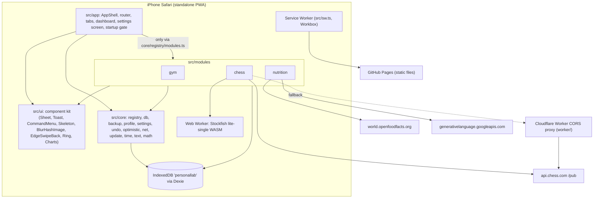
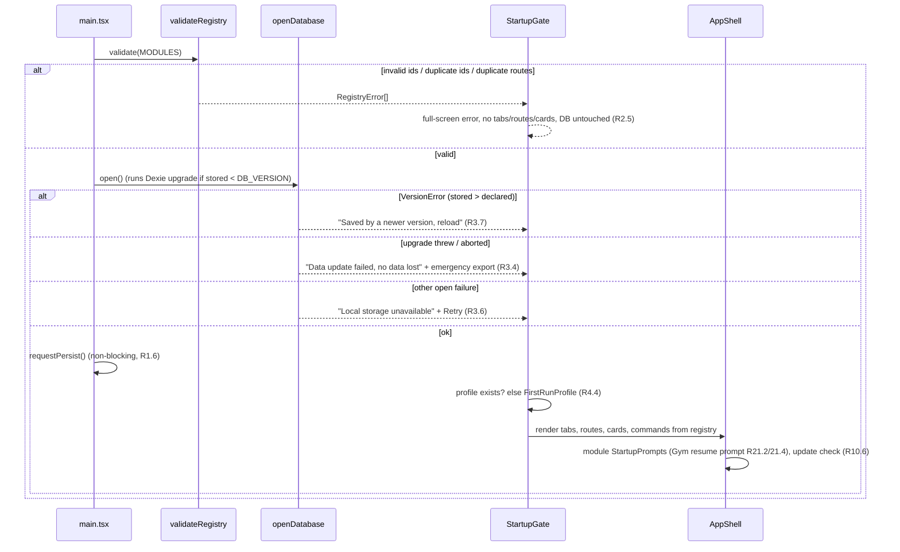
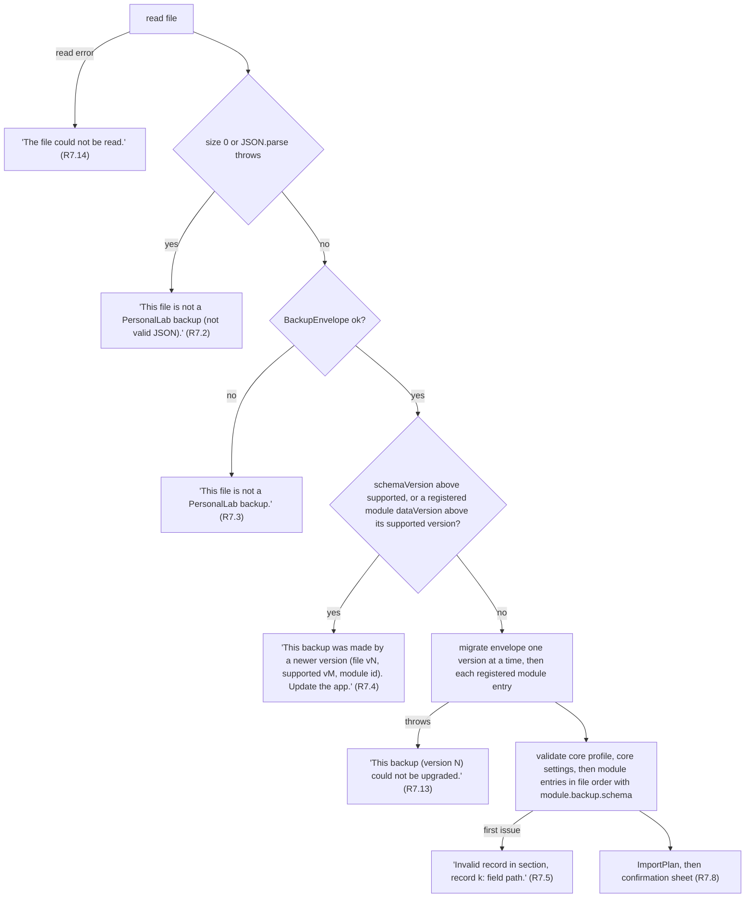
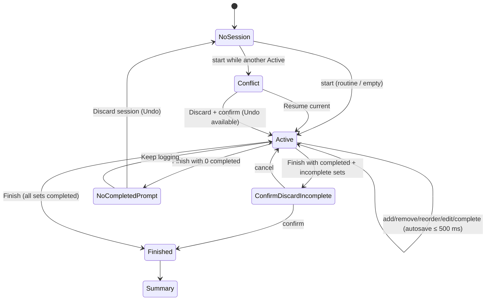
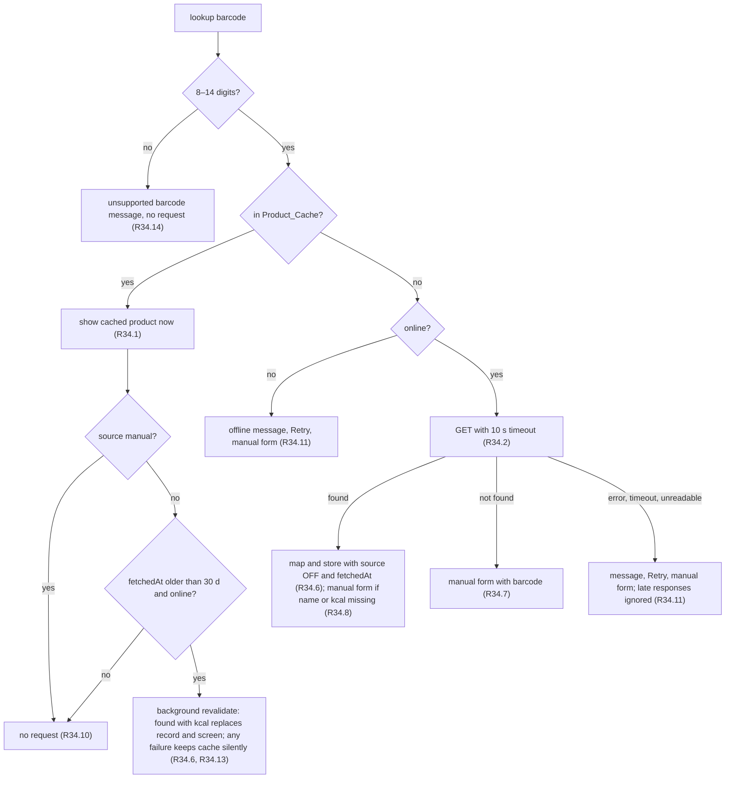
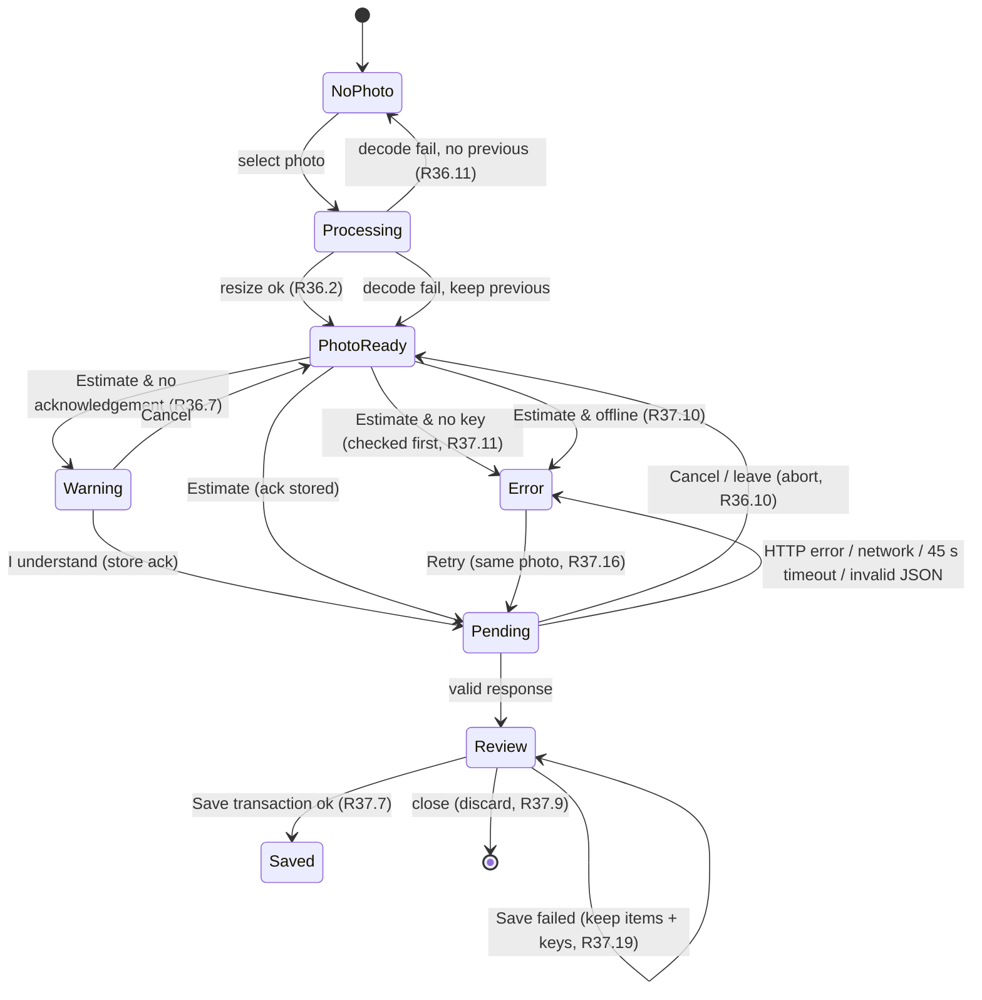
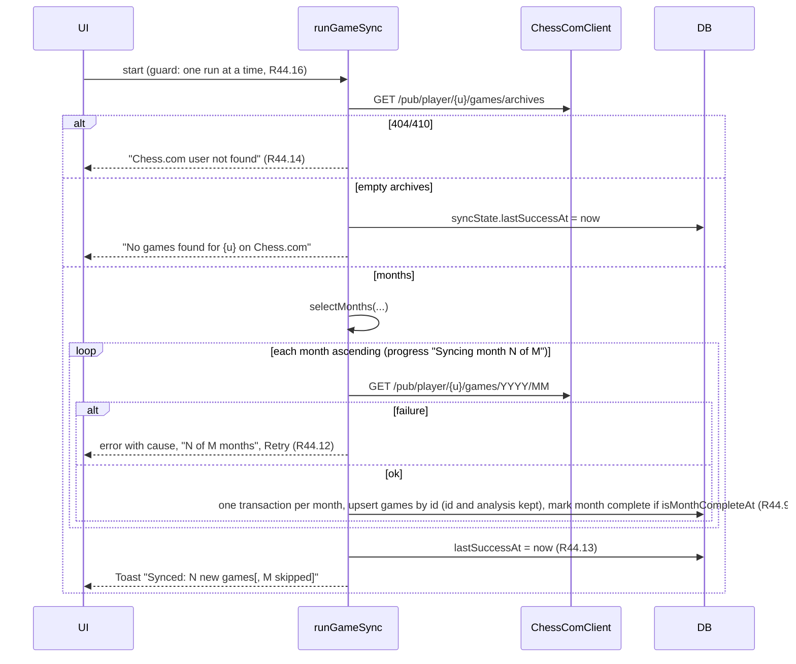
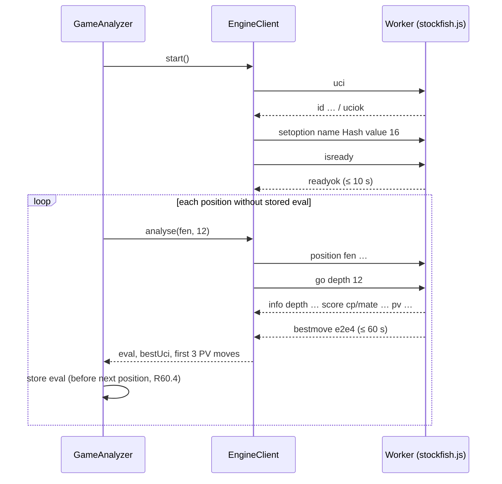
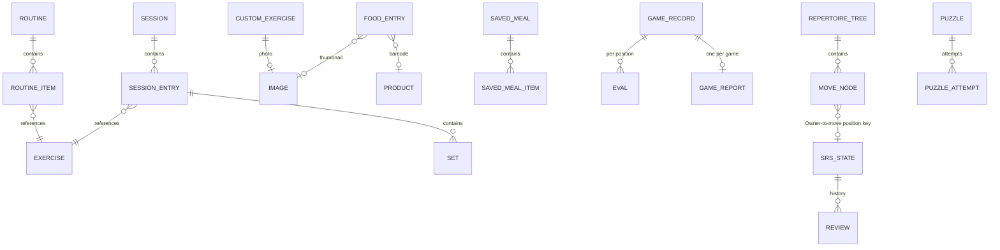

# Design Document: PersonalLab

## Overview

PersonalLab is a single-user, offline-first Progressive Web App for iPhone, written in React + TypeScript and hosted on GitHub Pages. All Owner data lives in IndexedDB (through Dexie) on the phone. The app has a small core (profile, settings, backup, updates, navigation, dashboard, command menu, UI kit) and three modules (Gym, Nutrition, Chess) that plug into a module registry.

This document is the implementation blueprint. It fixes the folder layout, every public TypeScript interface, the database schema, the backup format, the exact algorithms (with signatures, constants and rounding), the network clients, the service worker, the Stockfish worker protocol, the UI component system, error handling, the correctness properties and the test plan. Requirement references use the form "R29.2" (Requirement 29, criterion 2).

### Design principles

1. **Pure logic, thin I/O.** Every formula, threshold and property in the requirements lives in a pure function under a `logic/` folder. Those folders may import only other `logic/` code, `src/core/math`, `src/core/time`, `src/core/text` and `chess.js`. A static import scan enforces this (R74.2).
2. **Modules own their data.** A module owns its tables (prefixed `{id}_`), its settings namespace, its backup section and its migrations. Core never imports a module except through `src/core/registry/modules.ts` (R2.8).
3. **Local database is the source of truth.** Screens read through Dexie `liveQuery`, so every write is reflected everywhere without manual refresh. Optimistic overlays sit on top of live queries for the 100 ms rule (R63).
4. **Every create is idempotent.** Drafts get an Idempotency_Key at creation; the repository layer de-duplicates in memory and in the database (R11).
5. **Every destructive action is undoable** through one Undo service (R64).
6. **Network is optional.** Remote data is cached and revalidated in the background; network failures never block local features (R1.5, R65).

### Key decisions and rationale

| Decision | Choice | Rationale |
|---|---|---|
| SPA routing on GitHub Pages | `BrowserRouter` with `basename = import.meta.env.BASE_URL`; the build copies `index.html` to `404.html` | Keeps clean URLs and exact route parameters on deep-link reload (R12.6). GitHub Pages serves `404.html` for unknown paths with status 404, and the page content is the App, so no GitHub 404 page appears. Offline, the service worker answers navigations with the precached `index.html` (R12.10). Hash routing was rejected because route URLs would differ from the requirement wording and look non-native. |
| Service worker | `vite-plugin-pwa` with `strategies: 'injectManifest'` and `registerType: 'prompt'`, custom `src/sw.ts` built on Workbox | A custom SW is needed for the precache-status message (R1.7), the network-only `version.json` route used by the update check (R10) and the exercise-image cache rules (R13.6). Workbox install fails as a whole when any precache entry fails, so the old complete cache stays active (R1.8). |
| Engine | npm `stockfish` (nmrugg/stockfish.js), **lite single-threaded** flavour (`stockfish-*-lite-single.js` + `.wasm`, about 1.7 MB) | Runs without cross-origin isolation, which GitHub Pages cannot provide (no custom COOP/COEP headers). The package README recommends this flavour for browsers and states it works on any static host. [nmrugg/stockfish.js](https://github.com/nmrugg/stockfish.js) |
| Gemini call | Direct browser `fetch` to `https://generativelanguage.googleapis.com/v1beta/models/{MODEL_ID}:generateContent`, key in the `x-goog-api-key` header, `generationConfig.responseMimeType = "application/json"` plus `responseSchema` | Keeps the key out of the URL (R36.5). Structured output makes Gemini return JSON matching a schema ([Gemini structured output](https://ai.google.dev/gemini-api/docs/structured-output)). The model id is a constant (R36.4) because model names and free-tier models change often. |
| Chess.com | Direct `fetch` to `https://api.chess.com/pub/...` first, then the optional Cloudflare Worker proxy | Chess.com documents the PubAPI as a read-only public REST API ([Chess.com PubAPI](https://support.chess.com/en/articles/9650547-what-is-the-pubapi-and-how-do-i-use-it)). Browsers cannot set `User-Agent`, and CORS behaviour can change, so the proxy is a fallback (R46.7). |
| Open Food Facts | `GET https://world.openfoodfacts.org/api/v2/product/{barcode}.json?fields=...` | The v2 product endpoint accepts a `fields` query parameter and returns `{ code, product, status, status_verbose }` where `status` is 1 when found ([OFF API tutorial](https://openfoodfacts.github.io/documentation/docs/Product-Opener/api/tutorial-off-api/)). Nutrient values are inside `product.nutriments`; the mapper reads both `product.nutriments[k]` and `product[k]` (see Verification items). |
| Validation | `zod` v4 | One schema per record type serves import validation (R7.5), settings validation (R5.6) and Gemini response validation (R37.1). |
| Animation | Hand-written pointer gestures plus the Web Animations API (WAAPI); no animation library | The decided stack lists no animation library. WAAPI gives interruptible animations (`animation.pause()` + read `getComputedStyle().transform`) for R68.5 and R68.8. |
| Text comparison | `fold(s) = s.normalize('NFD').replace(/\p{M}/gu, '').toLowerCase()` and code-unit comparison of folded strings | Deterministic across Node (tests) and Safari, unlike `Intl.Collator`, whose ICU data differs between runtimes. Used by the Exercise_Library sort (R14.1) and the Command_Menu (R72.3). |
| Game primary key | `GameRecord.id = idemKey` (uuid, or url when uuid empty) | Makes Game_Sync idempotent and confluent field-by-field, including the primary key (R44.17–19). |
| Images | Stored as `ArrayBuffer` + MIME type in `{module}_images` tables | `ArrayBuffer` survives structured clone in both Safari IndexedDB and fake-indexeddb; base64 is used only in Backup_Files (R6.2). |

### Verification items for the first implementation task

These are facts that can change outside the project. Each has a fallback that keeps the requirements satisfied.

1. **Gemini model id and browser CORS**: confirm the current free-tier Flash model id on the [Gemini models page](https://ai.google.dev/gemini-api/docs/models) and set `GEMINI_MODEL_ID` (initial value `gemini-2.5-flash`). Confirm a browser `fetch` with `x-goog-api-key` passes CORS preflight.
2. **Open Food Facts nutrient fields**: confirm whether `fields=energy-kcal_100g,...` returns nutrient values. If the API returns nutrients only inside `nutriments`, change the field list to `product_name,brands,serving_quantity,nutriments`. The request still carries only the barcode (R3.2); record the deviation from R34.2's literal field list for the Owner.
3. **Stockfish file names**: `scripts/copy-engine.ts` resolves the lite single-threaded files in `node_modules/stockfish` by glob (`*lite-single*.js` / `.wasm`) and copies them to `public/engine/stockfish.js` and `public/engine/stockfish.wasm`. If the JS file locates its WASM by its own file name, keep the original name and record it in `ENGINE_FILES` instead.
4. **Licence names** (R5.4): read each project's LICENSE file and update `src/core/about/licences.ts`.

---

## Architecture

### Layer diagram



Dependency rules (checked by `src/test/architecture.test.ts`):

- `src/core/**`, `src/app/**`, `src/ui/**` must not import from `src/modules/**`, except `src/core/registry/modules.ts`.
- A module must not import another module. Cross-module data goes through **capabilities** registered by the providing module (see "Capabilities").
- Files under any `logic/` folder must not import `dexie`, `react`, `react-dom`, any `db/`, `data/`, `ui/` or `app/` path (R74.2).

### Folder layout

```
PersonalLab/
├─ .github/workflows/deploy.yml        # typecheck → vitest --run → build → deploy (R12)
├─ index.html                          # viewport-fit=cover, apple-touch-icon, theme-color
├─ package.json                        # scripts below
├─ tsconfig.json / tsconfig.node.json
├─ vite.config.ts                      # base path, PWA plugin, Tailwind, define(__APP_VERSION__, __BUILD_DATE__)
├─ vitest.config.ts                    # jsdom env, setupFiles, fast-check defaults
├─ public/
│  ├─ icons/icon-180.png, icon-512.png, maskable-512.png
│  ├─ sounds/rest-done.m4a             # ≤ 2 s (R20.6)
│  ├─ exercises/exercises.json         # generated by scripts/build-exercises.ts (committed)
│  ├─ exercises/img/{id}/{n}.jpg       # generated, NOT precached (runtime cache)
│  ├─ data/puzzles.json                # generated by scripts/build-puzzles.ts (committed, precached)
│  ├─ data/tips.json                   # authored Tips_Library (precached)
│  ├─ data/repertoire-starter.json     # authored starter Repertoire (precached)
│  └─ engine/stockfish.js, stockfish.wasm  # copied at build by scripts/copy-engine.ts (precached)
├─ scripts/
│  ├─ build-exercises.ts               # R13 (sharp + blurhash)
│  ├─ build-puzzles.ts                 # R47 (streaming CSV + chess.js)
│  ├─ copy-engine.ts                   # prebuild: copy Stockfish files
│  ├─ postbuild-404.ts                 # copy dist/index.html → dist/404.html
│  ├─ lib/exercises.ts, lib/puzzles.ts # pure transforms used by the scripts and their tests
│  └─ fixtures/                        # tiny inputs for determinism tests (R74.6)
├─ worker/                             # Cloudflare CORS proxy (R46.10–11)
│  ├─ src/index.ts
│  ├─ test/index.test.ts
│  ├─ wrangler.toml                    # vars: ALLOWED_ORIGIN
│  └─ README.md                        # step-by-step deploy guide
└─ src/
   ├─ main.tsx                         # boot: registry validation → db open gate → router
   ├─ sw.ts                            # service worker source (injectManifest)
   ├─ app/
   │  ├─ AppShell.tsx                  # header (search button), outlet, tab bar, overlays, toasts
   │  ├─ router.tsx                    # builds routes from registry
   │  ├─ StartupGate.tsx               # registry errors, db open/migration errors, first-run profile
   │  ├─ HomeDashboard.tsx             # cards in registry order + backup banner
   │  ├─ SettingsScreen.tsx            # Profile, Backup, module sections, About
   │  └─ FirstRunProfile.tsx
   ├─ core/
   │  ├─ registry/  types.ts, modules.ts (THE Module_Registry), validate.ts, capabilities.ts
   │  ├─ db/        db.ts, versions.ts, tables.ts, idempotent.ts, writeQueue.ts, errors.ts, changeTracker.ts, rawDump.ts
   │  ├─ backup/    format.ts, schema.ts, export.ts, import.ts, migrations.ts, base64.ts, filename.ts, share.ts, reminder.ts (logic)
   │  ├─ profile/   schema.ts, repo.ts
   │  ├─ settings/  schema.ts, repo.ts, secrets.ts, useSetting.ts
   │  ├─ undo/      undoService.ts, recordDiff.ts
   │  ├─ optimistic/ overlay.ts, useOptimisticList.ts
   │  ├─ net/       online.ts, fetchWithTimeout.ts, swr.ts, ageLabel.ts (logic)
   │  ├─ update/    updateService.ts, precacheStatus.ts
   │  ├─ command/   types.ts, logic/ranking.ts, recents.ts, coreCommands.ts
   │  ├─ storage/   persist.ts
   │  ├─ about/     licences.ts, buildInfo.ts
   │  ├─ math/      round.ts, decimal.ts, tolerance.ts          (pure)
   │  ├─ time/      localDate.ts, monthRange.ts, format.ts       (pure)
   │  ├─ text/      fold.ts, compare.ts                          (pure)
   │  └─ ids.ts                                                  # newId(), newIdemKey()
   ├─ ui/
   │  ├─ sheet/ Sheet.tsx, useSheetDrag.ts, ConfirmDiscard.tsx
   │  ├─ toast/ ToastHost.tsx, toastStore.ts
   │  ├─ command/ CommandMenu.tsx
   │  ├─ transitions/ navigate.ts, RouteTransition.tsx
   │  ├─ gestures/ EdgeSwipeBack.tsx, velocity.ts, useDrag.ts
   │  ├─ skeleton/ Skeleton.tsx, useSkeletonGate.ts
   │  ├─ image/ BlurHashImage.tsx, blurhashCache.ts
   │  ├─ keyboard/ useHardwareKeyboard.ts, ShortcutHint.tsx, shortcuts.ts
   │  ├─ form/ NumberField.tsx, TextField.tsx, Select.tsx, Switch.tsx, FieldError.tsx
   │  ├─ chart/ LineChartCard.tsx (Recharts wrapper), RangeSelector.tsx
   │  ├─ ring/ ProgressRing.tsx
   │  ├─ status/ OfflineNotice.tsx, AgeLabel.tsx, ErrorPanel.tsx, EmptyState.tsx
   │  ├─ ErrorBoundary.tsx
   │  └─ styles/ index.css (Tailwind v4 + tokens + squircle @supports)
   ├─ modules/
   │  ├─ gym/        index.ts, constants.ts, types.ts, schema.ts, tables.ts, logic/, data/, ui/
   │  ├─ nutrition/  index.ts, constants.ts, types.ts, schema.ts, tables.ts, logic/, data/, net/, ui/
   │  └─ chess/      index.ts, constants.ts, types.ts, schema.ts, tables.ts, logic/, data/, net/, engine/, ui/
   └─ test/
      ├─ setup.ts                      # fake-indexeddb/auto, RTL cleanup, fc.configureGlobal
      ├─ arbitraries/                  # shared fast-check generators (core + per module)
      ├─ architecture.test.ts          # R2.8, R74.2 import scans
      └─ helpers/ (db reset, fake clock, mock fetch, mock worker)
```

`package.json` scripts:

| Script | Command |
|---|---|
| `dev` | `vite` |
| `typecheck` | `tsc -b --noEmit` |
| `test` | `vitest --run` |
| `build` | `tsx scripts/copy-engine.ts && vite build && tsx scripts/postbuild-404.ts` |
| `data:exercises` | `tsx scripts/build-exercises.ts --src <free-exercise-db checkout> --out public/exercises` |
| `data:puzzles` | `tsx scripts/build-puzzles.ts --in lichess_db_puzzle.csv --out public/data/puzzles.json [--min-popularity 80] [--min-plays 500]` |

The data scripts run on the developer PC; their outputs are committed, so CI never downloads source datasets.

### Start-up sequence



---

## Components and Interfaces

### 1. Module registry (`src/core/registry`)

#### `types.ts`

```ts
export type ModuleId = string;                    // /^[a-z][a-z0-9]{0,19}$/

export interface ModuleRoute {
  path: string;                                   // absolute app path, e.g. "/gym/routines/:routineId"
  Component: React.ComponentType;                 // usually React.lazy(...)
  tabRoot?: boolean;                              // exactly one per module: the tab's start screen
  title: string;                                  // header title
}

export interface CommandEntry {
  id: string;                                     // unique within the module, e.g. "exercise:Barbell_Squat"
  name: string;
  type: 'Screen' | 'Action' | 'Exercise' | 'Routine' | 'Saved meal' | 'Repertoire tree';
  run(ctx: CommandContext): void | Promise<void>; // navigate or perform the action
  exists?(): Promise<boolean>;                    // R72.8 check before running
  needsNetwork?: boolean;                         // R72.6
}
export interface CommandContext { navigate(to: string): void; online: boolean; }

export interface ModuleBackup<TData> {
  dataVersion: number;                            // current Module data version
  schema: import('zod').ZodType<TData>;           // validates a migrated module entry
  migrations: Record<number, (data: unknown) => unknown>; // key v migrates v → v+1
  sections(data: TData): Array<{ name: string; records: unknown[] }>; // record order for R7.5 positions and R7.8 counts
}

export interface ModuleSettings {
  /** keys are stored as `${moduleId}.${key}` in core_settings */
  schema: Record<string, import('zod').ZodType>;
  defaults: Record<string, unknown>;
  Section: React.ComponentType;                   // rendered in the Settings_Screen
}

export interface ModuleDefinition<TData = unknown> {
  id: ModuleId;
  name: string;
  icon: React.ComponentType<{ className?: string }>;
  routes: ModuleRoute[];
  DashboardCard: React.ComponentType;
  tables: Record<string, string>;                 // short name → Dexie index spec; stored as `${id}_${short}`
  exportData(): Promise<TData>;
  importData(data: TData): Promise<void>;         // runs inside the caller's Dexie transaction zone
  backup: ModuleBackup<TData>;
  useCommandEntries?: () => CommandEntry[];       // optional, live (R2.3)
  settings?: ModuleSettings;
  Overlay?: React.ComponentType;                  // always-mounted UI, e.g. Active Session link (R20.7)
  StartupPrompt?: React.ComponentType;            // e.g. Gym resume prompt (R21.2)
  lifecycle?: { flushPendingWrites?(): Promise<void> }; // awaited before an update reload (R10.4)
  provides?: Partial<Capabilities>;
}
```

Every field listed in R2.1 is required in the type, so a definition missing one fails `tsc` (R2.1). A type-level test (`expectTypeOf` + `// @ts-expect-error` cases) proves it.

#### `modules.ts` (the Module_Registry)

```ts
import { gymModule } from '../../modules/gym';
import { nutritionModule } from '../../modules/nutrition';
import { chessModule } from '../../modules/chess';
export const MODULES: readonly ModuleDefinition[] = [gymModule, nutritionModule, chessModule]; // R2.2
```

This is the only core file allowed to import from `src/modules` (R2.8).

#### `validate.ts`

```ts
export interface RegistryProblem {
  kind: 'invalid-id' | 'duplicate-id' | 'duplicate-route';
  id?: string; path?: string; declaredBy?: string[];
}
export function validateRegistry(mods: readonly Pick<ModuleDefinition, 'id' | 'routes'>[]): RegistryProblem[];
```

- `invalid-id`: `!/^[a-z][a-z0-9]{0,19}$/.test(id)`.
- `duplicate-id`: exact string equality, reported once per duplicated id.
- `duplicate-route`: a route path declared by two or more modules (or twice by one module); reports the path and every declaring id.
- Core route paths (`/`, `/settings`) are included in the duplicate check under the pseudo-id `core`.

Non-empty result → `StartupGate` renders `RegistryErrorScreen` listing every problem and the app does not open the database (R2.5).

#### `capabilities.ts`

```ts
export interface TrainingSessionSummary { startedAt: number; finishedAt: number; }
export interface Capabilities {
  trainingLog: {
    /** Finished Sessions only; reads gym tables, safe inside liveQuery. */
    listFinishedSessions(): Promise<TrainingSessionSummary[]>;
  };
}
export function getCapability<K extends keyof Capabilities>(key: K): Capabilities[K] | undefined;
```

`getCapability` reads `MODULES[i].provides`. The Nutrition_Module uses `trainingLog`; when it is absent, Logged_Training_Hours has no sessions (rule (c) of R29.3 applies).

### 2. App shell, navigation and dashboard (`src/app`)

- `router.tsx` builds `createBrowserRouter([...coreRoutes, ...MODULES.flatMap(m => m.routes)], { basename: import.meta.env.BASE_URL })`.
- The tab bar shows Home, then one tab per module in registry order (icon + name, target = the module's `tabRoot` route), then Settings is reached from the Home header. Module order everywhere is `MODULES` order (R2.3).
- `HomeDashboard` renders `MODULES.map(m => <ErrorBoundary fallback={<CardFailed name={m.name}/>}><m.DashboardCard/></ErrorBoundary>)` (R2.10) and the backup reminder banner above the cards.
- `AppShell` mounts every module `Overlay`, `ToastHost`, `CommandMenu`, `UpdateToast`, `OfflineNotice` and the `EdgeSwipeBack` wrapper around the outlet.
- Command entries: `useAllCommands()` = core entries (Home, Settings, Export backup) + each module's `useCommandEntries?.() ?? []` (R2.3).

### 3. Database layer (`src/core/db`)

#### Database and tables

- Database name: `personallab`. One Dexie instance `db` created in `db.ts`.
- Core tables (prefix `core_`):

| Table | Primary key / indexes | Content | Exported | Counts as data change (R9.2) |
|---|---|---|---|---|
| `core_profile` | `&id` (always `"profile"`) | Profile | yes | yes |
| `core_settings` | `&key` | `{ key: "core.backupReminderDays" \| "gym.defaultRestSec" \| …, value }` | yes | yes |
| `core_secrets` | `&key` | `{ key: "nutrition.geminiKey", value }` | **never** | no |
| `core_meta` | `&key` | lastBackupAt, reminderSnoozeUntil, persistResult, lastUpdateCheckAt, firstDataAt, lastDataChangeAt, commandRecents | no | no |

- Module tables: for each module `m` and `[short, spec]` of `m.tables`, the Dexie store is `${m.id}_${short}` with `spec` (R2.6). `tables.ts` exports `buildStores(modules): Record<string, string>`.

#### Versioning (`versions.ts`)

```ts
export const DB_VERSION = 1;
export interface DbMigration {
  version: number;                               // 2, 3, …
  stores?: Record<string, string | null>;        // Dexie delta; null deletes a table
  upgrade?: (tx: import('dexie').Transaction) => Promise<void>;
  deletes?: string[];                            // documentation of records it deletes (R3.3)
  moduleDataVersions: Record<string, number>;    // module data version per module at this DB version
}
export const MIGRATIONS: DbMigration[] = [];     // version 1 has no migration
export const MODULE_DATA_VERSIONS_V1 = { gym: 1, nutrition: 1, chess: 1 };
```

`db.ts` declares `db.version(1).stores(buildStores(MODULES) ∪ coreStores)`, then for each migration `db.version(m.version).stores(m.stores ?? {}).upgrade(m.upgrade)`, and the latest version always gets the full current store map. Dexie runs every upgrade from stored + 1 to `DB_VERSION` in one IndexedDB `versionchange` transaction, which is all-or-nothing: a thrown error or an App close aborts it and the database stays at the old version with all records (R3.3, R3.4). Opening is awaited in `StartupGate` before any screen reads (R3.3).

`openDatabase(): Promise<OpenResult>`:

```ts
type OpenResult =
  | { ok: true }
  | { ok: false; reason: 'newer-version'; storedVersion: number }   // Dexie VersionError (R3.7)
  | { ok: false; reason: 'migration-failed'; storedVersion: number; error: string } // UpgradeError / abort (R3.4)
  | { ok: false; reason: 'unavailable'; error: string };            // any other open failure (R3.6)
```

`rawDump.ts`: `emergencyExport(): Promise<Blob>` opens a second `new Dexie('personallab')` in **dynamic mode** (no version declared, so Dexie opens the stored version as is), reads every table, and builds a Backup_File whose module entries carry the module data versions recorded for the stored version (`MODULE_DATA_VERSIONS_V1` or the matching `MIGRATIONS` entry). This is offered on the migration-failure screen (R3.4).

#### Write path (`idempotent.ts`, `writeQueue.ts`, `errors.ts`)

```ts
export class DbWriteError extends Error { constructor(public readonly cause: unknown, public readonly quota: boolean) }
export function toDbWriteError(e: unknown): DbWriteError; // quota = any error in the cause chain named 'QuotaExceededError'
export async function write<T>(tables: string[], fn: () => Promise<T>): Promise<T>; // db.transaction('rw', …) + error mapping

export interface Idempotent { idemKey: string }
export async function createIdempotent<T extends Idempotent & { id: string }>(
  table: string, record: T): Promise<{ record: T; created: boolean }>;
```

`createIdempotent` algorithm (R11.2, R11.5):

1. If `record.idemKey` is not a non-empty string, throw `MissingIdempotencyKeyError` and write nothing.
2. `inflight = Map<string /* table|key */, Promise<…>>`. If the key is in flight, return that promise.
3. Otherwise start: `rw` transaction on `table` → `existing = where('idemKey').equals(key).first()`; if found return `{ record: existing, created: false }`; else `add(record)` and return `{ record, created: true }`.
4. A `ConstraintError` on the unique `&idemKey` index (another window won the race) → read and return the existing record.
5. Remove the key from `inflight` when settled (success or failure). A failed write leaves no record, so a retry with the same key creates it (R11.6).

Records embedded in a parent document (Sets inside a Session, items inside a Saved_Meal, repertoire moves) are de-duplicated by the parent's operation: `addSet(sessionId, entryId, draft)` returns the existing Set when a Set with `draft.idemKey` already exists in the Session.

`writeQueue.ts`: `enqueueWrite(recordKey: string, op: () => Promise<void>): Promise<void>` chains writes per record key so they apply in tap order (R63.3).

#### Change tracking (`changeTracker.ts`)

A Dexie DBCore middleware wraps `mutate` for every table except `core_secrets` and `core_meta`. After a successful mutation it sets `core_meta.lastDataChangeAt = now` and, if absent, `core_meta.firstDataAt = now`, in a follow-up transaction. The backup reminder (R9.2, R9.3) reads these two values.

#### Undefined handling

Repositories call `stripUndefined(obj)` before every write so optional fields are absent rather than present-with-`undefined`. This keeps `importData(exportData())` structurally equal to the stored data (R8.4).

### 4. Ids and Idempotency_Keys (`src/core/ids.ts`)

```ts
export const newId = (): string => crypto.randomUUID();
export const newIdemKey = (): string => crypto.randomUUID();
```

Strategy (R11):

| Record | When the key is created | Where it is stored |
|---|---|---|
| Set | when the draft Set row is created in the Session_Logger | `SetRecord.idemKey` |
| Food_Entry (manual) | when the add-food form opens (one per opened form) | `FoodEntry.idemKey` |
| Food_Entries from a Saved_Meal | one `actionKey` per opened add-meal sheet; entry key = `${actionKey}:${itemIndex}` | `FoodEntry.idemKey` |
| Food_Entries from the AI review | one key per review item when the item is created (R37.8) | `FoodEntry.idemKey` |
| Food_Entry from a portion | when the portion form opens | `FoodEntry.idemKey` |
| Weight_Entry | when the weight form opens | `WeightEntry.idemKey` |
| Saved_Meal, Routine, Custom_Exercise | when the create form opens | `idemKey` field |
| Puzzle attempt | when the attempt's score is decided (once per attempt) | `PuzzleAttempt.idemKey` |
| Game_Record | Chess.com `uuid`, else `url` (R11.4) | `GameRecord.idemKey` = `GameRecord.id` |

A draft keeps its key across failures and retries; the key is dropped only when the draft is discarded or saved successfully (R11.6). A random v4 UUID differs from every stored key with overwhelming probability; the unique index makes a collision fail safely as "already exists" rather than duplicate.

### 5. Settings and profile (`src/core/settings`, `src/core/profile`)

```ts
export function useSetting<T>(fullKey: string): [value: T, commit: (v: unknown) => Promise<SettingResult>];
type SettingResult = { ok: true } | { ok: false; error: string /* accepted values text */ };
```

`commit` validates with the zod schema registered for `fullKey` (core schema or the module's `settings.schema`), writes `core_settings`, and leaves the stored value unchanged on failure (R5.5, R5.6). Defaults come from the schema registry, so an unset key reads its default.

Core settings: `core.backupReminderDays: 3 | 7 | 14 | 30 | 'off'` (default 7).

Module settings (declared by the modules):

| Key | Schema | Default |
|---|---|---|
| `gym.defaultRestSec` | int, 30–600, multiple of 15 | 90 |
| `gym.restSound` | boolean | true |
| `nutrition.trainingOverride` | `{ enabled: boolean; hours: number (0–40, step 0.5) }` | `{ enabled: false, hours: 0 }` |
| `nutrition.goalAdjust` | `{ cut, maintain, bulk }` each int −1000…1000, multiple of 50 | `{ cut: -500, maintain: 0, bulk: 300 }` |
| `nutrition.proteinFactor` | `{ cut, maintain, bulk }` each `'default'` or 1.6–2.2 in 0.1 steps | all `'default'` |
| `chess.username` | 3–25 chars `[A-Za-z0-9_-]` after trim | `"AdiChessLarper"` |
| `chess.proxyUrl` | `''` or `https://…`, ≤ 2048 chars, parses with `new URL` | `''` |
| `chess.ratingSource` | `'rapid' \| 'manual'` | `'rapid'` |
| `chess.manualRating` | int 100–3000 | 1100 |

Secrets: `getSecret('nutrition.geminiKey')`, `setSecret`, `deleteSecret` on `core_secrets`. The Gemini key schema: `''` or 1–200 characters with no whitespace after trimming (R5.2). `maskKey(k) = '•'.repeat(max(0, k.length - 4)) + k.slice(-4)` (R5.7).

Profile schema (R4.2): `age` int 13–100; `heightCm` int 100–250; `weightKg` 30.0–300.0 with ≤ 1 decimal; `weeklyTrainingHours` 0–40 multiple of 0.5; `sex` and `goal` enums. Decimal-step checks use `isMultipleOfStep(text, step)` on the **entered text** (see `core/math/decimal.ts`), so 70.25 and 3.2 are rejected exactly. The first-run screen writes the Profile only on a valid save, so closing early stores nothing (R4.8).

### 6. Backup service (`src/core/backup`)

#### File format (Schema_Version 1)

```jsonc
{
  "format": "personallab-backup",
  "schemaVersion": 1,
  "appVersion": "1.0.0+3f2a9c1",
  "exportedAt": "2025-03-07T07:05:00Z",          // ISO 8601 UTC, seconds, Z (R6.1)
  "core": {
    "profile": { "id": "profile", "age": 30, ... } | null,
    "settings": [ { "key": "chess.username", "value": "AdiChessLarper" }, ... ]  // sorted by key
  },
  "modules": [                                    // registry order (R6.1)
    { "id": "gym", "dataVersion": 1, "data": { "customExercises": [], "libraryState": [], "routines": [], "sessions": [], "images": [] } },
    { "id": "nutrition", "dataVersion": 1, "data": { ... } },
    { "id": "chess", "dataVersion": 1, "data": { ... } }
  ]
}
```

- Images inside module data: `{ "id": "…", "mime": "image/jpeg", "base64": "…" }` (R6.2).
- The Gemini key is never read by the exporter (it lives in `core_secrets`). After serialising, `export` also asserts `!text.includes(geminiKey)` when a key is set and aborts if it does (defence for R6.3).
- File name: `personallab-backup-${yyyy}-${MM}-${dd}-${HH}${mm}.json` from the export timestamp in local time (R6.4).

#### Zod schemas (`schema.ts`)

```ts
export const BackupEnvelope = z.object({
  format: z.literal('personallab-backup'),
  schemaVersion: z.number().int().min(1),
});
export const BackupV1 = BackupEnvelope.extend({
  schemaVersion: z.literal(1),
  appVersion: z.string().min(1),
  exportedAt: z.string().regex(/^\d{4}-\d{2}-\d{2}T\d{2}:\d{2}:\d{2}Z$/),
  core: z.object({ profile: ProfileSchema.nullable(), settings: z.array(z.object({ key: z.string(), value: z.unknown() })) }),
  modules: z.array(z.object({ id: z.string(), dataVersion: z.number().int().min(1), data: z.unknown() })),
});
```

Each settings record is validated against the schema registered for its key; an unknown key belonging to a registered module fails validation, an unknown key of an unregistered module is skipped with that module.

#### Export algorithm (`export.ts`)

```ts
export async function buildBackup(now: Date): Promise<{ file: BackupV1; text: string }>;
export async function exportBackup(): Promise<ExportOutcome>;
type ExportOutcome = { kind: 'shared' | 'downloaded'; exportedAt: string } | { kind: 'dismissed' } | { kind: 'failed'; part: string; message: string };
```

1. `exportedAt = now.toISOString().replace(/\.\d{3}Z$/, 'Z')`.
2. Read core data; on failure → `failed('core data')`.
3. For each module in registry order: `data = await m.exportData()` (exactly once each, R2.4); a throw → `failed(m.id)` (R2.9, R6.10). Image read failures inside a module are reported as `images`.
4. Assemble, `text = JSON.stringify(file)`, then run the full import validation on `JSON.parse(text)` (R8.7). Failure → `failed(section/field)`.
5. `File([text], name, { type: 'application/json' })`. If `navigator.canShare?.({ files: [file] })` → `navigator.share({ files: [file] })`:
   - resolves → `shared`;
   - rejects with `AbortError` → `dismissed` (R6.8);
   - rejects otherwise → fall back to download (R6.9).
   Else download via `<a download>` with an object URL (R6.6).
6. On `shared` or `downloaded`, write `core_meta.lastBackupAt = exportedAt` (R6.7). Nothing else is written, so the Local_Database is unchanged on failure.

#### Import algorithm (`import.ts`)

```ts
export type ImportCheck =
  | { ok: true; plan: ImportPlan }
  | { ok: false; message: string };
export interface ImportPlan {
  file: BackupV1;                              // migrated, validated
  exportedAt: string;
  present: Array<{ id: string; name: string; recordCount: number }>;
  absent: string[];                            // registered module names not in file
  skipped: string[];                           // module ids not registered (R7.7)
}
export async function checkBackupFile(file: File): Promise<ImportCheck>;
export async function applyImport(plan: ImportPlan): Promise<void>; // one transaction + undo registration
```

`checkBackupFile` runs the R7.1 order and stops at the first failure:



Record positions for R7.5: core section = profile (record 1, when not null) then settings in file order; module section = concatenation of `module.backup.sections(data)` in declared order. The zod issue path gives the field (`entries[0].sets[1].weight`).

`applyImport(plan)`:

1. `snapshot = { core: dump(core_profile, core_settings), modules: dump(all tables of present modules) }` before the transaction (R7.11).
2. `db.transaction('rw', [core_profile, core_settings, ...presentModuleTables], async () => { clear core_profile/core_settings; write file core; for each present module: clear its tables; await m.importData(entry.data) })`. `core_secrets` is not in scope, so the Gemini key is untouched (R7.9, R8.6).
3. On failure: Dexie rolls back; show the error, no Undo_Toast (R7.10).
4. On success: `undoService.push({ label: 'Backup imported', undo: () => restoreSnapshot(snapshot) })` (R7.11) and a result Toast listing skipped module ids (R7.7).

Importing the same file twice yields the same state because every present table is cleared and rewritten from the file (R8.2).

#### Backup reminder (`reminder.ts`, pure)

```ts
export function shouldShowBackupReminder(i: {
  intervalDays: 3 | 7 | 14 | 30 | 'off'; now: number; lastBackupAt?: number;
  snoozeUntil?: number; lastDataChangeAt?: number; firstDataAt?: number;
}): boolean;
```

- `off` → false; `snoozeUntil > now` → false.
- With `lastBackupAt`: `now − lastBackupAt > interval × 86_400_000` and `lastDataChangeAt > lastBackupAt` (R9.2).
- Without: `firstDataAt !== undefined && now − firstDataAt > 72 × 3_600_000` (R9.3).
- "Remind me later" writes `snoozeUntil = now + 86_400_000` (R9.4).

### 7. Undo service (`src/core/undo`)

```ts
export interface UndoAction { label: string; undo(): Promise<void>; }
export const undoService: {
  push(a: UndoAction): void;      // finalises the current action, shows a new Undo_Toast for 6000 ms (R64.4)
  undo(): Promise<void>;          // first tap only; disables button (R64.2)
  dismiss(): void;                // swipe away → finalise (R64.5)
  subscribe(cb): () => void;
};
export function recordDiffUndo(label: string, before: TableSnapshot, after: TableSnapshot): UndoAction;
```

- `TableSnapshot = Record<tableName, Map<primaryKey, record>>` for the records an action touches. `recordDiffUndo` restores, in one transaction, every key that existed before (`put(before)`) and deletes every key created by the action. Restoring by key restores primary keys, Idempotency_Keys, relations and positions exactly (R64.2, R64.3).
- Domain-specific undos are used where the record is a document that keeps changing during the 6 seconds: removing a Set or Exercise from the Active Session re-inserts the removed items at their original indices into the **current** Session (R18.8).
- The timer runs in the toast store outside the router, so it continues across navigation (R64.6). Undo data lives only in memory; a reload finalises (R64.6).
- Undo failure → keep after-state, close toast, show "Could not undo" + reason (R64.7).

### 8. Optimistic updates (`src/core/optimistic`)

```ts
export interface PendingOp<T> { key: string; apply(list: T[]): T[]; write(): Promise<void>; }
export function useOptimisticList<T>(live: T[] | undefined, keyOf: (t: T) => string): {
  items: T[];                                   // live ⊕ pending ops, in order
  run(op: PendingOp<T>): Promise<boolean>;      // applies in < 100 ms, writes through writeQueue
};
```

`run` adds the op to the overlay synchronously (React state), enqueues `write()` on `writeQueue(key)`, and removes the op when it settles. On failure it shows the error Toast (R3.5 wording), and when the op was a delete it closes its Undo_Toast (R63.2). Because the overlay is empty once all ops settle, the UI equals `live`, which equals the database (R63.3, R63.4). The pure part, `applyOverlay(stored, ops)`, is property-tested.

### 9. Network utilities (`src/core/net`)

- `online.ts`: `useOnline(): { online: boolean }`. `online = navigator.onLine && !unreachable`. `reportUnreachable()` is called by clients on a network error while `navigator.onLine` is true (R1.9); while unreachable, a probe `fetch(BASE_URL + 'version.json', { cache: 'no-store' })` runs every 5 s, and the `online` event clears both flags (R1.10). `version.json` is excluded from precache and served network-only, carries no Owner data.
- `fetchWithTimeout(url, init, ms)`: `AbortController` + timer; distinguishes `timeout`, `aborted` (caller), `network` (TypeError) and HTTP status.
- `swr.ts`: `useRemoteResource<T>({ key, readCache, fetchFresh, maxAgeMs, enabled })` returns `{ data, fetchedAt, state: 'fresh' | 'refreshing' | 'failed' | 'offline', retry }`. It shows cached data immediately, starts a background fetch when `online && now − fetchedAt > maxAgeMs`, holds one in-flight promise per `key` in a module-level map (R65.2), and keeps data on failure (R65.4).
- `ageLabel.ts` (pure): `ageLabel(fetchedAt, now)`: `d = max(0, now − fetchedAt)`; `< 60 s` → "Updated just now"; `< 60 min` → `Updated ${⌊d/60000⌋} min ago`; `< 24 h` → `Updated ${⌊d/3.6e6⌋} h ago`; else `Updated ${⌊d/8.64e7⌋} d ago` (R65.1).

### 10. Update service and service worker

#### `vite.config.ts` (relevant parts)

```ts
const base = process.env.BASE_PATH ?? '/PersonalLab/';          // CI sets `/${repo}/`
export default defineConfig({
  base,
  define: { __APP_VERSION__: JSON.stringify(`${pkg.version}+${gitShortSha}`), __BUILD_DATE__: JSON.stringify(new Date().toISOString().slice(0, 10)) },
  plugins: [react(), tailwindcss(), VitePWA({
    strategies: 'injectManifest', srcDir: 'src', filename: 'sw.ts',
    registerType: 'prompt', injectRegister: false,
    manifest: {
      name: 'PersonalLab', short_name: 'PersonalLab', display: 'standalone',
      start_url: base, scope: base, background_color: '#0b0b0f', theme_color: '#0b0b0f',
      icons: [{ src: 'icons/icon-180.png', sizes: '180x180', type: 'image/png' },
              { src: 'icons/icon-512.png', sizes: '512x512', type: 'image/png' },
              { src: 'icons/maskable-512.png', sizes: '512x512', type: 'image/png', purpose: 'maskable' }],
    },
    injectManifest: {
      globPatterns: ['**/*.{js,css,html,svg,png,woff2,json,wasm,m4a}'],
      globIgnores: ['exercises/img/**', 'version.json', '404.html'],
      maximumFileSizeToCacheInBytes: 12 * 1024 * 1024,
    },
  })],
});
```

`index.html` contains `<meta name="viewport" content="width=device-width, initial-scale=1, viewport-fit=cover">`, `<link rel="apple-touch-icon" href="%BASE_URL%icons/icon-180.png">`, `<meta name="apple-mobile-web-app-capable" content="yes">` and `<meta name="apple-mobile-web-app-status-bar-style" content="black-translucent">` (R1.1, R1.2, R70.2). The build also writes `dist/version.json` = `{ "version": __APP_VERSION__ }`.

#### `src/sw.ts`

```ts
declare const self: ServiceWorkerGlobalScope & { __WB_MANIFEST: PrecacheEntry[] };
const BASE = import.meta.env.BASE_URL;              // '/PersonalLab/' (the SW is built by Vite with the same base)
precacheAndRoute(self.__WB_MANIFEST);               // install fails as a whole on any failure (R1.8)
cleanupOutdatedCaches();
registerRoute(new NavigationRoute(createHandlerBoundToURL(`${BASE}index.html`), { allowlist: [new RegExp(`^${BASE}`)] })); // R12.10
registerRoute(({ url }) => url.pathname.startsWith(`${BASE}exercises/img/`),
  new CacheFirst({ cacheName: 'exercise-images-v1', plugins: [new CacheableResponsePlugin({ statuses: [200] })] })); // no expiry, no max (R13.6)
registerRoute(({ url }) => url.pathname === `${BASE}version.json`, new NetworkOnly());
self.addEventListener('message', (e) => {
  if (e.data?.type === 'SKIP_WAITING') self.skipWaiting();
  if (e.data?.type === 'PRECACHE_STATUS') e.waitUntil(allPrecached().then((ok) => e.ports[0].postMessage(ok)));   // R1.7
});
```

No `skipWaiting()` on install and no `clientsClaim()`, so a new version waits until the Owner taps "Reload" or every window closes (R10.3). `allPrecached()` opens the Workbox precache cache and checks that every `__WB_MANIFEST` URL has a match.

#### `updateService.ts`

```ts
export const updateService: {
  start(): void;                    // registerSW({ onNeedRefresh }) from 'virtual:pwa-register'
  checkIfDue(): Promise<void>;      // on start and on visibilitychange→visible
  reload(): Promise<void>;          // Owner tapped "Reload"
};
```

- `checkIfDue`: if `!lastUpdateCheckAt || now − lastUpdateCheckAt ≥ 3_600_000` → `Promise.race([registration.update(), timeout(10_000)])`; on success write `lastUpdateCheckAt`; on failure or offline do nothing visible (R10.6, R10.7).
- `onNeedRefresh` (a worker is `waiting`): fetch `version.json` with `cache: 'no-store'` (network-only, carries no Owner data); if its `version` differs from the running `__APP_VERSION__`, show the persistent update Toast (R10.1). The waiting worker can only exist after a successful network fetch of the new `sw.js`, so this fetch normally succeeds; if it fails, the Toast is shown anyway. Dismissal hides it until the next start or foreground while still waiting (R10.2). `__APP_VERSION__` is the same string shown in Settings → About (R5.3).
- `reload()`: `await Promise.race([all(MODULES.map(m => m.lifecycle?.flushPendingWrites?.())), timeout(5000)])`. On timeout or error: cancel, error Toast "The workout could not be saved, so the update was postponed.", show the update Toast again (R10.5). On success: post `SKIP_WAITING`, reload on `controllerchange` (R10.4).

#### Precache status and persistence

- `precacheStatus.ts`: `getOfflineReady(): Promise<boolean>` posts `PRECACHE_STATUS` to the active worker (false when none) (R1.7).
- `storage/persist.ts`: on first start (no `persistResult` in `core_meta`), `navigator.storage?.persist?.()` without awaiting start-up; records `'granted' | 'not granted' | 'not supported'` (R1.6). Settings shows `navigator.storage.persisted()` when available, else the recorded value (R1.7).

### 11. Deployment pipeline (`.github/workflows/deploy.yml`)

```yaml
on: { push: { branches: [main] } }                # R12.1
permissions: { contents: read, pages: write, id-token: write }
concurrency: { group: pages, cancel-in-progress: true }   # an older run is cancelled when a newer starts (R12.8)
jobs:
  build:
    steps: checkout → setup-node (lts/*, cache npm) → npm ci
      → npm run typecheck                         # R12.2 step 1
      → npx vitest --run                          # step 2 (fails on zero test files: no passWithNoTests)
      → BASE_PATH=/${{ github.event.repository.name }}/ npm run build   # step 3
      → guard: fail if `git ls-remote origin refs/heads/main` ≠ $GITHUB_SHA (newer commit exists, R12.8)
      → actions/upload-pages-artifact (path: dist)
  deploy:
    needs: build
    environment: github-pages
    steps: actions/deploy-pages                   # deploys only this run's dist (R12.4)
```

Any failing step fails the run and skips `deploy`, so the live site is unchanged (R12.3). The repository holds no secrets (R12.9); a test scans `dist/` and `src/` for strings matching `AIza[0-9A-Za-z_-]{35}` (Google API key shape).

### 12. Command_Menu (`src/core/command`, `src/ui/command`)

#### Ranking (`logic/ranking.ts`, pure)

```ts
export type MatchClass = 1 | 2 | 3 | 4;
export function matchClass(name: string, query: string): MatchClass | null;
export function rankEntries<E extends { id: string; name: string; type: string }>(entries: E[], rawQuery: string): E[];
```

- `q = fold(rawQuery.trim().slice(0, 100))`, `n = fold(name)`.
- Class 1: `n.startsWith(q)`. Class 2: some word of `n` (split on `/[ \-\/()]+/`) starts with `q`. Class 3: `n.includes(q)`. Class 4: the characters of `q` with spaces removed occur in `n` in order (subsequence). Highest (lowest number) class wins.
- Sort key: `(class, fold(name), type, id)` with code-unit comparison (R72.3). Precompute `fold(name)` once per entry list (memoised), so 2,000 entries rank in well under 100 ms (R72.4).

#### Behaviour

- Opened from the header search button or Cmd/Ctrl+K as a `Sheet` with the input focused (R72.1, R73.1).
- Empty query: "Recent" (up to 5 ids from `core_meta.commandRecents` that still exist, most recent first), then all other entries grouped by type, alphabetical (R72.5).
- Select: close, push id to recents (dedupe, cap 20 stored, 5 shown), then `entry.exists?.()`; false → keep open, drop entry, Toast "This item no longer exists" (R72.8); else `run(ctx)`.

### 13. UI component system (`src/ui`)

#### Sheet (Bottom_Sheet)

```ts
interface SheetProps { open: boolean; onRequestClose(): void; dirty?: boolean; children: ReactNode; title?: string; }
```

- Rendered in a portal, `role="dialog"`, `aria-modal`, focus trap; padding bottom `max(16px, env(safe-area-inset-bottom))` (R70.3).
- `useSheetDrag`: pointer events on the sheet. Drag offset `y = max(0, pointerY − startY)` (R68.1). When the drag starts inside a scroll container with `scrollTop > 0`, the gesture scrolls that container first and only switches to sheet movement once `scrollTop === 0` (R68.2).
- Velocity: a ring buffer of `(t, y)` samples; `velocity = (y_last − y_first) / (t_last − t_first)` over samples within the last 100 ms (`ui/gestures/velocity.ts`, pure).
- Release: dismiss when `y > 0.25 × height` or `velocity > 0.5 px/ms` (R68.3), else animate back with WAAPI in ≤ 250 ms (R68.4).
- Interrupt: on `pointerdown` during any animation, read the current `translateY` from `getComputedStyle`, cancel the animation, set the inline transform and continue the drag from there (R68.5, R68.8).
- Backdrop tap, swipe-dismiss and Escape call `requestDismiss()`. If `dirty`, the sheet animates back and shows `ConfirmDiscard` ("Discard changes?" with "Discard" / "Keep editing") (R68.7).

#### Toasts

```ts
toast.show({ message, kind?: 'info' | 'error', action?: { label, run }, durationMs?: number | 'persistent' });
```

- `ToastHost` is mounted in `AppShell` outside the routed outlet, so toasts persist across navigation. It shows at most one Undo_Toast (from `undoService`), the update Toast and one transient message stacked above the tab bar and the home indicator (R70.3).
- Swipe horizontally to dismiss (same drag/velocity utilities). For the Undo_Toast, dismiss finalises (R64.5).
- `aria-live="polite"` region.

#### View transitions (`ui/transitions`)

- `navigate.ts` wraps React Router's `navigate`: when `document.startViewTransition` exists and reduced motion is off, call `navigate(to, { viewTransition: true })`; CSS `::view-transition-old/new(root)` animations last 200 ms (R67.1).
- Fallback: `RouteTransition` keys the outlet by `location.key` and applies a 200 ms CSS keyframe (opacity + 8 px translate) (R67.2).
- A new navigation during a running transition calls `currentTransition.skipTransition()` first (R67.5). `transition.finished` rejection is caught and ignored, the navigation completes (R67.7).
- Back navigations triggered by `EdgeSwipeBack` pass `{ viewTransition: false }` and skip the CSS fallback (R67.6).
- `useReducedMotion()` subscribes to `matchMedia('(prefers-reduced-motion: reduce)')` change events, so the next animation uses the new value (R67.4). With reduce: route changes use a 120 ms opacity fade; sheets and toasts appear with opacity fades; rings, board pieces and skeleton shimmer are static (R67.3).

#### Edge swipe back (`ui/gestures/EdgeSwipeBack.tsx`)

- Keeps the previous screen's rendered outlet (captured from the previous location) mounted underneath, `inert`, translated −30 % and revealed as the top screen moves.
- Start condition: `touchstart.clientX ≤ 20`, the navigation stack has a previous entry, the current route is not a tab root (R69.5), and the target is not inside `[data-gesture="board"]` (R69.4).
- Direction lock: after 10 px of movement, horizontal if `dx > |dy|` (R69.1), else hand over to scroll.
- Release: back when `dx > 0.35 × width` or velocity > 0.5 px/ms (R69.2), else animate back ≤ 250 ms (R69.3).
- Dirty forms register via `useUnsavedChanges(dirty)`; a qualifying release then snaps back and shows `ConfirmDiscard`, navigating back only on "Discard" (R69.6).

#### Skeleton

```ts
function useSkeletonGate(loading: boolean, opts?: { delayMs?: 150; minVisibleMs?: 200 }): 'content' | 'skeleton' | 'blank';
```

- `blank` for the first 150 ms of loading, then `skeleton` (R62.1); if data arrives in the first 150 ms, straight to `content` (R62.2). Once shown, the skeleton stays at least 200 ms (R62.3). Errors bypass the gate to the error panel with Retry (R62.4).
- Skeleton components reuse the real layout primitives (`CardFrame`, `ChartFrame`, `ListRow`) with fixed heights, so the swap moves nothing by more than 1 px (R62.3). Row count = `ceil(visibleHeight / rowHeight)`.
- Shimmer uses a CSS animation disabled under `prefers-reduced-motion` (R62.5).

#### BlurHashImage

```ts
interface BlurHashImageProps { src?: string; blurhash?: string; width: number; height: number; alt: string; className?: string; }
```

- The box has fixed `aspect-ratio`/size before load (R66.1). The BlurHash is decoded once to a 32 × 32 canvas → data URL, memoised in an LRU (`blurhashCache.ts`).
- On `load`: fade `opacity` 0 → 1 over 200 ms, or instantly with reduced motion (R66.2).
- On `error` or missing `src`: keep the BlurHash with a small image-off icon; if no or invalid BlurHash, show the neutral placeholder SVG (R66.3, R14.9). No Toast.

#### Other primitives

- `NumberField`: `inputMode="decimal"`, accepts "." and "," (normalised to "."), validates on the entered text, shows a `FieldError` with the accepted range and step.
- `ProgressRing`: SVG ring; `fraction` 0–1; `variant: 'normal' | 'over'`; the "over" variant uses a different colour and a text label (R32.2).
- Typography: Tailwind utility `tabular-nums` on all numeric text (R71.1); `h1, h2, h3 { text-wrap: balance }` (R71.2); `@supports (corner-shape: squircle) { .rounded-continuous { corner-shape: squircle; } }` with the same `border-radius` as fallback (R71.3, R71.4).
- Touch targets: every interactive element is built from `Button`, `IconButton`, `ListRow` or form primitives, which apply the `.tap` utility (`min-width: 44px; min-height: 44px`, or a transparent `::before` hit area for smaller visuals, with `gap` between neighbours so hit areas never overlap). jsdom has no layout, so a component test asserts that each primitive renders the `.tap` class, and a manual on-device checklist covers the rest (R70.1). Chessboard squares are exempt.
- Safe areas: `AppShell` pads with `env(safe-area-inset-*)` on all four sides; the tab bar, toasts and sheets add `env(safe-area-inset-bottom)` (R70.2, R70.3).
- Keyboard: `useHardwareKeyboard()` sets a module-level flag on the first `keydown` whose target is not a text-entry element (R73.2); `ShortcutHint` renders only when the flag is set (R73.3, R73.4). `shortcuts.ts` installs a capture-phase `keydown` listener for Cmd/Ctrl+K (calls `preventDefault`), Escape (closes the top sheet through its `requestDismiss`) and arrows (dispatched to the Game_Viewer when no text field is focused) (R73.1).


### 14. Shared pure helpers (`src/core/math`, `src/core/time`, `src/core/text`)

```ts
// math/round.ts — round half away from zero, exact for decimal inputs (Conventions)
export function round(x: number, decimals = 0): number;
//   sign(x) * Number(Math.round(Number(`${Math.abs(x)}e${decimals}`)) + `e-${decimals}`)
//   The exponent-string trick avoids 1.005 * 100 = 100.49999… errors.

// math/decimal.ts — validation on the entered text, never on floats
export function parseDecimal(text: string, opts: { maxDecimals: number; allowComma?: boolean }): number | null;
//   /^\d+([.,]\d+)?$/ after trim; rejects more than maxDecimals fractional digits.
export function isMultipleOfStep(value: number, step: number): boolean;
//   Math.abs(value / step - Math.round(value / step)) < 1e-9

// math/tolerance.ts
export const relClose = (x: number, y: number, t: number) => Math.abs(x - y) <= t * Math.max(Math.abs(x), Math.abs(y));

// time/localDate.ts — LocalDate = 'YYYY-MM-DD'
export function toLocalDate(epochMs: number): LocalDate;           // uses local Date getters (phone time zone)
export function addDays(d: LocalDate, n: number): LocalDate;        // via Date.UTC arithmetic, DST-safe
export function daysBetween(a: LocalDate, b: LocalDate): number;    // b − a in calendar days
export function startOfLocalDate(d: LocalDate): number;             // epoch ms of local midnight

// time/monthRange.ts — R25.4, R45.8
export function monthsBack(today: LocalDate, n: number): LocalDate;
//   same day-of-month n calendar months earlier; if that day does not exist, the last day of that month

// time/format.ts
export function formatClock(seconds: number): string;               // M:SS below 3600, H:MM:SS from 3600
export function formatDurationMinutes(ms: number): string;          // round(ms / 60000) → "1 h 05 min" | "45 min"

// text/fold.ts
export const fold = (s: string) => s.normalize('NFD').replace(/\p{M}/gu, '').toLowerCase();
export const compareFolded = (a: string, b: string) => (fold(a) < fold(b) ? -1 : fold(a) > fold(b) ? 1 : 0);
```

Pure functions never read the clock. Callers pass `now: number` and/or `today: LocalDate`. A `useNow(intervalMs)` hook and a `useToday()` hook (which ticks at the next local midnight and on `visibilitychange`) supply them to screens, so date changes trigger recomputation (R29.11, R32.7).

### 15. Shared image processing (`src/core/image/processImage.ts`)

```ts
export function scaleDims(w: number, h: number, maxSide: number): { width: number; height: number };
//   if max(w, h) ≤ maxSide → unchanged; else long side = maxSide, short side = round(short × maxSide / long)
export async function processImage(file: Blob, o: { maxSide: number; quality: number }): Promise<{
  bytes: ArrayBuffer; mime: 'image/jpeg'; width: number; height: number; blurhash: string;
}>;
```

1. Decode with `createImageBitmap(file, { imageOrientation: 'from-image' })` so EXIF orientation is applied to pixels; fall back to an `` element with an object URL (Safari also applies orientation there). A decode failure throws `ImageDecodeError`.
2. Draw onto a canvas of `scaleDims(...)`; `canvas.toBlob('image/jpeg', quality)`. Re-encoding from a canvas carries no EXIF/GPS metadata (R15.3, R36.2).
3. BlurHash: draw the result to a 32 × 32 canvas, `getImageData`, `encode(pixels, 32, 32, 4, 3)` from the `blurhash` package.

Uses: Custom_Exercise photo (`maxSide 1024, quality 0.85`), meal estimate (`1024, 0.8`, R36.2), meal thumbnail (`256, 0.8`, R37.7). On iOS the file input with `accept="image/*"` usually delivers HEIC as JPEG; when it delivers HEIC, Safari decodes it natively.

---

## Gym module (`src/modules/gym`)

### Module definition

- `id: 'gym'`, `name: 'Gym'`.
- Routes:

| Path | Screen |
|---|---|
| `/gym` (tab root) | Gym start: Start workout, Resume, Routines, History, Split analysis, Library |
| `/gym/library` | Exercise_Library |
| `/gym/library/:exerciseId` | Exercise detail |
| `/gym/library/:exerciseId/chart` | Progress chart |
| `/gym/exercises/new`, `/gym/exercises/:exerciseId/edit` | Custom_Exercise form |
| `/gym/routines`, `/gym/routines/:routineId` | Routine list, Routine builder |
| `/gym/session` | Session_Logger (Active Session) |
| `/gym/history`, `/gym/history/:sessionId` | History list, Finished Session detail |
| `/gym/split` | Split analysis |

- Tables: `customExercises: '&id, &idemKey'`, `libraryState: '&id'`, `images: '&id'`, `routines: '&id, &idemKey, createdAt'`, `sessions: '&id, status, startedAt, finishedAt'`.
- `Overlay`: `ActiveSessionLink` with the compact Rest_Timer, shown on every route except `/gym/session` while a Session is Active (R20.7).
- `StartupPrompt`: resume prompt (R21.2, R21.4).
- `lifecycle.flushPendingWrites`: flushes the Session autosaver (R10.4).
- `provides.trainingLog.listFinishedSessions()`.
- Settings section: default rest time, rest timer sound, "Download all exercise photos" with "N of M" progress (R13.7), and the archived-exercise list sorted by name with "Restore" actions and an empty state (R16.8, R16.9).
- Command entries: every non-archived Exercise, every Routine, "Gym" screen, "Start workout" action (opens the start choice sheet).
- Library_Exercises are loaded from the precached `exercises/exercises.json` once per App run (`useLibrary()`), merged with `libraryState` (archive flags) and `customExercises` into the `Exercise` view type.

### Constants (`constants.ts`)

```ts
export const MUSCLES = ['abdominals','abductors','adductors','biceps','calves','chest','forearms','glutes','hamstrings','lats','lower back','middle back','neck','quadriceps','shoulders','traps','triceps'] as const;
export const EQUIPMENT = ['body only','machine','other','foam roll','kettlebells','dumbbell','cable','barbell','bands','medicine ball','exercise ball','e-z curl bar'] as const;
export const TRACKED_MUSCLES = ['chest','shoulders','triceps','biceps','lats','middle back','traps','lower back','abdominals','quadriceps','hamstrings','glutes','calves'] as const;
export const SPLIT = { LOW_BELOW: 10, HIGH_ABOVE: 20, WINDOW_DAYS: 7, STEP_DAYS: 7, IMBALANCE_RATIO: 1.5 };
export const PR_E1RM_TOLERANCE_KG = 0.001;
export const LIMITS = { WEIGHT_MAX: 1000, REPS_MAX: 100, SETS_PER_EXERCISE: 20, ROUTINE_ITEMS: 50, ROUTINE_NAME: 60, EXERCISE_NAME: 80 };
export const ROUTINE_ITEM_DEFAULTS = { targetSets: 3, repMin: 8, repMax: 12 };
export const REST = { MIN: 30, MAX: 600, STEP: 15, DEFAULT: 90, ADJUST: 15, ITEM_MIN: 15 };
export const RESUME_STALE_MS = 10_800_000;   // 3 h (R21.2)
export const AUTOSAVE_MAX_DELAY_MS = 500;     // R21.1
```

### Logic (`logic/`, pure)

#### Strength metrics (`metrics.ts`, R23)

```ts
export function isValidStoredSet(s: SetRecord): boolean;
//   weight is a finite number in [0, 1000] and reps an integer in [0, 100] (R23.10); absent values → false
export function isCompletedSet(s: SetRecord): boolean;      // isValidStoredSet && completed && reps ≥ 1
export function e1rm(w: number, r: number): number;         // r === 1 ? w : w * (1 + r / 30)  (unrounded, R23.1)
export function setVolume(s: CompletedSet): number;         // w * r
export function exerciseVolume(session: Session, exerciseId: string): number;  // Σ over completed sets; 0 when none
export function sessionVolume(session: Session): number;
export function topWeight(session: Session, exerciseId: string): number | undefined;   // undefined when no completed set (R23.9)
export function bestE1rm(session: Session, exerciseId: string): number | undefined;
export function topSet(sets: CompletedSet[]): CompletedSet | undefined;
//   max e1rm; tie → higher weight; tie → earlier completedAt (R22.5)
export function sessionDurationMs(s: { startedAt: number; finishedAt: number }): number; // max(0, finished − started)
export function volumeChange(curr: number, prev: number | undefined):
  { kind: 'first' } | { kind: 'change'; deltaKg: number; pct?: number };   // pct only when prev > 0 (R22.8)
```

Display: E1RM `round(x, 1).toFixed(1)` (R23.2); volume `round(x)`; weights `formatWeight(w)` = `round(w, 2)` printed without trailing zeros (R23.8, R19.6).

#### Entry parsing (`entry.ts`, R19.1, R19.9)

```ts
export function parseWeight(text: string): number | null;   // /^\d{1,4}([.,]\d{1,2})?$/ and ≤ 1000
export function parseReps(text: string): number | null;     // /^\d{1,3}$/ and ≤ 100
export function canComplete(s: DraftView): { ok: true } | { ok: false; invalid: Array<'weight' | 'reps'> }; // reps ≥ 1 (R19.7, R19.8)
```

#### PR detection (`pr.ts`, R24)

```ts
export type PrType = 'weight' | 'e1rm' | 'reps';
export interface PrInput { setId: string; weight: number; reps: number; completedAt: number; sessionStartedAt: number; position: number; }
export function completionOrder(a: PrInput, b: PrInput): number;
//   completedAt ↑, then sessionStartedAt ↑, then position ↑, then setId ↑ (total order for determinism)
export function evaluateAgainst(prior: PriorStats, s: PrInput): PrType[];
export function detectPrs(history: PrInput[]): Map<string, PrType[]>;   // one pass; input order irrelevant
export function prInputsForExercise(sessions: Session[], exerciseId: string): PrInput[];
//   Completed_Sets of the exercise in Finished and Active Sessions; position = index in the session's flattened set order
```

One-pass algorithm:

1. Sort by `completionOrder`.
2. Keep `maxW`, `maxE` (unrounded), and a max-Fenwick tree over the distinct weights in descending order that stores, for each weight, the max reps seen so far. Query "max reps among prior sets with weight ≥ w" is a prefix-max query (O(log n)).
3. For each set `s` with `P` non-empty: weight PR if `s.weight > maxW`; E1RM PR if `e1rm(s) − maxE > 0.001`; rep PR if the prefix query returns a value `m` (some prior weight ≥ `s.weight`) and `s.reps > m`. Then insert `s`.
4. A set with empty `P` (the first in order) gets `[]` (R24.5).

PR marks are **derived, never stored**. Every screen computes them from the live Session data through a memoised selector keyed by the sessions array, so any edit, completion, deletion or Undo recomputes them automatically (R24.8, R24.13). Incremental evaluation in the Session_Logger calls `evaluateAgainst(statsOf(priorSets), set)`, which is the same rule, so R24.9 holds by construction and is property-tested.

#### Pre-fill (`prefill.ts`, R19.2–R19.4, R19.6)

```ts
export function referenceSets(exerciseId: string, finished: Session[]): CompletedSet[] | undefined;
//   Finished Session with the latest finishedAt containing ≥ 1 Completed_Set of the exercise;
//   its Completed_Sets of that exercise in logged order (entry order, then row order)
export function prefillFor(n: number, ref: CompletedSet[] | undefined, routineRepMin?: number):
  { weight?: number; reps?: number };
//   ref: ref[n−1] ?? ref[ref.length−1]; no ref: { reps: routineRepMin } (or {} without a routine item)
export function previousLabel(n: number, ref: CompletedSet[] | undefined): string;   // "<w> kg × <r>" or "—"
```

`n` is the 1-based index of the draft among all rows of that exercise in the Active Session, in session order. Pre-filled values carry `weightSource: 'prefill'` / `repsSource: 'prefill'`; editing one field flips only that field to `'owner'` (R19.5). Completing stores the values and flips both to `'owner'` (R19.10).

#### Session operations (`session.ts`, R18, R20–R22)

All are pure `(session, args) → session` functions used by `sessionReducer`:

```ts
startFromRoutine(routine, history, ctx: { now; ids }): Session;     // one entry per Routine_Item, targetSets drafts (R18.1)
startEmpty(ctx): Session;                                            // R18.2
addExercises(s, exerciseIds, history, ctx): Session;                 // new entries or +1 draft on existing (R18.3)
addSet(s, entryId, history, ctx): Session;                           // disabled at 20 sets (R18.4)
removeSet(s, entryId, setId): { session; undo: RemovedSet };         // R18.8
removeEntry(s, entryId): { session; undo: RemovedEntry };
restoreRemoved(s, undo): Session;                                    // re-insert at original indices
moveEntry(s, from, to): Session;                                     // R18.9
editSetField(s, entryId, setId, field, text): Session;               // validates via entry.ts
completeSet(s, entryId, setId, now, restSec): Session;               // sets completedAt, starts rest timer (R19.7, R20.1)
uncompleteSet(s, entryId, setId): Session;
finishPlan(s): { incomplete: number; completed: number };            // decides which prompt (R22.3, R22.4)
finish(s, at): Session;                                              // drop non-completed sets, empty entries, timer (R22.1, R22.3)
lastCompletionTime(s): number | undefined;                           // R21.5
resumeDecision(s, now): 'resume' | 'stale-with-finish' | 'stale-no-finish';  // R21.2, R21.4, R21.6
```

Rest time for a completed set: the entry's `restSec` when the entry came from a Routine_Item with a rest time, otherwise `gym.defaultRestSec` (R20.1).

#### Rest timer (`restTimer.ts`, R20)

```ts
export const startRest = (completedAt: number, restSec: number) => ({ endAt: completedAt + restSec * 1000 });
export function minus15(endAt: number, now: number): { endAt: number } | 'ended';  // ended if endAt − now ≤ 15 000
export function plus15(endAt: number, now: number): { endAt: number };             // now + min(endAt − now + 15 000, 600 000)
export function remainingLabel(endAt: number, now: number): string;               // ceil(max(0, endAt − now)/1000) as M:SS
```

The timer state `{ endAt, alertDismissed? }` is part of the Session record, so it is persisted with every autosave (R20.3) and restored on resume (R21.2). The display ticks with `requestAnimationFrame`-aligned `setInterval(250)`. Reaching zero in the foreground plays `sounds/rest-done.m4a` via an `HTMLAudioElement` primed on the first tap of the session (iOS requires a user gesture); a play failure is swallowed (R20.8). On foreground return after `endAt` passed, the alert shows with no sound (R20.5, R20.6).

#### Exercise_Library filters (`library.ts`, R14)

```ts
export interface LibraryQuery { text: string; muscles: Muscle[]; equipment: Equipment[]; includeSecondary: boolean; }
export function sortExercises(xs: Exercise[]): Exercise[];   // compareFolded(name); custom before library on ties; then id
export const matchesText = (x: Exercise, q: string) => q.trim() === '' || fold(x.name).includes(fold(q.trim().slice(0, 100)));
export const matchesMuscles = (x: Exercise, ms: Muscle[], sec: boolean) =>
  ms.length === 0 || ms.some(m => x.primaryMuscles.includes(m) || (sec && x.secondaryMuscles.includes(m)));
export const matchesEquipment = (x: Exercise, es: Equipment[]) => es.length === 0 || es.includes(x.equipment);
export function filterExercises(xs: Exercise[], q: LibraryQuery): Exercise[];  // sortExercises(xs.filter(all three))
export function muscleOptions(xs: Exercise[]): Muscle[];      // primary ∪ secondary of non-archived, alphabetical
export function equipmentOptions(xs: Exercise[]): Equipment[];
```

The list uses a virtualised list (`@tanstack/react-virtual` is not in the stack, so a small fixed-row-height windowing component in `src/ui/list/VirtualList.tsx`) to keep filtering under 150 ms for 1,000 rows (R14.2). Library screen state (query, toggle, scroll offset) is kept in a module-level store keyed by route so returning from a detail screen restores it; the toggle resets on a new App launch because the store is in memory (R14.4, R14.10).

#### Routine operations (`routine.ts`, R17)

```ts
export function appendItems(r: Routine, exerciseIds: string[], ids: () => string): Routine;  // defaults 3 × 8–12 (R17.11)
export function moveItem(items: RoutineItem[], from: number, to: number): RoutineItem[];      // drag
export const moveUp = (items, i) => moveItem(items, i, i - 1);
export const moveDown = (items, i) => moveItem(items, i, i + 1);
export function validateItemField(field: 'targetSets' | 'repMin' | 'repMax' | 'restSec', text: string, item: RoutineItem):
  { ok: true; value: number | undefined } | { ok: false; message: string };  // R17.3, R17.4, R17.10
export function validateRoutineName(text: string): { ok: true; name: string } | { ok: false; message: string }; // 1–60 trimmed
```

#### Split analysis (`split.ts`, R26, R27)

```ts
export interface SplitInput {
  sessions: Session[];                      // any status; only finished are used
  exercises: ReadonlyMap<string, { primaryMuscles: readonly string[]; secondaryMuscles: readonly string[] }>;
  windowEnd: LocalDate;
  toLocalDate: (ms: number) => LocalDate;
}
export interface SplitResult {
  weeklySets: Record<Muscle, number>;
  classes: Record<Muscle, 'low' | 'in range' | 'high'>;
  frequency: Record<TrackedMuscle, number>;
  sessionCount: number;
  flags: SplitFlag[];
  emptyMessage?: string;
}
export function analyseSplit(i: SplitInput): SplitResult;
```

Algorithm:

1. Window = `{ addDays(windowEnd, −6) … windowEnd }`. `inWindow = finished sessions whose toLocalDate(startedAt) ∈ window`. `sessionCount = inWindow.length` (R27.8).
2. For each Completed_Set in `inWindow`: look up the exercise (missing → skip, R26.11). `P = set(primary ∩ MUSCLES)`, `S = set(secondary ∩ MUSCLES) \ P`. Add 1 to each `m ∈ P` and 0.5 to each `m ∈ S` (R26.1).
3. `classes[m] = v < 10 ? 'low' : v ≤ 20 ? 'in range' : 'high'` (R26.2).
4. Frequency for tracked `m` = number of distinct start Local_Dates among `inWindow` sessions with ≥ 1 Completed_Set whose exercise lists `m` as primary (R27.6).
5. If `sessionCount === 0` → `flags = []`, `emptyMessage = 'No workouts were finished in this week.'` (R27.11).
6. Else flags in this order (R27.12):
   - untrained: tracked `m` with `weeklySets[m] === 0` (R27.2);
   - push/pull: `push = chest + shoulders + triceps`, `pull = lats + middle back + biceps`; if both > 0 and `max/min > 1.5` → ratio flag; if exactly one is 0 → one-sided flag naming the non-zero side (R27.3, R27.4, R27.10);
   - quad/hamstring: same rule with quadriceps and hamstrings (R27.5);
   - trained once: tracked `m` with `weeklySets[m] ≥ 1` and `frequency[m] === 1` (R27.7).
7. Messages (R27.9): sets via `formatSets(v)` = at most 1 decimal, no trailing ".0"; ratios `round(r, 1).toFixed(1) + '×'`. Examples: "Push 18 sets vs pull 9 sets (2.0×)", "Chest: 0 sets this week", "Biceps: 6 sets, trained on 1 day".

The view's "previous week"/"next week" controls change `windowEnd` by ±7 days; "next" is disabled when `windowEnd === today` (R26.9, R26.10).

#### Charts (`charts.ts`, R25)

```ts
export type ChartMetric = 'topWeight' | 'bestE1rm' | 'volume';
export function chartPoints(exerciseId: string, finished: Session[], metric: ChartMetric,
  prMarks: Map<string, PrType[]>, toLocalDate): Array<{ date: LocalDate; startedAt: number; value: number; marked: boolean }>;
//   one point per finished session with ≥ 1 completed set of the exercise, ordered by startedAt;
//   marked = some set in that session has 'weight' or 'e1rm' PR (R25.5)
export function inRange(points, today: LocalDate, range: '1m' | '3m' | '6m' | '1y' | 'all'): typeof points; // monthsBack
```

#### Dashboard stats (`dashboard.ts`, R28)

```ts
export function gymCardStats(sessions: Session[], exercises, today: LocalDate, toLocalDate):
  { sessionsLast7: number; last?: { date: LocalDate; routineName: string }; lowOrUntrained: number };
//   lowOrUntrained = count of TRACKED_MUSCLES with weeklySets < 10 in the window ending today (R28.1, R28.5)
export function elapsedLabel(startedAt: number, now: number): string;   // formatClock(⌊(now − startedAt)/1000⌋) (R28.2)
```

### Data access (`data/`)

- `exercises.ts`: `useExercises()` (library + custom + archive flags, live), `createCustomExercise(draft)` via `createIdempotent` (R15.6), `updateCustomExercise`, `archiveExercise(id)`, `restoreExercise(id)`.
  - `archiveExercise`: `write([routines, customExercises|libraryState])` that sets the archive flag and removes every Routine_Item referencing the exercise, capturing `before` snapshots; then `undoService.push(recordDiffUndo('Exercise archived', before, after))` (R16.3, R16.6). The confirmation listing affected Routines and item counts is computed before the write (R16.2).
  - Name duplicate check: `fold`-free, case-insensitive trimmed comparison against non-archived exercises (R15.4).
- `routines.ts`: CRUD; every edit writes the whole Routine record through `enqueueWrite(routineId)`; delete with `recordDiffUndo`.
- `sessions.ts`:
  - `startSession(plan)`: module-level in-flight promise (double-tap guard) + `rw` transaction on `gym_sessions`: if a record with `status = 'active'` exists → `{ conflict: existing }`; else `add(newSession)` → `{ started }`. IndexedDB serialises overlapping `rw` transactions across windows, so two windows cannot both pass the check (R18.7).
  - `discardAndStart(oldId, plan)`: one transaction deletes the old Session and adds the new one; Undo deletes the new one and restores the old one (R18.6).
  - `Autosaver`: holds `lastStored` and `pending`; every reducer change schedules `put(session)` after `min(250 ms debounce, 500 ms since first pending change)` (R21.1). `lastChangeAt` is set to the change time. On failure: dispatch `revertTo(lastStored)`, error Toast (R21.7). `flush()` writes immediately and resolves when stored (R10.4).
  - `finishSession(id, at)`: one `put` of `finish(session, at)` (R22.1); `finished` sessions are edited with `editFinishedSet` / `deleteFinishedSet` (+ Undo) under the R19.1 ranges (R22.6).
- `photoDownload.ts` (R13.7, R13.10): `downloadAllPhotos(onProgress)` opens the Cache API cache `exercise-images-v1` (the same cache the SW route uses), counts the library image URLs already present (`cache.match`), then fetches the missing ones with concurrency 4 and a 30 s timeout each, `cache.put` on HTTP 200 only, and reports `N of M` after each. A `QuotaExceededError` from `cache.put` stops further requests. The result Toast states how many of the M images are cached. Running it again only requests images still missing.

### Session_Logger UI



- Set rows show weight and reps `NumberField`s, the "previous" label, the complete button, PR highlight + labels (R24.7) and a swipe-to-delete action.
- Archived exercises in the Active Session keep working and show " (archived)" (R16.11).
- The summary sheet shows duration, Completed_Set count, total volume, top set per exercise, PR list and volume change per exercise (R22.5, R22.8).

---

## Nutrition module (`src/modules/nutrition`)

### Module definition

- `id: 'nutrition'`, `name: 'Nutrition'`.
- Routes: `/nutrition` (tab root: today's Food_Log with rings), `/nutrition/day/:date`, `/nutrition/add` (`?date=&slot=`), `/nutrition/scan`, `/nutrition/product/:barcode`, `/nutrition/estimate` (`?date=`), `/nutrition/meals`, `/nutrition/meals/:mealId`, `/nutrition/weight`, `/nutrition/energy`.
- Tables: `foodEntries: '&id, &idemKey, date, createdAt'`, `savedMeals: '&id, &idemKey'`, `dayMarks: '&date'`, `products: '&barcode'`, `weights: '&id, &idemKey, &date'`, `images: '&id'`, `state: '&key'` (keys `burnOffset`, `trendIgnoreUntil`, `aiWarningAck`).
- Settings section: Gemini key (masked, free-tier warning always visible, R36.8), training-hours override, goal adjustments and protein factors per goal, Burn_Offset reset (R39.11).
- Commands: every Saved_Meal, "Nutrition" screen, actions "Log food", "Scan barcode", "Estimate meal from photo" (`needsNetwork`), "Log weight".

### Constants (`constants.ts`)

```ts
export const MIFFLIN = { W: 10, H: 6.25, A: 5, MALE: 5, FEMALE: -161 };
export const ACTIVITY = [ { below: 1, f: 1.2 }, { below: 3, f: 1.375 }, { below: 5, f: 1.55 }, { below: 8, f: 1.725 }, { below: Infinity, f: 1.9 } ];
export const LOGGED_HOURS = { MIN_DAYS: 7, MAX_DAYS: 28, SESSION_CAP_H: 4, RECENT_DAYS: 28 };
export const GOAL_ADJUST_DEFAULT = { cut: -500, maintain: 0, bulk: 300 };
export const PROTEIN_DEFAULT = { cut: 2.2, maintain: 1.8, bulk: 1.6 };
export const CALORIE_FLOOR = { male: 1500, female: 1200 };
export const FOOD_LIMITS = { NAME: 80, KCAL: 5000, MACRO: 500, GRAMS_MIN: 0.1, GRAMS_MAX: 5000, ITEMS: 50 };
export const MULTIPLIER = { MIN: 0.25, MAX: 10, STEP: 0.25 };
export const PORTION = { GRAMS_MIN: 1, GRAMS_MAX: 5000, SERV_MIN: 0.25, SERV_MAX: 20, SERV_STEP: 0.25 };
export const OFF = { URL: 'https://world.openfoodfacts.org/api/v2/product/', FIELDS: ['product_name','brands','energy-kcal_100g','energy-kj_100g','proteins_100g','carbohydrates_100g','fat_100g','serving_quantity'],
                     KJ_PER_KCAL: 4.184, MAX_KCAL: 1000, MAX_KJ: 4184, MAX_MACRO: 100, STALE_MS: 30 * 86_400_000, TIMEOUT_MS: 10_000 };
export const GEMINI_MODEL_ID = 'gemini-2.5-flash';           // verify at implementation (see Verification items)
export const GEMINI_URL = (model: string) => `https://generativelanguage.googleapis.com/v1beta/models/${model}:generateContent`;
export const GEMINI_PROMPT = `You are a nutrition estimator. Identify each distinct food in the photo. For each, estimate the edible portion in grams and its energy (kcal), protein, carbohydrate and fat in grams for that portion. Use typical recipes when unsure. Return only JSON matching the schema. Set confidence to low when the photo is unclear or portions are hard to judge.`;
export const GEMINI_TIMEOUT_MS = 45_000;
export const AI_LIMITS = { ITEMS: 20, GRAMS: 3000, KCAL: 5000, MACRO: 500, REVIEW_GRAMS_MIN: 1, REVIEW_GRAMS_MAX: 5000 };
export const CONSISTENCY = { REL: 0.2, ABS_KCAL: 50 };
export const KCAL_PER_KG = 7700;
export const TREND = { MAX_L: 28, MIN_L: 14, BLOCK: 7, MIN_BLOCK_DATES: 3, LOGGED_SHARE: 0.8, MIN_DIFF: 100, C_MIN: 1200, C_MAX: 5000, IGNORE_DAYS: 7 };
```

### Logic (`logic/`, pure)

#### Energy calculator (`energy.ts`, R29, R30)

```ts
export function bmr(p: { sex: Sex; heightCm: number; age: number }, weightKg: number): number;
//   10W + 6.25H − 5A + (male ? 5 : −161)
export function currentWeight(weights: WeightEntry[], today: LocalDate, profileWeight: number): number;
//   weight of the entry with the latest date ≤ today, else profileWeight (R29.1, R38.6)
export function loggedTrainingHours(sessions: TrainingSessionSummary[], today: LocalDate, toLocalDate): number;
export function effectiveTrainingHours(i: { override: { enabled: boolean; hours: number }; sessions; today; profileHours; toLocalDate }):
  { hours: number; source: 'override' | 'logged' | 'profile' };
export function activityFactor(h: number): 1.2 | 1.375 | 1.55 | 1.725 | 1.9;
export function computeEnergy(i: EnergyInput): EnergyResult;
export function calorieTarget(dailyBurn: number, adjust: number, sex: Sex): { kcal: number; floored: boolean };
export function proteinTarget(weightKg: number, factor: number): number;     // round(W × factor)
export function proteinFactorFor(goal: Goal, setting: ProteinFactorSetting): number;  // 'default' → PROTEIN_DEFAULT[goal]
```

`loggedTrainingHours` (R29.2):

1. `finished` = sessions (all are finished by the capability contract). If none, return 0.
2. `F = min(toLocalDate(startedAt))`; `N = clamp(daysBetween(F, today) + 1, 7, 28)` (when `F` is after today, `daysBetween` is negative and the clamp gives 7).
3. Window = `[addDays(today, −(N − 1)), today]`.
4. `sum = Σ over sessions starting in the window of clamp(durationMs / 3.6e6, 0, 4)`.
5. Return `sum × 7 / N`.

`effectiveTrainingHours` (R29.3): override when enabled; else `logged` when some session starts on a Local_Date in `[today − 27, today]`; else profile.

`activityFactor` (R29.4): first row of `ACTIVITY` with `h < below`.

`computeEnergy` returns `{ bmr, factor, hours, hoursSource, tdee: bmr × factor, dailyBurn: tdee + burnOffset, calorieTarget, floored, proteinTarget, currentWeight }` with no intermediate rounding (R29.5). `calorieTarget`: `k = round(dailyBurn + adjust)`; `floor = CALORIE_FLOOR[sex]`; `{ kcal: max(k, floor), floored: k < floor }` (R30.3, R30.4, R30.10). Display rounding is done in the view (R29.6).

A `useEnergy()` hook wraps `computeEnergy` in a `liveQuery` that reads Profile, settings, weights, `state.burnOffset` and `trainingLog.listFinishedSessions()`, plus `useToday()`. Any change to those tables or the date recomputes (R29.11). A read failure yields `{ error }` and no partial values (R29.13).

#### Food log, saved meals and rings (`food.ts`, `rings.ts`, R31, R32)

```ts
export function dayTotals(entries: FoodEntry[]): { kcal: number; protein: number; carbs: number; fat: number }; // missing → 0
export function groupBySlot(entries: FoodEntry[]): Record<MealSlot, FoodEntry[]>;  // breakfast, lunch, dinner, snacks; createdAt order
export function validateFoodForm(f: FoodFormText): { ok: true; value: FoodFields } | { ok: false; errors: FieldErrors }; // R31.2, R31.9
export function scaleMeal(meal: SavedMeal, k: number, ctx: { date; slot; actionKey; now }):
  { ok: true; entries: FoodEntry[] } | { ok: false; firstItem: string; maxMultiplier: number | null };
export function maxMultiplier(meal: SavedMeal): number | null;
//   largest m in {0.25, 0.5, …, 10} with every item.field × m within limits; null if even 0.25 exceeds (R31.10)
export function isLoggedDay(date: LocalDate, entries: FoodEntry[], marks: DayMark[]): boolean;   // ≥ 1 entry and not incomplete (R31.7)
export function ringState(total: number, target: number | undefined, unit: 'kcal' | 'g'): RingState;
```

`scaleMeal` multiplies each of kcal, protein, carbs, fat and (when present) grams by `k`, with no rounding; idempotency keys are `${actionKey}:${index}` and the entries are written with one `bulkAdd` inside one transaction that first checks whether any of those keys exist (R31.5). `maxMultiplier` computes `m = floor(min over item fields of (limit / value) × 4) / 4`, then steps down by 0.25 while any scaled value exceeds the limit (guards against float error), capped at 10.

`ringState` (R32.1–R32.3, R32.6):

```ts
type RingState =
  | { kind: 'no-target'; consumed: number }                                  // target missing or ≤ 0
  | { kind: 'ok'; fraction: number; consumed: number; target: number; remaining: number }
  | { kind: 'over'; fraction: 1; consumed: number; target: number; over: number };
//   c = round(total), t = round(target); fraction = min(1, total / target);
//   c > t → over with over = c − t; else remaining = t − c (0 when equal)
```

#### Barcodes (`barcode.ts`, R33)

```ts
export function gs1CheckDigit(body: string): number;
//   weights 3,1,3,1… from the rightmost body digit; check = (10 − Σ mod 10) mod 10
export const isValidGs1 = (code: string) => /^\d+$/.test(code) && gs1CheckDigit(code.slice(0, -1)) === Number(code.at(-1));
export function expandUpcE(upce: string): string;          // 8 digits, first digit 0 or 1 → 12-digit UPC-A
export function isValidUpcE(code: string): boolean;        // /^[01]\d{7}$/ && isValidGs1(expandUpcE(code))
export type BarcodeFormat = 'EAN_13' | 'EAN_8' | 'UPC_A' | 'UPC_E';
export function normaliseBarcode(code: string, f: BarcodeFormat): string;
//   EAN_13 → code; UPC_A → '0' + code; UPC_E → '0' + expandUpcE(code); EAN_8 → code (R33.9)
export function validateTyped(text: string):
  | { ok: true; format: BarcodeFormat; normalised: string }
  | { ok: false; reason: 'characters' | 'length' | 'check-digit' };
//   strip spaces/hyphens; non-digits → characters; length ∉ {8, 12, 13} → length;
//   13 → EAN_13; 12 → UPC_A; 8 → EAN_8 if valid, else UPC_E if valid; else check-digit (R33.5, R33.8)
```

UPC-E expansion with `ns = d[0]`, `x = d[1..6]`, `c = d[7]`:

| `x[5]` | UPC-A |
|---|---|
| 0, 1, 2 | `ns x0 x1 x5 0000 x2 x3 x4 c` |
| 3 | `ns x0 x1 x2 00000 x3 x4 c` |
| 4 | `ns x0 x1 x2 x3 00000 x4 c` |
| 5–9 | `ns x0 x1 x2 x3 x4 0000 x5 c` |

The UPC-E check digit is by definition the check digit of its expansion, so the expanded code keeps the same check digit (R33.7).

#### Open Food Facts mapping (`off.ts`, R34)

```ts
export function parseNutrient(v: unknown): number | undefined;
//   number: finite and ≥ 0; string: /^\s*\d+(\.\d+)?\s*$/ then Number; anything else → undefined (R34.5)
export function mapOffProduct(product: unknown): ProductFields;
export type OffOutcome =
  | { kind: 'found'; fields: ProductFields }
  | { kind: 'not-found' }
  | { kind: 'unreadable' };
export function classifyOffResponse(status: number, body: unknown): OffOutcome;
//   body.status === 1 && body.product is object → found; HTTP 404 or body.status === 0 → not-found; else unreadable
```

`mapOffProduct` (R34.3–R34.5):

- `read(k) = product.nutriments?.[k] ?? product[k]`.
- `name = trimOrUndefined(product.product_name)`, `brand = trimOrUndefined(product.brands)`.
- `kcal = parseNutrient(read('energy-kcal_100g'))`, dropped when > 1000. If undefined: `kj = parseNutrient(read('energy-kj_100g'))`, dropped when > 4184; `kcal = kj / 4.184` (unrounded).
- `protein`, `carbs`, `fat` = `parseNutrient(read(...))`, dropped when > 100.
- `servingQuantity = typeof v === 'number' && Number.isFinite(v) && v > 0 ? v : (string that parses, > 0) : undefined`.

`needsManualForm(fields) = fields.kcalPer100 === undefined || fields.name === undefined` (R34.8).

#### Food_Lookup flow (`data/foodLookup.ts`)



Request URL: `${OFF.URL}${barcode}.json?fields=${OFF.FIELDS.join(',')}`, `credentials: 'omit'`. One in-flight promise per barcode (R65.2). Late responses are ignored by comparing a request token.

#### Portion calculator (`portion.ts`, R35)

```ts
export interface Per100 { kcal?: number; protein?: number; carbs?: number; fat?: number; }
export function scalePortion(p: Per100, grams: number): Per100;   // each defined v → v * grams / 100; undefined stays undefined
export function servingsToGrams(s: number, q: number): number;    // s * q
export function validateGrams(text: string): { ok: true; grams: number } | { ok: false; message: string };   // 1–5000, ≤ 1 decimal
export function validateServings(text: string, q: number): { ok: true; grams: number } | { ok: false; message: string };
//   0.25–20, multiple of 0.25, and 1 ≤ s × q ≤ 5000 (R35.3, R35.10)
```

A portion save creates one Food_Entry with source `'barcode'`, the unrounded scaled values, the barcode and `grams` (servings stored as converted grams), with missing macros stored as absent (R35.9, R35.11).

#### Barcode_Scanner (`ui/BarcodeScanner.tsx`)

- `@zxing/browser` `BrowserMultiFormatReader` with hints `POSSIBLE_FORMATS = [EAN_13, EAN_8, UPC_A, UPC_E]`; `decodeFromConstraints({ video: { facingMode: { ideal: 'environment' } } }, videoEl, onResult)`.
- `onResult`: map the ZXing format; if `!validFor(format, text)` ignore and keep scanning (R33.3); else set `locked = true` (ignore further results), `controls.stop()`, `lookup(normaliseBarcode(text, format))` exactly once (R33.2).
- Start timeout: if no `loadedmetadata` within 10 s → stop tracks, show "timed out" (R33.4). Errors: `NotAllowedError` → denied (with iPhone Settings steps), `NotFoundError`/`OverconstrainedError` → no camera, `NotReadableError` → in use.
- `visibilitychange` hidden, route unmount, or close → `controls.stop()` and `stream.getTracks().forEach(t => t.stop())` (< 1 s, R33.6). Visible again with no lookup started → restart (R33.10).
- "Type barcode" opens a field validated with `validateTyped` (R33.5, R33.8).

#### Meal_Estimator (`net/gemini.ts`, `logic/estimate.ts`, `ui/MealEstimator.tsx`, R36, R37)

Request (R36.3):

```jsonc
POST GEMINI_URL(GEMINI_MODEL_ID)
headers: { "Content-Type": "application/json", "x-goog-api-key": <Gemini_Key> }
{
  "contents": [{ "role": "user", "parts": [
    { "inline_data": { "mime_type": "image/jpeg", "data": "<base64 of the resized JPEG>" } },
    { "text": GEMINI_PROMPT }
  ]}],
  "generationConfig": {
    "temperature": 0.2,
    "responseMimeType": "application/json",
    "responseSchema": {
      "type": "OBJECT",
      "properties": {
        "items": { "type": "ARRAY", "items": { "type": "OBJECT",
          "properties": { "name": {"type":"STRING"}, "grams": {"type":"NUMBER"}, "kcal": {"type":"NUMBER"},
                          "protein_g": {"type":"NUMBER"}, "carbs_g": {"type":"NUMBER"}, "fat_g": {"type":"NUMBER"} },
          "required": ["name","grams","kcal","protein_g","carbs_g","fat_g"] } },
        "confidence": { "type": "STRING", "enum": ["low","medium","high"] }
      },
      "required": ["items","confidence"]
    }
  }
}
```

The request has no other Owner data. The key goes only in the header; `gemini.ts` never logs the request, and every error message is a fixed string, so the key cannot reach console output, Toasts or error text (R36.5).

Response handling:

```ts
export function extractText(body: unknown): string | undefined;
//   candidates[0].content.parts filtered to parts with a string `text` and `thought !== true`, joined
export const EstimateSchema = z.object({
  items: z.array(z.object({
    name: z.string().refine(s => s.trim().length > 0),
    grams: z.number().finite().min(0).max(3000),
    kcal: z.number().finite().min(0).max(5000),
    protein_g: z.number().finite().min(0).max(500),
    carbs_g: z.number().finite().min(0).max(500),
    fat_g: z.number().finite().min(0).max(500),
  })).min(1).max(20),
  confidence: z.enum(['low', 'medium', 'high']),
});                                           // z.object strips unknown keys (R37.1)
export function validateEstimate(text: string | undefined): Estimate | null;   // JSON.parse + safeParse
export function httpErrorKind(status: number): 'key-rejected' | 'rate-limited' | 'service';
//   400/401/403 → key-rejected (R37.12); 429 → rate-limited (R37.13); others → service (R37.14)
```

State machine:



Review logic (`logic/review.ts`):

```ts
export interface ReviewItem { idemKey: string; name: string; grams: number; kcal: number; protein: number; carbs: number; fat: number; }
export function setGrams(it: ReviewItem, g: number): ReviewItem;   // old > 0 → scale kcal/macros by g / old; old = 0 → only grams (R37.3)
export function consistencyWarning(it: ReviewItem): boolean;
//   d = |kcal − (4p + 4c + 9f)|; d > 0.2 × kcal && d > 50 (R37.5)
export function reviewTotals(items: ReviewItem[]): { kcal; protein; carbs; fat };
export function reviewSaveBlockers(items: ReviewItem[], slot?: MealSlot): Blockers;  // R37.18
```

Save (R37.7): one transaction writes the 256 px thumbnail image once and one Food_Entry per item (`source: 'ai'`, confidence, slot, the date captured when the estimate started, `thumbnail` reference), skipping keys that already exist.

#### Weight log and trend (`weight.ts`, R38)

```ts
export function trendAt(entries: WeightEntry[], d: LocalDate): number | undefined;
//   mean of weights with date in [addDays(d, −6), d]; undefined when none
export function trendSeries(entries: WeightEntry[], from: LocalDate, to: LocalDate): Array<{ date: LocalDate; value?: number }>;
//   uses entries before `from` too (R38.4); undefined values render as gaps (R38.5)
export function validateWeightForm(text: string, date: LocalDate, today: LocalDate): ...;  // 30.0–300.0, ≤ 1 decimal, date ≤ today
```

`saveWeight(draft)`: one transaction deletes any other entry with the same date and puts the draft (unique `&date` index enforces one per date, R38.2); `recordDiffUndo` covers replacement and deletion (R38.2, R38.3). Chart ranges: last 30/90/180/365 Local_Dates or all time (R38.5).

#### Trend correction (`trend.ts`, R39)

```ts
export interface TrendInput { today: LocalDate; weights: WeightEntry[]; foods: FoodEntry[]; marks: DayMark[]; }
export type TrendResult =
  | { kind: 'insufficient'; L: number; shortfalls: Shortfall[] }
  | { kind: 'computed'; L: number; D: number; I: number; dW: number; C: number };
export function trendCorrection(i: TrendInput): TrendResult;
export const correctedBurn = (I: number, dW: number, D: number) => I - dW * 7700 / D;   // R39.6
export function suggestionView(r: TrendResult, dailyBurn: number, ignoreUntil?: LocalDate, today?: LocalDate):
  'none' | 'suggest' | 'out-of-range' | 'shortfalls' | 'close-enough';
```

Algorithm:

1. `y = addDays(today, −1)`. `E = min(date of weights with date ≤ y)`; if none `L = 0`, else `L = min(28, daysBetween(E, y) + 1)`.
2. Window `[addDays(y, −(L − 1)), y]`; first block = first 7 dates; last block = last 7 dates (R39.2).
3. Conditions (R39.3): `L ≥ 14`; distinct weight dates in first block ≥ 3; in last block ≥ 3; `loggedDays(window) ≥ ceil(0.8 × L)`.
4. If not met → `insufficient` with shortfalls (R39.8): `14 − L` days when `L < 14`; else `3 − count` per block when below 3; and `ceil(0.8L) − loggedDays` when > 0.
5. `I = Σ kcal of entries on Logged_Days in the window / loggedDays` (R39.4). `dW = mean(last block weights) − mean(first block weights)`; `D = L − 7` (R39.5). `C = correctedBurn(I, dW, D)`.
6. `suggestionView`: `C ∉ [1200, 5000]` → `out-of-range` (R39.15); `|C − dailyBurn| < 100` → `close-enough` (R39.16); `ignoreUntil > today` → `none`; else `suggest` (R39.7).

"Accept" stores `burnOffset = round(C − tdee)` (replace, R39.9). "Ignore" stores `trendIgnoreUntil = addDays(today, 7)` (R39.10).

---

## Chess module (`src/modules/chess`)

### Module definition

- `id: 'chess'`, `name: 'Chess'`.
- Routes: `/chess` (tab root: daily tip, ratings, Puzzle_Rating, due drills, shortcuts), `/chess/tips`, `/chess/tips/:tipId`, `/chess/board`, `/chess/games`, `/chess/games/:gameId`, `/chess/ratings`, `/chess/puzzles`, `/chess/puzzles/stats`, `/chess/openings`, `/chess/openings/:treeId`, `/chess/openings/:treeId/learn`, `/chess/drill`, `/chess/openings/stats`, `/chess/patterns`, `/chess/analysis`.
- Tables: `games: '&id, endTime, syncedFor'`, `syncState: '&username'`, `ratings: '&id'`, `puzzleAttempts: '&id, &idemKey, puzzleId, ts'`, `puzzleRating: '&id'`, `trees: '&id, colour, createdAt'`, `srs: '&posKey, due'`, `reviews: '&id, posKey, date'`, `tipState: '&id'`, `evals: '&[gameId+depth+version+ply], gameId'`, `reports: '&gameId'`.
- Settings section: username (with verification), proxy URL (+ link to `worker/README.md` on GitHub), rating source and manual rating.
- Commands: every repertoire tree, "Chess" screen, actions "Next puzzle", "Drill openings", "Sync chess games" (`needsNetwork`).

### Constants (`constants.ts`)

```ts
export const RATING_BANDS = ['below 800','800–999','1000–1199','1200–1399','1400–1599','1600–1799','1800–1999','2000 and above'] as const;
export const TOPICS = ['opening','tactics','strategy','endgame','time management','calculation','psychology'] as const;
export const DETECTOR_IDS = ['hanging-piece','missed-opponent-fork','missed-opponent-mate','missed-own-tactic','delayed-castling','early-queen','endgame-technique','time-pressure'] as const;
export const DETECTOR_THEMES = { 'hanging-piece': ['hangingPiece'], 'missed-opponent-fork': ['fork'], 'missed-opponent-mate': ['mateIn1','mateIn2'],
  'missed-own-tactic': ['fork','pin','skewer','discoveredAttack'], 'endgame-technique': ['endgame'] } as const;   // R59.6
export const CHESSCOM = { BASE: 'https://api.chess.com', TIMEOUT_MS: 15_000, RETRY_WAITS_MS: [1000, 2000, 4000], RATINGS_MAX_AGE_MS: 3_600_000, GAMES_MAX_AGE_MS: 6 * 3_600_000, MONTH_COMPLETE_GRACE_MS: 86_400_000 };
export const GLICKO = { SCALE: 173.7178, TAU: 0.5, EPS: 0.000001, MAX_ITER: 100, INIT_RD: 350, INIT_VOL: 0.06, RD_MIN: 60, RD_MAX: 350, PROVISIONAL_RD: 110 };
export const SM2 = { E_INIT: 250, E_MIN: 130, INTERVAL_CAP: 36_500, NEW_PER_DAY: 10, MASTERY_DAYS: 21 };
export const ANALYSIS_DEPTH = 12;
export const ANALYSER_VERSION = 1;
export const ENGINE = { READY_TIMEOUT_MS: 10_000, MOVE_TIMEOUT_MS: 60_000, STOP_TIMEOUT_MS: 1_000, HASH_MB: 16 };
export const WIN_K = 0.00368208;
export const CLASS_THRESHOLDS = { inaccuracy: 5, mistake: 10, blunder: 15 };
export const MATE_CP = 10_000;
export const TACTIC_MIN_GAIN_CP = 200;
export const PHASE = { ENDGAME_MAX_MINORS_MAJORS: 6, OPENING_MAX_FULLMOVE: 12 };
export const PIECE_VALUE = { p: 1, n: 3, b: 3, r: 5, q: 9, k: 0 };
export const PATTERN = { MIN_GAMES: 5, MIN_SHARE: 25, MIN_NUMERATOR: 3, BUCKETS: [[1,10],[11,20],[21,30],[31,Infinity]] };
export const PUZZLE = { OPPONENT_DELAY_MS: 300, REVERT_MS: 500, SOLUTION_STEP_MS: 500, WINDOW_STEP: 100 };
export const OPENING = { OPPONENT_DELAY_MS: 300, EXPLANATION_MAX: 300, TREE_NAME_MAX: 60, DEVIATION_LIST: 10 };
export const BOARD_LIMITS = { FEN: 100, PGN: 100_000 };
```

### Chess.com client (`net/chesscom.ts`, R40, R43, R44, R46)

```ts
export type ChessComError =
  | { kind: 'offline' } | { kind: 'not-found' } | { kind: 'rate-limited' } | { kind: 'timeout' }
  | { kind: 'server'; status: number } | { kind: 'http'; status: number } | { kind: 'unreadable' }
  | { kind: 'network-direct-no-proxy' } | { kind: 'network-proxy' };
export type ChessComResult<T> = { ok: true; data: T; receivedAt: number } | { ok: false; error: ChessComError };

export interface ChessComClient {
  get<T = unknown>(path: `/pub/${string}`): Promise<ChessComResult<T>>;
  resetRoute(): void;                           // called when the proxy URL setting changes (R46.7)
}
export function createChessComClient(deps: { fetch: typeof fetch; sleep(ms: number): Promise<void>; online(): boolean;
  proxyUrl(): string; now(): number; onUnreachable(): void }): ChessComClient;
```

Behaviour:

1. **Serial queue** (R46.1): `chain = chain.then(() => attempt(path))`; one request at a time, FIFO.
2. Offline → `offline` with no request (R46.6).
3. `route = useProxy ? proxy : direct`. Request: `fetch(base + path, { method: 'GET', credentials: 'omit', mode: 'cors', signal })`, no extra headers or query (R46.5). Paths lowercase the username.
4. Per attempt 15 s `AbortController` timeout → `timeout`, no retry (R46.3).
5. `429` → wait 1 s, 2 s, 4 s and retry the same route; after the third retry still 429 → `rate-limited` (R46.2).
6. `404`/`410` → `not-found`; `5xx` → `server`, no retry; other non-200 → `http`; 200 with non-JSON → `unreadable` (R46.4).
7. `TypeError` (network or CORS) on direct: if `proxyUrl()` non-empty → set `useProxy = true` for the rest of the run and resend once via `proxyUrl().replace(/\/$/, '') + path` (R46.7); else `network-direct-no-proxy` (R46.9). `TypeError` via proxy → `network-proxy` (R46.8). Both call `onUnreachable()` (R1.9).

Error → message mapping lives in `net/messages.ts` with the exact strings of R46.2–R46.4, R46.8, R46.9 and R40.5.

### Stale-while-revalidate and sync state

- Ratings: `useRemoteResource({ key: 'chess:ratings', readCache: ratings singleton, fetchFresh: refreshRatings, maxAgeMs: 1 h })` (R43.5, R65.2).
- Games: `useRemoteResource({ key: 'chess:games', readCache: lastSuccessAt from syncState, fetchFresh: runGameSync, maxAgeMs: 6 h })`; also triggered when the Chess tab opens (R44.15).
- `refreshRatings()`: `GET /pub/player/{u}/stats`; on 200 + object: `mapRating(v)` for each of `chess_rapid.last.rating`, `chess_blitz.last.rating`, `chess_bullet.last.rating`, `tactics.highest.rating`, `tactics.lowest.rating` (`finite && 0 ≤ v ≤ 4000 ? round(v) : undefined`, R43.3), one `put` replacing all five and `fetchedAt = receivedAt` (R43.2). 404/410 keeps values and shows "Chess.com user not found" (R43.6).
- Username verification (R40.3–R40.6): `GET /pub/player/{u}`; 200 + JSON → store the trimmed username as typed. If `fold(new) !== fold(old)` (ASCII case-insensitive), the same transaction deletes the ratings singleton (R40.7). Month-complete marks are per `syncState.username = lower(username)`.

### Game_Sync (`data/gameSync.ts`, `logic/sync.ts`)

Pure parts:

```ts
export function parseArchiveMonths(archives: unknown): string[];          // 'YYYY/MM' from URLs matching /\/(\d{4})\/(0[1-9]|1[0-2])$/ ; sorted ascending
export function selectMonths(listed: string[], complete: Set<string>, nowUtc: number, latestStoredMonth?: string): string[];
//   listed months not complete ∪ {current UTC month if listed} ∪ {latestStoredMonth if listed}; ascending (R44.2)
export function isMonthCompleteAt(month: string, receivedAt: number): boolean;   // receivedAt > Date.UTC(endOfMonth) + 24 h (R44.3)
export type MappedGame = { kind: 'game'; record: GameRecord } | { kind: 'ignored' } | { kind: 'skipped'; reason: string };
export function mapGame(raw: unknown, syncedFor: string): MappedGame;
export function ownerResult(code: string): 'win' | 'loss' | 'draw' | 'unknown';   // R44.8 tables
export function openingName(eco?: string): string;   // last path segment, decodeURIComponent, '-' → ' '; else 'Unknown opening' (R45.2)
```

`mapGame` (R44.4–R44.7, R44.10, R11.4, R11.7):

1. `rules !== 'chess'` → `ignored` (not counted).
2. `key = nonEmpty(uuid) ?? nonEmpty(url)`; none → `skipped`.
3. `end_time` not finite, or missing `white.username`/`black.username` → `skipped`.
4. Owner colour: ASCII case-insensitive match of `syncedFor` against `white.username`, then `black.username`; no match → `skipped`.
5. `pgnUnreadable = !pgn || !canLoadPgn(pgn)` (chess.js `loadPgn` in try/catch).
6. Record `{ id: key, idemKey: key, uuid, url, pgn, timeClass, timeControl, endTime, rated, white: {username, rating, result}, black: {...}, eco, syncedFor: lower(syncedFor), ownerColour, ownerResult, pgnUnreadable }`.

Run:



Upsert: `existing = get(id)`; `put({ ...record })` (the record carries the same id, so the primary key and Analysis_Cache entries keyed by `gameId` stay valid); `created += existing ? 0 : 1`. A `visibilitychange` to hidden sets an abort flag checked between months (R44.12).

### Game list, viewer and rating chart (`logic/games.ts`)

```ts
export function sortGames(gs: GameRecord[]): GameRecord[];          // endTime ↓, then idemKey ↑ (R45.1)
export function filterGames(gs, f: { timeClass; result; colour; opening }): GameRecord[];   // R45.3
export function parseClocks(pgn: string): Array<number | undefined>;  // seconds after each ply from [%clk H:MM:SS(.s)]
export function baseTimeSeconds(timeControl: string): number | undefined;   // integer before '+'; '1/…' (daily) → undefined
export function clocksAt(ply: number, clocks, base): { white?: number; black?: number };  // latest own clock ≤ ply, else base (R45.6)
export function ratingPoints(gs, timeClass, ownerColour): Array<{ t: number; rating: number }>;   // rated only (R45.8)
```

`parseClocks` tokenises the movetext after the header block: comments `{…}`, move numbers `\d+\.(\.\.)?`, results, and SAN tokens. Each SAN token advances the ply; a `[%clk h:mm:ss(.s)]` inside the following comment sets that ply's clock (truncated to whole seconds).

### Interactive board (`ui/board/`, `logic/boardHistory.ts`, R42)

- `ChessBoardView` wraps `react-chessboard` and exposes `{ fen, orientation, allowedColour, onMove(from, to, promotion?) → boolean, highlights, arrows }`. The wrapper sets `data-gesture="board"` on its root so the edge swipe ignores it (R69.4).
- Board size: `side = floor(min(contentWidth, availableHeight) / 8) * 8` from a `ResizeObserver` on the container, inside safe-area insets (R42.6).
- Move input: drag (library) and tap-tap (wrapper state: `selected?: Square`). Legal targets from `chess.moves({ square, verbose: true })` (R42.1, R42.5). Pawn to last rank → `PromotionPicker` sheet; dismiss cancels (R42.4).
- Illegal or wrong-side moves return `false`, so the piece snaps back with no message (R42.3).
- Free board history (pure):

```ts
export interface BoardHistory { startFen: string; moves: string[] /* UCI */; redo: string[]; }
export function play(h: BoardHistory, uci: string): BoardHistory | null;   // legal → push, clear redo
export function undo(h: BoardHistory): BoardHistory;                       // pop to redo
export function redo(h: BoardHistory): BoardHistory;
export function reset(): BoardHistory;
export function fenOf(h: BoardHistory): string;                            // replay from startFen
export function loadInput(text: string, h: BoardHistory): { ok: true; h: BoardHistory } | { ok: false; error: string }; // FEN ≤ 100, PGN ≤ 100 000 (R42.8, R42.9)
```

### Rating bands and tips (`logic/bands.ts`, `logic/tips.ts`, R40, R41)

```ts
export function ratingBand(r: number): RatingBand;
//   r < 800 → 'below 800'; r ≥ 2000 → '2000 and above'; else `${200⌊r/200⌋}–${200⌊r/200⌋ + 199}`
export function chessRating(i: { source: 'rapid' | 'manual'; rapid?: number; manual: number }): number;  // R40.9
export interface TipState { id: 'tips'; dailyDate?: LocalDate; dailyTipId?: string; shown: Partial<Record<RatingBand, string[]>>; }
export function selectDailyTip(state: TipState, tips: Tip[], band: RatingBand, today: LocalDate): { tipId: string; state: TipState };
```

`selectDailyTip` (R41.4, R41.5): if `state.dailyDate === today` and the tip still exists → keep. Else `bandTips = tips of band in file order`; `shown = set(state.shown[band]) ∩ ids(bandTips)`; `next = first bandTip not in shown`; if none → `shown = ∅`, `next = bandTips[0]`; add `next` to `shown`; set `dailyDate`, `dailyTipId`. Other bands' sets are untouched. If storing fails, the tip is still shown and the state is not updated, so the next display recomputes the same tip (R41.9).

### Puzzles (`logic/puzzles.ts`, `logic/glicko2.ts`, R47–R50)

Puzzle data loading: `loadPuzzles()` fetches `data/puzzles.json` (precached) once and caches in memory; a failure shows "Puzzles could not be loaded." with Retry (R47.10).

Selection (R50.1–R50.3):

```ts
export function pickPuzzle(pool: Puzzle[], attempted: Set<string>, R: number, rng: () => number): Puzzle | undefined;
//   un = pool \ attempted; if empty → undefined; w = 100·k for the smallest k ≥ 1 with some |p.rating − R| ≤ w;
//   candidates sorted by id; return candidates[⌊rng() × candidates.length⌋]
export function reviewQueue(pool: Puzzle[], ratedAttempts: Map<string, PuzzleAttempt>, rng): Puzzle[];  // rated score-0, shuffled
export function themeStats(attempts: PuzzleAttempt[], puzzlesById): Array<{ theme; rated; solved; accuracy }>;  // R50.4–R50.6
```

Puzzle_Trainer session (pure reducer `puzzleReducer`) tracks `{ puzzle, ply, hintLevel, hintsUsed, scoreDecided?: 0 | 1, failed, solved }`. Rules:

- Owner move equal to `solution[ply]` (from, to, promotion) → accept; a legal non-matching mate → accept and solve (R48.2, R48.3). Otherwise → fail and revert within 500 ms (R48.6).
- Score decided at the first of: solved with no fail, hint or solution → 1; first fail, first effective hint, or "Show solution" → 0 (R48.9). At that moment `recordAttempt` runs once.
- Hints: level 1 highlights the origin square, level 2 draws the arrow, further taps do nothing; reset per Owner move (R48.7).

`recordAttempt(puzzle, score, hintsUsed, idemKey)` runs one transaction: `rated = no stored attempt with puzzleId`; if rated: `before = stored ?? init(Chess_Rating, 350, 0.06)` (R49.2), `after = clampRd(glicko2(before, [{ rating: p.rating, rd: p.rd, score }]))`; put attempt (with before/after) and rating; unrated attempts store `before = after = current`. Uses `createIdempotent` semantics on `idemKey` so a retry stores once and updates once (R48.11, R48.13).

Glicko-2 (`glicko2.ts`, R49.1):

```ts
export interface G2 { rating: number; rd: number; vol: number; }
export function glicko2(player: G2, games: Array<{ rating: number; rd: number; score: 0 | 0.5 | 1 }>,
  o = { tau: 0.5, eps: 1e-6, maxIter: 100 }): G2 & { iterations: number };
```

1. `μ = (r − 1500)/173.7178`, `φ = RD/173.7178`; per opponent `μj`, `φj`.
2. `g(φj) = 1/√(1 + 3φj²/π²)`; `Ej = 1/(1 + exp(−g(φj)(μ − μj)))`.
3. `v = 1 / Σ g(φj)² Ej (1 − Ej)`; `Δ = v Σ g(φj)(sj − Ej)`.
4. Volatility (Illinois): `a = ln σ²`; `f(x) = eˣ(Δ² − φ² − v − eˣ) / (2(φ² + v + eˣ)²) − (x − a)/τ²`. `A = a`; `B = ln(Δ² − φ² − v)` if `Δ² > φ² + v`, else `k = 1; while f(a − kτ) < 0: k++`; `B = a − kτ`. Loop while `|B − A| > ε` (count iterations, throw `Glicko2NonConvergence` after `maxIter`): `C = A + (A − B) fA / (fB − fA)`; if `fC · fB ≤ 0` then `A = B, fA = fB` else `fA = fA / 2`; `B = C, fB = fC`. `σ' = e^{A/2}`.
5. `φ* = √(φ² + σ'²)`; `φ' = 1/√(1/φ*² + 1/v)`; `μ' = μ + φ'² Σ g(φj)(sj − Ej)`.
6. Return `r' = 173.7178 μ' + 1500`, `RD' = 173.7178 φ'`, `σ'`, unrounded. No pre-period RD inflation (R49.3). The caller clamps RD to [60, 350] (R49.4).

Display: `round(rating)`; "provisional" while `rd > 110`; "—" when no rating stored (R49.8).

### Openings (`logic/repertoire.ts`, `logic/sm2.ts`, `logic/drill.ts`, `logic/openingStats.ts`, R51–R54)

Repertoire model:

```ts
export interface MoveNode { id: string; parentId: string | null; uci: string; san: string; explanation?: string; seq: number; } // seq = insertion counter
export interface RepertoireTree { id: string; name: string; colour: 'w' | 'b'; createdAt: number; nodes: MoveNode[]; nextSeq: number; }
export function positionKey(fen: string, colour: 'w' | 'b'): string;     // `${colour}|${placement} ${side} ${castling} ${normalisedEp}`
export function normaliseEp(fen: string): string;                          // ep field '-' unless a legal en passant capture exists (R51.6)
export function expectedMoves(trees: RepertoireTree[], colour): Map<string /* posKey */, string /* uci */>;
export function addMove(trees, treeId, parentId: string | null, uci: string, ids): AddResult;
//   AddResult = { kind: 'added'; trees } | { kind: 'exists' } | { kind: 'illegal' }
//             | { kind: 'conflict'; existing: string; treeNames: string[]; removedCount: number }   (R51.8)
export function replaceExpected(trees, colour, posKey, uci, ids): RepertoireTree[];  // every occurrence in that colour (R51.8)
export function deleteBranch(tree, nodeId): RepertoireTree;                // node + descendants
export function linesOf(tree): MoveNode[][];                               // DFS root→leaf, children by seq ↑ (R52.1)
export function ownerPositions(tree): Array<{ posKey: string; depth: number; nodeIds: string[] }>;
```

Invariant (R51.9): every node's move is legal from its parent position (checked by replay), and `expectedMoves` is a function (no posKey with two different Owner moves; each Owner-to-move node has at most one child). `addMove` returns `conflict` instead of breaking it; `replaceExpected` removes the old move and its subtree at every occurrence and adds the new move.

Starter Repertoire (`public/data/repertoire-starter.json`) is authored as PGN-like lines per tree and loaded with `addMove`; a test checks ≥ 16 main-line plies and ≥ 2 opponent replies at the first 3 opponent-to-move positions of each main line (R51.2).

SM-2 (`sm2.ts`, R53):

```ts
export interface SrsState { E: number; n: number; I: number; due?: LocalDate; }
export const SRS_INITIAL: SrsState = { E: 250, n: 0, I: 0 };
export function isValidSrs(s: SrsState): boolean;    // int E ≥ 130, int n ≥ 0, int 0 ≤ I ≤ 36 500, n ≥ 1 ⇒ I ≥ 1
export function sm2Review(s: SrsState, q: number, reviewDate: LocalDate): SrsState;
//   throws if !Number.isInteger(q) || q < 0 || q > 5 || !isValidSrs(s) (R53.7)
//   q ≥ 3: I' = n === 0 ? 1 : n === 1 ? 6 : min(36 500, ⌊(I·E + 99)/100⌋)  (uses E before update)
//          E' = max(130, E + 10 − (5 − q)(8 + (5 − q)·2)); n' = n + 1
//   q < 3: n' = 0; I' = 1; E' = E
//   due = addDays(reviewDate, I')
```

Reference (R53.8): three q = 5 reviews from the initial state. Review 1: n = 0 → I = 1, E 250 → 260. Review 2: n = 1 → I = 6, E → 270. Review 3: n = 2 → I = ⌊(6 · 270 + 99)/100⌋ = ⌊1719/100⌋ = 17 (E before this review is 270), E → 280. Intervals 1, 6, 17; EF 2.6, 2.7, 2.8.

Drill (`drill.ts`, R52):

```ts
export function buildDrillQueue(trees, srs: Map<string, SrsState>, firstReviewsToday: number, today: LocalDate): string[];
//   due (due ≤ today) sorted by due ↑, tree createdAt ↑, depth ↑; then new positions in tree/depth order,
//   limited to NEW_PER_DAY − firstReviewsToday (R52.7)
export function chooseReply(replies: MoveNode[], reachesQueued: (n: MoveNode) => boolean, rng): MoveNode;   // R52.3
export function gradeFor(tries: 'first' | 'second' | 'failed'): 5 | 3 | 1;                                    // R52.4
export function drillSummary(grades: number[], srs): { graded; accuracy?: number; nextDue?: LocalDate };     // R52.9
```

Each grade runs one transaction: `put(srs[posKey] = sm2Review(...))` and `add(review { id, posKey, date, q })` (R52.6). A session-local `graded: Set<posKey>` enforces one grade per position per session (R52.4).

Opening statistics (`openingStats.ts`, R54):

```ts
export function matchGame(moves: string[] /* UCI */, ownerColour, trees: RepertoireTree[]):
  { treeId: string; k: number; exitPly?: number; reason: 'line ended' | 'Owner left' | 'opponent left' | 'ended in repertoire' } | null;
//   for each tree of ownerColour: follow moves from the root while a child with that uci exists → k;
//   max k, tie → earliest createdAt; k = 0 → null (R54.3)
//   moves.length ≤ k → 'ended in repertoire'; else exitPly = k + 1 and
//   reason = node at k has no child → 'line ended'; ply k + 1 is an Owner move → 'Owner left'; else 'opponent left' (R54.4)
export function treeAccuracy(reviews, tree, today): number | undefined;       // last 30 days, q = 5 share (R54.1)
export function mastery(tree, srs): number | undefined;                       // share of positions with I ≥ 21 (R54.2)
export function scoreRows(games, matches): Row[];                             // wins + 0.5 draws over counted games (R54.5)
export function deviationList(games, matches, trees): Array<{ posKey; count; latestEnd }>;  // top 10 'Owner left' (R54.6)
```

Ply k + 1 is an Owner move when `(k % 2 === 0) === (ownerColour === 'w')` (ply 1 is White's first move).

### Engine and Game_Analyzer (`engine/`, `logic/analysis/`, R55–R60)

#### Stockfish Web Worker protocol (`engine/engineClient.ts`)

```ts
export interface EngineTransport { post(cmd: string): void; onLine(cb: (line: string) => void): void; onError(cb: (e: unknown) => void): void; terminate(): void; }
export const createWorkerTransport = (): EngineTransport => /* new Worker(`${BASE_URL}engine/stockfish.js`) */;
export interface EngineEval { kind: 'cp'; cp: number } | { kind: 'mate'; n: number }
export interface EngineResult { eval: EngineEval; bestUci: string; pv: string[] /* first 3 */ }
export class EngineClient {
  constructor(makeTransport: () => EngineTransport, timers: Timers);
  start(): Promise<void>;                 // 'uci' → 'uciok'; setoption Hash 16; 'isready' → 'readyok' within 10 s (R55.8)
  analyse(fen: string, depth: number): Promise<EngineResult>;   // R55.2
  stop(): Promise<void>;                  // 'stop', await 'bestmove' ≤ 1 s, else terminate (R55.6)
  restart(): Promise<void>;
  terminate(): void;
}
```

`analyse` sends `position fen <fen>` then `go depth <D>`. It keeps the last `info` line with `depth D` (falling back to the deepest seen) and `multipv 1` or no multipv; parses `score cp X` or `score mate N` (side-to-move point of view, as UCI defines) and `pv m1 m2 m3 …`; resolves on `bestmove <uci>`. A 60 s timer rejects with `EngineTimeout` (R55.9). `ucinewgame` is sent once per game. The worker file and WASM are precached (R55.1). Only the Worker runs the search, so the main thread stays responsive (R55.5).



#### Game_Analyzer (`engine/gameAnalyzer.ts`)

```ts
export interface AnalyzerDeps { engine: EngineClient; db: AnalysisStore; tips: Tip[]; chessRating(): number; now(): number; }
export class GameAnalyzer {
  enqueue(gameIds: string[]): void;   // newest first; one game at a time (R55.7)
  cancel(): Promise<void>;            // stop engine, clear queue, keep evals (R55.6)
  pause(): void; resume(): Promise<void>;   // visibilitychange (R55.10)
  readonly progress: Observable<{ gameId; done; total }>;   // "N of T positions" (R55.5)
}
```

Per game:

1. `positions = buildPositions(pgn)` (pure, `logic/analysis/positions.ts`): replay with chess.js; for each index 0…P: `fen`, the move leading to it (`uci`, `san`, `from`, `to`, `piece`, `captured`, `promotion`, `colour`), and `terminal`: `'checkmate'` when `isCheckmate()`, `'draw'` when `isStalemate() || isInsufficientMaterial() || isThreefoldRepetition() || isDrawByFiftyMoves()` (using the live game history for repetition), else none.
2. `stored = evals for (gameId, ANALYSIS_DEPTH, ANALYSER_VERSION)`. For each index without a stored eval: terminal positions store `{ kind: 'mated' }` or `{ kind: 'draw' }` without the engine (R55.3, R55.4); others call `engine.analyse` and store `{ kind: 'cp' | 'mate', bestUci, pv }` immediately (R60.4).
3. Failure handling: worker error or timeout → `engine.restart()` and retry the same position once; second failure → stop analysis and queue, show "Analysis stopped: the engine stopped responding." (R55.9). A storage failure stops analysis and queue (R60.7).
4. When every index has an eval: build the report (below) and, in one transaction, store it and delete any report/evals with other depth/version for that game (R60.3).

Resumption after reload restarts nothing by itself; the next request continues from the first index without an eval (R55.11, R60.5).

#### Move classification (`logic/analysis/classify.ts`, R56)

```ts
export type StoredEval = { kind: 'cp'; cp: number } | { kind: 'mate'; n: number } | { kind: 'mated' } | { kind: 'draw' };
export const winProb = (cp: number) => 50 + 50 * (2 / (1 + Math.exp(-0.00368208 * cp)) - 1);
export function winProbOf(e: StoredEval): number;   // cp → winProb; mate n > 0 → 100; n < 0 or mated → 0; draw → 50
export function drop(before: StoredEval, after: StoredEval): number;   // max(0, W(before) − (100 − W(after)))
export type MoveLabel = 'inaccuracy' | 'mistake' | 'blunder' | null;
export function labelFor(d: number): MoveLabel;      // ≥ 15 blunder; ≥ 10 mistake; ≥ 5 inaccuracy; else null
export function classifyMove(before?: StoredEval & { bestUci?: string }, after?: StoredEval, playedUci?: string):
  { evaluated: false } | { evaluated: true; drop: number; label: MoveLabel };
//   missing eval → not evaluated (R56.6); playedUci === bestUci → label null (R56.5)
```

`winProb(0)` is exactly 50 because `2/(1+1) − 1 = 0`. Symmetry holds up to float error (R56.8).

#### Mistake detectors (`logic/analysis/detectors.ts`, R57)

Input:

```ts
export interface DetectorInput {
  positions: PositionInfo[];               // from buildPositions
  evals: (StoredEval & { bestUci?: string; pv?: string[] } | undefined)[];  // index = position index
  labels: MoveLabel[];                     // index = ply (1-based) → label of that move
  clocks: (number | undefined)[];          // seconds after each ply
  timeControl: string; timeClass: string;
  ownerColour: 'w' | 'b'; ownerResult: 'win' | 'loss' | 'draw' | 'unknown';
}
export interface Detection { detector: DetectorId; ply: number; fullMove: number; phase: GamePhase; explanation: string; }
export function runDetectors(i: DetectorInput): Detection[];   // sorted by ply, then DETECTOR_IDS order
export function gamePhase(fen: string): 'opening' | 'middlegame' | 'endgame';   // R57.1
```

Board helpers (`logic/analysis/attacks.ts`): `attackedSquares(board, square)` with ray-casting for sliding pieces (pawns attack diagonally), `isDefended(board, square)` = some other piece of the same colour attacks it, `value(piece)`.

Rules (Owner moves only; `ply` is an Owner move when `(ply % 2 === 1) === (ownerColour === 'w')`):

| Detector | Fires on Owner ply p when |
|---|---|
| `hanging-piece` | label(p) ∈ {mistake, blunder}; the engine best move in position p (after the move) captures an Owner piece of value ≥ 3 that is undefended there or worth more than the capturer |
| `missed-opponent-fork` | label(p) ∈ {mistake, blunder}; after the best move in position p, the moved opponent piece attacks ≥ 2 targets (Owner king, or Owner piece of value ≥ 3 that is undefended or worth more than the attacker) |
| `missed-opponent-mate` | eval(p − 1) is not a mate against the Owner (Owner to move: not `mate n < 0`, not mated); eval(p) is a mate for the side to move (opponent): `mate n > 0` |
| `missed-own-tactic` | label(p) ∈ {mistake, blunder}; eval(p − 1) is `mate n > 0` (Owner to move), or best move in p − 1 is a capture, check or fork (sides swapped) and `cpOwner(eval(p − 1)) − (−cpSide(eval(p))) ≥ 200` with mates ±10 000 |
| `delayed-castling` | p is the Owner's 12th move, no Owner castling in moves 1–12, Owner king on e1/e8 after it (once) |
| `early-queen` | first Owner non-capture queen move within the Owner's first 5 moves (once) |
| `endgame-technique` | (a) phase(p − 1) = endgame and label(p) ∈ {mistake, blunder}; (b) once, on the Owner's first endgame move, when the Owner's W at the first endgame position ≥ 75 and result ∈ {draw, loss}, unless (a) already fired there |
| `time-pressure` | timeClass ≠ daily, clocks[p] defined, base defined, label(p) ∈ {mistake, blunder}, clocks[p] < 0.1 × base |

Explanations name pieces and squares, e.g. "After Bd3, Black's best reply Nxd3 wins your bishop on d3." A detector whose eval or label is missing stays silent (R57.2).

#### Game_Report (`logic/analysis/report.ts`, R58)

```ts
export interface GameReport {
  gameId: string; depth: number; version: number; createdAt: number;
  counts: { inaccuracy: number; mistake: number; blunder: number };
  labels: Array<{ ply: number; label: MoveLabel; drop: number; bestSan?: string }>;   // Owner moves
  keyMistakes: Array<{ ply: number; moveNo: string; san: string; wBefore: number; wAfter: number; better: string[]; detectors: DetectorId[] }>;
  detections: Detection[];
  tipIds: string[]; band: RatingBand;
}
export function buildReport(i: ReportInput): GameReport;
export function selectReportTips(tips: Tip[], band: RatingBand, detections: Detection[]): string[];
```

- Key mistakes (R58.2): Owner moves labelled mistake/blunder sorted by drop ↓ then ply ↑, take 3, then sort by ply ↑. `moveNo` = `${fullMove}.` (White) or `${fullMove}…` (Black). `wBefore`/`wAfter` are the Owner's W rounded; `better` = SAN of `bestUci` then up to 2 more PV moves converted to SAN by replay (R58.3).
- Tips (R58.4): `count = detections.length > 0 ? 3 : 2`. Detector order = by detection count ↓, then `DETECTOR_IDS` order. Take tips of the band tagged with each detector in file order, then band tips with no detector tag, then any band tip; no duplicates.
- Tips and band are stored in the report and never recomputed (R58.8).

#### Pattern_Report (`logic/analysis/patterns.ts`, R59)

```ts
export interface PatternInput { reports: Array<{ gameId; endTime; timeClass; ownerResult; detections: Detection[] }>; scope: 20 | 50 | 'all'; timeClass: 'all' | TimeClass; }
export type PatternOutput = { kind: 'too-few'; n: number } | { kind: 'patterns'; patterns: Pattern[] };
export interface Pattern { detector: DetectorId; bucket: 0 | 1 | 2 | 3; basis: 'games' | 'losses'; share: number; numerator: number; denominator: number; text: string; }
export function patternReport(i: PatternInput): PatternOutput;
```

1. Filter by time class, sort by `endTime` ↓, take the scope (R59.1). If fewer than 5 → `too-few` (R59.2).
2. For each detector d and bucket b (by `fullMove`: 1–10, 11–20, 21–30, ≥ 31): `gamesWith = #games with ≥ 1 detection (d, b)`; `gameShare = 100 × gamesWith / games`; `lossesWith`, `lossShare = losses > 0 ? 100 × lossesWith / losses : undefined` (R59.3).
3. Qualifying: share ≥ 25 and numerator ≥ 3. Pick the higher qualifying share, the loss share on ties (R59.4).
4. Sort by share ↓, numerator ↓, detector order, bucket order.
5. Text (R59.5): e.g. "You hang pieces in moves 21–30 in 40 % of losses (4 of 10)". A per-detector phrase table supplies the verb phrase.
6. Actions: themes from `DETECTOR_THEMES` → "Practice"; otherwise "Read tips" (R59.6, R59.7).

### Chess dashboard card (R61)

Reads, inside one `liveQuery`: ratings singleton, `puzzleRating`, `tipState` (and the tips file), and `srs.where('due').belowOrEqual(today).count()`. It never calls the network (R61.2). Actions "Next puzzle" and "Drill openings" navigate to `/chess/puzzles?next=1` and `/chess/drill` (R61.3).

### CORS proxy (`worker/src/index.ts`, R46.10, R46.11)

```ts
export default {
  async fetch(req: Request, env: { ALLOWED_ORIGIN: string }): Promise<Response> {
    // 1. OPTIONS → 204 with CORS headers (preflight is not expected for simple GETs, but harmless)
    // 2. method !== 'GET' → 403
    // 3. url = new URL(req.url); path = new URL(url.pathname, 'https://x').pathname   (WHATWG resolves '..' and '%2e%2e')
    //    if (!path.startsWith('/pub/')) → 403 (no upstream request)
    // 4. upstream = await fetch('https://api.chess.com' + path + url.search, { method: 'GET' })
    // 5. return new Response(upstream.body, { status: upstream.status, headers: { 'Content-Type': upstream.headers.get('Content-Type') ?? 'application/json', 'Access-Control-Allow-Origin': env.ALLOWED_ORIGIN } })
  },
};
```

Tests use `@cloudflare/vitest-pool-workers` or a plain Vitest run that calls `fetch` with a stubbed global `fetch`: forwarded `/pub/player/x` GET, rejected POST, rejected `/pub/../admin` and `/%2e%2e/x` (R46.11). `ALLOWED_ORIGIN` is `https://<user>.github.io` (an origin has no path). The README covers: `npm create cloudflare`, copy `src/index.ts`, set `ALLOWED_ORIGIN` in `wrangler.toml`, `npx wrangler deploy`, paste the `https://….workers.dev` URL in Settings → Chess.

### Build scripts (`scripts/`)

#### Exercise_Build_Script (R13)

```ts
// scripts/lib/exercises.ts (pure)
export type Normalised =
  | { kind: 'ok'; record: LibraryExerciseDraft }
  | { kind: 'excluded'; ref: string; reason: string }               // R13.4
  | { kind: 'fatal'; id: string; field: string; value: unknown };   // R13.8
export function normaliseExercise(raw: unknown, index: number): Normalised;
export function findDuplicateIds(raws: unknown[]): string[];
```

Run order: read `dist/exercises.json` of the free-exercise-db checkout → fatal checks for all records (duplicates, unknown muscles/equipment/category/level) → if any, print each and `process.exit(1)` before writing → normalise (trim name, case-insensitive muscle mapping to canonical spelling, missing equipment → `other`) → for each image (`sharp(path).resize({ width: 600, height: 600, fit: 'inside', withoutEnlargement: true }).jpeg({ quality: 80 })`), BlurHash from a 32 × 32 `raw()` RGBA render, `encode(…, 4, 3)` → missing or undecodable images are printed and dropped (R13.9) → write into a temp directory → rename over `public/exercises` only on success (so a failed run leaves old files unchanged). Records sorted by id (code-unit order); JSON written with fixed key order and no timestamps, so output is byte-identical across runs (R13.5).

#### Puzzle_Build_Script (R47)

```ts
// scripts/lib/puzzles.ts (pure)
export function parseRow(cols: Record<string, string>): { kind: 'row'; row: PuzzleRow } | { kind: 'malformed' };
export function isCandidate(r: PuzzleRow, p: { minPopularity: number; minPlays: number }): boolean;   // 700–1600, popularity, plays
export function replayOk(r: PuzzleRow): boolean;                  // chess.js from FEN; every UCI incl. promotion legal (R47.3)
export function bucketOf(rating: number): number;                 // min(8, ⌊(rating − 700)/100⌋)
export function compareCandidates(a, b): number;                  // popularity ↓, nbPlays ↓, id ↑
export function selectPuzzles(rows: PuzzleRow[]): PuzzleRow[];    // ≤ 1111 per bucket, sorted rating ↑ then id ↑
```

The CLI streams the CSV with `readline`, keeps per-bucket arrays and trims each to 1,111 with `compareCandidates` whenever it exceeds 4,444 entries (bounded memory), prints counts per reason and per bucket (R47.6), writes the JSON (`{ id, fen, moves, rating, rd, themes }` per puzzle) to a temp file, checks `zlib.gzipSync(buf, { level: 9 }).length ≤ 3_145_728` (R47.8), and renames over `public/data/puzzles.json` only on success.


---

## Data Models

Conventions for every stored record:

- Timestamps are epoch milliseconds (`number`). Local dates are `LocalDate` strings `YYYY-MM-DD`.
- Primary keys are UUID strings from `newId()` unless a natural key is stated.
- Optional fields are absent, never `undefined` or `null`, unless the type says `| null`.
- Every record type has a zod schema in the owning module's `schema.ts`; the TypeScript type is `z.infer` of it, so the backup validator and the types cannot drift.

### Core types (`src/core`)

```ts
type LocalDate = string;                         // /^\d{4}-\d{2}-\d{2}$/
type Sex = 'male' | 'female';
type Goal = 'cut' | 'maintain' | 'bulk';

interface Profile {
  id: 'profile';
  age: number;                 // int 13–100
  sex: Sex;
  heightCm: number;            // int 100–250
  weightKg: number;            // 30.0–300.0, ≤ 1 decimal
  weeklyTrainingHours: number; // 0–40, step 0.5
  goal: Goal;
  updatedAt: number;
}
interface SettingRecord { key: string; value: unknown }          // core_settings
interface SecretRecord  { key: 'nutrition.geminiKey'; value: string }  // core_secrets (never exported)
type MetaKey = 'lastBackupAt' | 'reminderSnoozeUntil' | 'persistResult' | 'lastUpdateCheckAt'
             | 'firstDataAt' | 'lastDataChangeAt' | 'commandRecents';
interface MetaRecord { key: MetaKey; value: unknown }               // core_meta (never exported)

interface ImageRecord { id: string; mime: 'image/jpeg'; bytes: ArrayBuffer; width: number; height: number; }   // {module}_images
interface BackupImage { id: string; mime: string; base64: string; width: number; height: number; }            // in Backup_Files
interface PhotoRef { imageId: string; blurhash: string; width: number; height: number; }
```

### Gym types

```ts
type Muscle = typeof MUSCLES[number];
type Equipment = typeof EQUIPMENT[number];

interface LibraryExercise {              // public/exercises/exercises.json (bundled, read-only)
  id: string; name: string;
  primaryMuscles: Muscle[]; secondaryMuscles: Muscle[]; equipment: Equipment;
  category: 'strength' | 'stretching' | 'plyometrics' | 'strongman' | 'powerlifting' | 'cardio' | 'olympic weightlifting';
  level: 'beginner' | 'intermediate' | 'expert';
  instructions: string[];
  images: Array<{ path: string; blurhash: string; width: number; height: number }>;   // path relative to exercises/img/
}
interface LibraryState { id: string /* library exercise id */; archived: true }       // gym_libraryState
interface CustomExercise {                                                              // gym_customExercises
  id: string; idemKey: string; name: string;
  primaryMuscles: Muscle[]; secondaryMuscles: Muscle[]; equipment: Equipment;
  photo?: PhotoRef; archived: boolean; createdAt: number; updatedAt: number;
}
interface Exercise {                     // view model, not stored
  id: string; source: 'library' | 'custom'; name: string;
  primaryMuscles: Muscle[]; secondaryMuscles: Muscle[]; equipment: Equipment;
  instructions: string[]; photos: Array<{ src?: string; blurhash?: string; width: number; height: number }>;
  archived: boolean;
}
interface RoutineItem { itemId: string; exerciseId: string; targetSets: number; repMin: number; repMax: number; restSec?: number; }
interface Routine { id: string; idemKey: string; name: string; items: RoutineItem[]; createdAt: number; updatedAt: number; }   // gym_routines

interface SetRecord {
  id: string; idemKey: string;
  weight?: number; reps?: number;                // absent while empty
  weightSource: 'prefill' | 'owner'; repsSource: 'prefill' | 'owner';
  completed: boolean; completedAt?: number;
}
interface SessionEntry {
  entryId: string; exerciseId: string;
  routineItemId?: string; repMin?: number; repMax?: number; restSec?: number;
  sets: SetRecord[];
}
interface Session {                                                                       // gym_sessions
  id: string; status: 'active' | 'finished';
  startedAt: number; finishedAt?: number; lastChangeAt: number;
  routineId?: string; routineName?: string;
  entries: SessionEntry[];
  restTimer?: { endAt: number; alertDismissed?: boolean };
}
```

Invariants (R16.7, R18.7): at most one `status = 'active'` Session; no `RoutineItem.exerciseId` points to an archived Exercise; every `SessionEntry.exerciseId` resolves to a library or custom exercise record (archived ones included).

Gym backup data (`dataVersion 1`): `{ customExercises: CustomExercise[]; libraryState: LibraryState[]; routines: Routine[]; sessions: Session[]; images: BackupImage[] }`. `sections()` order: customExercises, libraryState, routines, sessions, images.

### Nutrition types

```ts
type MealSlot = 'breakfast' | 'lunch' | 'dinner' | 'snacks';
interface FoodEntry {                                                                      // nutrition_foodEntries
  id: string; idemKey: string; date: LocalDate; slot: MealSlot; name: string;
  kcal: number; protein?: number; carbs?: number; fat?: number; grams?: number;           // unrounded
  source: 'manual' | 'saved meal' | 'barcode' | 'ai';
  barcode?: string; confidence?: 'low' | 'medium' | 'high'; thumbnail?: PhotoRef;
  createdAt: number;
}
interface SavedMealItem { name: string; kcal: number; protein: number; carbs: number; fat: number; grams?: number; }
interface SavedMeal { id: string; idemKey: string; name: string; items: SavedMealItem[]; createdAt: number; updatedAt: number; }  // nutrition_savedMeals
interface DayMark { date: LocalDate; incomplete: true }                                    // nutrition_dayMarks
interface Product {                                                                        // nutrition_products (key: barcode)
  barcode: string; source: 'Open Food Facts' | 'manual';
  name?: string; brand?: string;
  kcalPer100?: number; proteinPer100?: number; carbsPer100?: number; fatPer100?: number; servingQuantity?: number;
  fetchedAt: number;
}
interface WeightEntry { id: string; idemKey: string; date: LocalDate; weightKg: number; createdAt: number; }  // nutrition_weights, unique date
type NutritionStateRecord =                                                                 // nutrition_state
  | { key: 'burnOffset'; value: number }            // whole kcal, default 0
  | { key: 'trendIgnoreUntil'; value: LocalDate }
  | { key: 'aiWarningAck'; value: number };         // acknowledgement time

interface EnergyResult {
  bmr: number; factor: 1.2 | 1.375 | 1.55 | 1.725 | 1.9; hours: number; hoursSource: 'override' | 'logged' | 'profile';
  tdee: number; burnOffset: number; dailyBurn: number;
  calorieTarget: number; floored: boolean; proteinTarget: number; currentWeight: number;
}
```

Nutrition backup data (`dataVersion 1`): `{ foodEntries, savedMeals, dayMarks, products, weights, state, images: BackupImage[] }`.

### Chess types

```ts
type Colour = 'w' | 'b';
type RatingBand = typeof RATING_BANDS[number];
interface GameRecord {                                                                       // chess_games (id = idemKey)
  id: string; idemKey: string; uuid?: string; url?: string; pgn: string;
  timeClass: string; timeControl: string; endTime: number /* Unix s */; rated: boolean;
  white: { username: string; rating?: number; result: string };
  black: { username: string; rating?: number; result: string };
  eco?: string; syncedFor: string /* lowercase */; ownerColour: Colour;
  ownerResult: 'win' | 'loss' | 'draw' | 'unknown'; pgnUnreadable: boolean;
}
interface SyncState { username: string /* lowercase */; monthsComplete: string[] /* 'YYYY/MM' */; lastSuccessAt?: number; }   // chess_syncState
interface ChessComRatings { id: 'chesscom'; rapid?: number; blitz?: number; bullet?: number; tacticsHigh?: number; tacticsLow?: number; fetchedAt: number; }  // chess_ratings
interface Puzzle { id: string; fen: string; moves: string[]; rating: number; rd: number; themes: string[]; }    // public/data/puzzles.json
interface PuzzleRatingRecord { id: 'puzzle'; rating: number; rd: number; vol: number; }                       // chess_puzzleRating
interface PuzzleAttempt {                                                                                    // chess_puzzleAttempts
  id: string; idemKey: string; puzzleId: string; ts: number; score: 0 | 1; hintsUsed: number; rated: boolean;
  before: { rating: number; rd: number; vol: number }; after: { rating: number; rd: number; vol: number };
}
interface Tip { id: string; band: RatingBand; topics: string[]; title: string; body: string; detectors: DetectorId[]; }   // public/data/tips.json
interface TipState { id: 'tips'; dailyDate?: LocalDate; dailyTipId?: string; shown: Partial<Record<RatingBand, string[]>>; }  // chess_tipState
interface RepertoireTree { id: string; name: string; colour: Colour; createdAt: number; nodes: MoveNode[]; nextSeq: number; }  // chess_trees
interface MoveNode { id: string; parentId: string | null; uci: string; san: string; explanation?: string; seq: number; }
interface SrsRecord { posKey: string; E: number; n: number; I: number; due?: LocalDate; }                    // chess_srs
interface ReviewRecord { id: string; posKey: string; date: LocalDate; q: number; }                          // chess_reviews
interface EvalRecord {                                                                                      // chess_evals
  gameId: string; depth: number; version: number; ply: number /* position index 0…P */;
  eval: StoredEval; bestUci?: string; pv?: string[];
}
interface ReportRecord extends GameReport {}                                                                // chess_reports (key gameId)
```

Chess backup data (`dataVersion 1`): `{ games, syncState, ratings, puzzleAttempts, puzzleRating, trees, srs, reviews, tipState, evals, reports }` (R60.6).

### Dexie schema, version 1

| Store | Index spec |
|---|---|
| `core_profile` | `&id` |
| `core_settings` | `&key` |
| `core_secrets` | `&key` |
| `core_meta` | `&key` |
| `gym_customExercises` | `&id, &idemKey` |
| `gym_libraryState` | `&id` |
| `gym_images` | `&id` |
| `gym_routines` | `&id, &idemKey, createdAt` |
| `gym_sessions` | `&id, status, startedAt, finishedAt` |
| `nutrition_foodEntries` | `&id, &idemKey, date, createdAt` |
| `nutrition_savedMeals` | `&id, &idemKey` |
| `nutrition_dayMarks` | `&date` |
| `nutrition_products` | `&barcode` |
| `nutrition_weights` | `&id, &idemKey, &date` |
| `nutrition_images` | `&id` |
| `nutrition_state` | `&key` |
| `chess_games` | `&id, endTime, syncedFor` |
| `chess_syncState` | `&username` |
| `chess_ratings` | `&id` |
| `chess_puzzleAttempts` | `&id, &idemKey, puzzleId, ts` |
| `chess_puzzleRating` | `&id` |
| `chess_trees` | `&id, colour, createdAt` |
| `chess_srs` | `&posKey, due` |
| `chess_reviews` | `&id, posKey, date` |
| `chess_tipState` | `&id` |
| `chess_evals` | `&[gameId+depth+version+ply], gameId` |
| `chess_reports` | `&gameId` |

IndexedDB cannot index boolean values, so `archived` is not indexed; archived exercises are filtered in memory (the list is small). Session `status` is a string and is indexed.

### Entity relationships



### Backup format versioning

- `SUPPORTED_SCHEMA_VERSION = 1` in `core/backup/format.ts`. `core/backup/migrations.ts` holds `ENVELOPE_MIGRATIONS: Record<number, (file: unknown) => unknown>` (key `v` upgrades v → v+1).
- Each module's `backup.migrations` upgrades its `data` one version at a time, in memory, before validation (R7.6).
- Changing a module's stored record shape requires: a DB migration (if indexes change or records need transforming), a bump of `backup.dataVersion`, and a `backup.migrations[old]` step. A test round-trips a fixture backup of every previous version through the migrations.


---

## Correctness Properties

*A property is a characteristic or behavior that should hold true across all valid executions of a system-essentially, a formal statement about what the system should do. Properties serve as the bridge between human-readable specifications and machine-verifiable correctness guarantees.*

Each property below is implemented by exactly one fast-check test with `numRuns ≥ 100`, tagged `// Feature: personal-lab, Property N: <title>`. Criteria classified as examples, smoke or integration checks are covered in the Testing Strategy instead.

### Shared generators (`src/test/arbitraries/`)

| Generator | Definition |
|---|---|
| `arbText(min, max)` | `fc.string` over a mixed alphabet: ASCII, Latin letters with combining diacritics (`e\u0301`), precomposed accents (`é`), Hebrew letters and niqqud (`א–ת`, `\u05B0–\u05BC`), emoji including ZWJ sequences, spaces, `-/()` |
| `arbLocalDate` | `fc.integer` day offset from 2020-01-01 to 2035-12-31 → `LocalDate` |
| `arbEpoch` | `fc.integer` over 2020–2035 in ms |
| `arbWeight2dp` | `fc.integer({ min: 0, max: 100_000 }).map(c => c / 100)` |
| `arbReps` | `fc.integer({ min: 1, max: 100 })` (`0` added where incomplete sets are needed) |
| `arbSetRecord`, `arbSession`, `arbSessions` | sessions with 0–10 entries, 0–20 sets, random completed flags, completion times inside the session, `status` mostly `finished` with ≤ 1 `active` |
| `arbExerciseMap` | 1–40 exercises with random primary/secondary subsets of `MUSCLES`, plus occasional unknown muscle names and duplicates |
| `arbRoutine` | 0–50 items, valid ranges |
| `arbFoodEntry`, `arbSavedMeal`, `arbWeightEntries`, `arbDayMarks` | valid-range records, fractional values at full precision |
| `arbOffProduct` | `fc.record` with each nutrient drawn from `fc.oneof(absent, null, '', numeric string, non-numeric string, negative, NaN, Infinity, huge, valid number)` and `nutriments` placement chosen randomly |
| `arbImageBytes` | `fc.uint8Array({ minLength: 0, maxLength: 4096 })` |
| `arbAppState` | full DB state: profile (or none), settings, and every module table from the generators above (each table may be empty), images included |
| `arbBackupFile` | `buildBackup` output of `arbAppState`, serialised |
| `arbGameJson` | Chess.com game objects: `rules` mostly `chess`; `uuid` present / empty / absent; `url` present / absent; usernames in random letter case; random result codes incl. unknown codes; real PGNs from `arbPlayout` |
| `arbArchives` | 0–24 months × 0–50 games, with deliberate duplicates of identical games across months |
| `arbPlayout(maxPlies)` | random legal playout from the start position with chess.js and an `fc.infiniteStream` of move indices; yields UCI moves, SANs and FENs |
| `arbStoredEval` | `fc.oneof(cp ∈ [−5000, 5000], mate n ∈ [−30, 30] \ {0}, mated, draw)` |
| `arbRepertoireOps` | 1–100 ops: add move (from legal moves of a random node position), delete branch, replace (forced conflicts), delete tree, reset, undo |
| `arbTips(n)` | `n` tips per band with unique ids |

---

### Core platform

#### Property 1: Registry derivation follows registry order
*For any* list of valid module definitions (generated ids, 0–5 routes each, optional command entries), the derived tab list, route list, dashboard card list, command entry list and Dexie store names follow the registry order, a module without command entries contributes none, and every store name equals `${id}_${short}`.
**Validates: Requirements 2.3, 2.6**

#### Property 2: Export calls every module once, in order
*For any* list of fake modules with spy `exportData` functions that resolve, `buildBackup` calls each `exportData` exactly once in registry order and writes each result into the entry with that module's id.
**Validates: Requirements 2.4**

#### Property 3: Registry validator reports exactly the problems
*For any* list of `{ id, routes }` generated from valid ids, invalid ids (uppercase, leading digit, length 0 or > 20, symbols), duplicated ids and duplicated route paths, `validateRegistry` returns every invalid id, every duplicated id once, and every duplicated path with all declaring ids, and nothing else (oracle comparison).
**Validates: Requirements 2.5**

#### Property 4: Database migrations preserve records
*For any* generated v1 database state, applying a synthetic test migration chain (v1 → v2 → v3 with a field transform and one declared deletion) leaves every non-deleted record present with exactly the transformed values, and an upgrade that throws in step v3 leaves the database at v1 with every record unchanged.
**Validates: Requirements 3.3, 3.4**

#### Property 5: Profile validation accepts exactly valid profiles
*For any* six field texts drawn from valid values and from invalid ones (empty, non-numeric, out of range, too many decimals, off-step like 3.2 h or 175.5 cm), `validateProfile` accepts if and only if every field satisfies R4.2, and a rejected form leaves the stored Profile unchanged.
**Validates: Requirements 4.2, 4.3**

#### Property 6: Settings accept exactly their accepted values
*For any* setting key and any generated candidate value (inside and outside the accepted set, including boundary and off-step values), `commit` stores the value if and only if the key's schema accepts it, and otherwise the stored value is unchanged. This covers the reminder interval, rest time, Gemini key format, training override, goal adjustments, protein factors, Chess.com username format, proxy URL and manual rating.
**Validates: Requirements 5.2, 5.6, 30.2, 30.9, 40.2, 40.8**

#### Property 7: Key mask shows only the last four characters
*For any* accepted Gemini key `k`, `maskKey(k)` has the same length as `k`, ends with `k.slice(-4)`, and contains no other character of `k` in an unmasked position.
**Validates: Requirements 5.7**

#### Property 8: Image base64 round trip
*For any* byte array, `fromBase64(toBase64(bytes))` returns identical bytes, and a stored image exported in a Backup_File decodes to the stored bytes with the same MIME type.
**Validates: Requirements 6.2**

#### Property 9: The Gemini key never appears in a Backup_File
*For any* app state and any accepted Gemini key stored in `core_secrets` (including keys that share substrings with record text), the exported Backup_File text does not contain the key, and the stored key is unchanged afterwards.
**Validates: Requirements 6.3**

#### Property 10: Backup file name format
*For any* export instant, the file name matches `^personallab-backup-\d{4}-\d{2}-\d{2}-\d{4}\.json$` and its date and time fields equal the local year, month, day, hour and minute of that instant, zero-padded.
**Validates: Requirements 6.4**

#### Property 11: Import validation stops at the earliest failing stage
*For any* valid backup text corrupted at one or more of the stages "not JSON", "envelope", "unsupported version", "migration failure" and "invalid record", `checkBackupFile` returns the message of the earliest corrupted stage in the R7.1 order and the database is unchanged.
**Validates: Requirements 7.1, 7.2, 7.3, 7.4**

#### Property 12: The first invalid record is reported
*For any* valid Backup_File with one or more records made invalid (wrong type, out-of-range number, missing required field), the rejection message names the section, 1-based record position and field path of the first invalid record in file order.
**Validates: Requirements 7.5**

#### Property 13: Unregistered modules are skipped
*For any* valid Backup_File extended with entries for random unregistered module ids (with arbitrary, even invalid, data), validation succeeds, the plan's `skipped` list equals those ids in file order, and the import writes no table for them.
**Validates: Requirements 7.7**

#### Property 14: Import replaces exactly the present modules
*For any* starting database state and any valid Backup_File containing a random subset of the registered modules, after `applyImport` the core data equals the file's core data, each present module's tables equal the file's records, each absent module's tables equal their starting contents, and the stored Gemini key is unchanged.
**Validates: Requirements 7.9, 8.6**

#### Property 15: Backup round trip
*For any* valid app state S (including all-empty tables, Hebrew and emoji text, fractional numbers at full precision and stored images), exporting S to F1, clearing the database, importing F1 and exporting F2 gives `parse(F2)` equal to `parse(F1)` in every field except `exportedAt`, with arrays compared in order and numbers by exact value.
**Validates: Requirements 8.1, 8.5**

#### Property 16: Import is idempotent
*For any* starting state and any valid Backup_File B, importing B once and importing B twice from the same starting state produce identical core data and identical records in every module table.
**Validates: Requirements 8.2**

#### Property 17: Backup parse/print round trip
*For any* valid Backup_File value P at the supported Schema_Version, `JSON.parse(JSON.stringify(P))` deep-equals P (arrays in order, numbers exact).
**Validates: Requirements 8.3**

#### Property 18: Per-module round trip
*For any* registered module M and any valid data D of M (chess data includes evaluations and Game_Reports), loading D into M's tables, calling `exportData()` → E, clearing, calling `importData(E)` restores records equal to D (primary keys included, absent optional fields still absent), and a second `exportData()` deep-equals E.
**Validates: Requirements 8.4, 60.6**

#### Property 19: Backup reminder decision
*For any* interval, `now`, optional `lastBackupAt`, optional `snoozeUntil`, optional `lastDataChangeAt` and optional `firstDataAt`, `shouldShowBackupReminder` equals the oracle: false when off or snoozed; with a backup time, true exactly when more than `interval × 24 h` have passed and a data change happened after the backup; without one, true exactly when the first record is older than 72 h.
**Validates: Requirements 9.2, 9.3, 9.4**

#### Property 20: Create operations are idempotent
*For any* sequence of create operations on any idempotent table (Food_Entries, Weight_Entries, Saved_Meals, Routines, Custom_Exercises, puzzle attempts, and Sets inside a Session), each applied 1–5 times with repeats adjacent or interleaved, some concurrent and some with different field values, the final table contents equal applying each operation once, and every repeat returns the record of the first application.
**Validates: Requirements 11.2, 11.3, 15.6, 37.8, 48.11**

#### Property 21: Creates without a key are rejected
*For any* record with a missing, empty or non-string `idemKey`, `createIdempotent` rejects with `MissingIdempotencyKeyError` and the table contents are unchanged.
**Validates: Requirements 11.5**

#### Property 22: Optimistic UI equals stored state after settling
*For any* sequence of 1–50 create, edit and delete operations on a list with any subset of writes made to fail (fake-indexeddb with an injected failing middleware), after every write settles the list produced by `useOptimisticList` equals the list read from the database, and writes to the same record were applied in operation order.
**Validates: Requirements 3.5, 63.3, 63.4**

#### Property 23: Undo restores the exact previous state
*For any* generated app state and any destructive action applicable to it (delete Set, remove Session Exercise, discard/delete Session, archive Exercise, delete Routine, Food_Entry, Saved_Meal or Weight_Entry, replace Weight_Entry, delete repertoire branch or tree, replace repertoire move, reset Repertoire, import), performing the action and then Undo yields a database identical to the state before the action, record by record including primary keys and Idempotency_Keys, and a second Undo tap changes nothing.
**Validates: Requirements 64.2, 64.3, 7.11, 16.6, 38.2, 38.3**

#### Property 24: Age labels
*For any* `fetchedAt` and `now` (including `fetchedAt > now`), `ageLabel` returns "Updated just now" when `now − fetchedAt < 60 s` or negative, otherwise the minutes, hours or days label with N equal to the floored elapsed unit, choosing the unit by the thresholds of R65.1.
**Validates: Requirements 65.1**

#### Property 25: Skeleton gate timing
*For any* data arrival time `t ∈ [0, 3000] ms` (fake clock), the gate never shows the skeleton when `t ≤ 150`, shows it from 150 ms when `t > 150`, and once shown keeps it visible for at least 200 ms before switching to content.
**Validates: Requirements 62.1, 62.2, 62.3**

#### Property 26: Gesture release decision
*For any* drag sample sequence (timestamps increasing, positions arbitrary) and container size, the computed velocity equals the displacement over the samples within the last 100 ms divided by their time span, and `shouldRelease(offset, size, velocity, share)` is true exactly when `offset > share × size` or `velocity > 0.5 px/ms`, with share 0.25 for sheets and 0.35 for edge swipe.
**Validates: Requirements 68.3, 69.2**

#### Property 27: Command_Menu ranking
*For any* entry list of 0–2,000 entries (names of 1–80 characters from `arbText`, repeated names allowed) and any query of 1–20 characters, every shown entry matches the query, every matching entry is shown exactly once, entries of a higher match class precede all entries of lower classes, and within a class entries are ordered by folded name, then type, then id.
**Validates: Requirements 72.3, 72.9**

#### Property 28: Clock and elapsed formatting
*For any* integer seconds `s ∈ [0, 360 000]`, `formatClock(s)` is `M:SS` when `s < 3600` and `H:MM:SS` otherwise, and parsing the output back yields `s`.
**Validates: Requirements 28.2, 45.6**

#### Property 29: Month ranges
*For any* `today` and `n ∈ {1, 3, 6, 12}`, `monthsBack(today, n)` lies n calendar months before today's month, has today's day-of-month when it exists in that month and that month's last day otherwise, and is never after today.
**Validates: Requirements 25.4, 45.8**

#### Property 30: Image scaling dimensions
*For any* width and height in 1–10,000 px and maximum side m ∈ {256, 600, 1024}, `scaleDims` returns the original size when the longest side ≤ m; otherwise a longest side of exactly m and a short side equal to `round(short × m / long)`, so the aspect ratio is kept within 1 px.
**Validates: Requirements 13.2, 15.3, 36.2**

#### Property 31: Rounding is half away from zero
*For any* decimal value with up to 6 fractional digits (generated as an integer and a power of ten) and any `d ∈ [0, 3]`, `round(x, d)` equals the exact decimal result of rounding half away from zero computed with `BigInt` arithmetic, including values such as 1.005 and −2.5.
**Validates: Conventions (Rounding)**

### Gym

#### Property 32: Exercise source normalisation
*For any* generated raw free-exercise-db record (valid, with whitespace and letter-case variants of muscle names, missing equipment, missing or blank id/name, empty primary muscles, invalid enum values, duplicated ids), `normaliseExercise` classifies it as `ok`, `excluded` or `fatal` exactly as the oracle does, `ok` records carry trimmed names, canonical muscle spellings and `other` for missing equipment, and a run's output is sorted by id ascending.
**Validates: Requirements 13.1, 13.3, 13.4, 13.8**

#### Property 33: Exercise_Library sort order
*For any* list of exercises (random names from `arbText`, random sources) and any permutation of it, `sortExercises` returns the same list, ordered by folded name, with Custom_Exercises before Library_Exercises on equal folded names.
**Validates: Requirements 14.1**

#### Property 34: Library filters intersect
*For any* exercise list, search text (with surrounding whitespace), muscle selection, equipment selection and secondary toggle, `filterExercises` equals the sorted intersection of the four single-filter results, each single filter matches its oracle (folded substring; primary-or-secondary per toggle; equipment membership), and empty selections or blank text apply no filter.
**Validates: Requirements 14.2, 14.3, 14.4, 14.5, 14.6**

#### Property 35: Custom_Exercise validation
*For any* draft (name of 0–120 characters with surrounding whitespace, 0–4 primary and 0–4 secondary muscles possibly overlapping, optional equipment), validation passes exactly when the trimmed name has 1–80 characters, at least one primary muscle is chosen, no muscle is both primary and secondary, and one equipment type is chosen; failures name every failing field.
**Validates: Requirements 15.1, 15.7**

#### Property 36: Duplicate name detection
*For any* exercise list and candidate name, the duplicate check returns the non-archived exercise whose trimmed name equals the trimmed candidate ignoring letter case, and none when no such exercise exists or the only match is archived or is the exercise being edited.
**Validates: Requirements 15.4**

#### Property 37: Archive confirmation lists affected routines
*For any* set of routines and exercise id, the confirmation data lists exactly the routines containing that exercise, each with the number of its items that reference it, and is empty (no confirmation) when no routine uses it.
**Validates: Requirements 16.2**

#### Property 38: Gym referential invariants
*For any* sequence of archive, Undo, restore, routine edit and backup import operations on a generated gym state, after every committed write no Routine_Item references an archived exercise and every Set references an existing exercise record; a restore never re-adds removed Routine_Items.
**Validates: Requirements 16.3, 16.7, 16.9**

#### Property 39: Archiving does not change history-derived values
*For any* gym state and exercise, archiving it leaves the PR marks, chart points and split weekly sets computed from all Sessions unchanged.
**Validates: Requirements 16.4**

#### Property 40: Routine field validation
*For any* routine name text and any target-sets, rep-min, rep-max and rest texts, validation accepts exactly the values of R17.1 and R17.3 (trimmed name 1–60 characters; integers 1–10, 1–100, 1–100; rest 15–600 in multiples of 15 or empty), rejects a minimum greater than the maximum, and a rejected change leaves the stored item unchanged.
**Validates: Requirements 17.1, 17.3, 17.4, 17.9, 17.10**

#### Property 41: Reordering preserves contents
*For any* item list (Routine_Items or Session entries) and any sequence of drag moves, "Move up" and "Move down" operations, the result has the same multiset of items with unchanged settings and sets, a drag places the item at the drop index, "Move up/down" moves by exactly one position, and boundary moves are no-ops.
**Validates: Requirements 17.5, 17.6, 18.9**

#### Property 42: Appending picked exercises
*For any* routine and selection of exercise ids (duplicates and ids already in the routine allowed), `appendItems` appends exactly one item per selected id at the end, in selection order, with defaults 3 sets and 8–12 reps and no rest time, leaving earlier items unchanged.
**Validates: Requirements 17.11**

#### Property 43: Starting from a routine mirrors it
*For any* routine with 1–50 items, `startFromRoutine` creates one entry per item in routine order carrying the item's rep range and rest time, with exactly `targetSets` draft Sets each, pre-filled by `prefillFor`; later changes to the routine do not change the session value.
**Validates: Requirements 18.1**

#### Property 44: Adding exercises and sets
*For any* active session and selection of exercise ids, `addExercises` appends a new entry with one draft Set for each id not yet in the session (in selection order) and appends one draft Set to the existing entry for each id already present; `addSet` appends one Set to the chosen entry when it has fewer than 20 and changes nothing otherwise; no other Set changes.
**Validates: Requirements 18.3, 18.4**

#### Property 45: At most one Active Session
*For any* interleaving of 1–10 concurrent `startSession` calls (fake-indexeddb, two Dexie instances simulating two windows), the database holds at most one Session with `status = 'active'` afterwards, and every other call returns a conflict.
**Validates: Requirements 18.7**

#### Property 46: Remove then restore is identity
*For any* active session and any Set or entry in it, `restoreRemoved(removeX(s).session, removeX(s).undo)` equals `s`, including the restored item's position, values, completed flag and completion time; removing the last Set of an entry leaves the entry with no Sets.
**Validates: Requirements 18.8**

#### Property 47: Weight and reps parsing
*For any* text, `parseWeight` returns a number exactly when the text is 0–1000 with at most two decimals using "." or ",", and that number equals the decimal value; `parseReps` returns an integer exactly for integer texts 0–100.
**Validates: Requirements 19.1, 19.9**

#### Property 48: Pre-fill from the latest finished session
*For any* finished-session history, exercise id, draft index n and optional routine minimum reps, `prefillFor(n, referenceSets(...), repMin)` equals the n-th Completed_Set (or the last one when fewer than n exist) of that exercise in the finished session with the latest finish time containing it, and `{ reps: repMin }` or empty values when no such session exists.
**Validates: Requirements 19.2, 19.3, 19.4**

#### Property 49: Weight display
*For any* weight with at most two decimals, `formatWeight(w)` parses back to `w`, has no trailing zeros or trailing decimal point, and `previousLabel` is `"<formatWeight(w)> kg × <r>"` for an existing reference set and "—" otherwise.
**Validates: Requirements 19.6, 23.8**

#### Property 50: Completion gate
*For any* weight text and reps text, `canComplete` is ok exactly when the weight parses to 0–1000 with ≤ 2 decimals and the reps parse to an integer 1–100; otherwise it names each invalid field and the Set stays not completed with its values unchanged.
**Validates: Requirements 19.7, 19.8**

#### Property 51: Rest timer arithmetic
*For any* `endAt` and `now`, `remainingLabel` shows `ceil(max(0, endAt − now) / 1000)` seconds as M:SS; `minus15` ends the countdown when 15 s or fewer remain and otherwise moves `endAt` 15 s earlier; `plus15` sets the remaining time to `min(remaining + 15 s, 600 s)`.
**Validates: Requirements 20.3, 20.4**

#### Property 52: Active Session persistence round trip
*For any* sequence of session changes (add/remove/reorder exercises, add/remove sets, edit weight or reps, toggle completion, start/adjust/skip the rest timer) applied through the reducer and autosaver (fake timers, fake-indexeddb), reloading the Active Session from the database after the last committed write equals the in-memory state in start time, entry order, set order, every set value, completed flag, completion time and timer end time.
**Validates: Requirements 21.3**

#### Property 53: Finish at last set time
*For any* session with at least one Completed_Set, `lastCompletionTime` equals the maximum `completedAt` over all Completed_Sets of all entries, and it is undefined when no Completed_Set exists.
**Validates: Requirements 21.5**

#### Property 54: Duration is never negative
*For any* start and finish timestamps, `sessionDurationMs` equals `finish − start` when that is non-negative and 0 otherwise.
**Validates: Requirements 22.2**

#### Property 55: Finishing keeps exactly the Completed_Sets
*For any* session, `finish(s, at)` keeps every Completed_Set in its original relative order, removes every other Set, removes entries left without Sets, clears the rest timer and sets `finishedAt = at` and `status = 'finished'`.
**Validates: Requirements 22.3**

#### Property 56: Top set selection
*For any* non-empty list of Completed_Sets, `topSet` returns a set with the maximum E1RM, and among sets with that E1RM one with the maximum weight, and among those the earliest completion time.
**Validates: Requirements 22.5**

#### Property 57: Volume change baseline
*For any* finished-session history and exercise, the summary's volume change uses the most recent finished session with an earlier start time containing a Completed_Set of that exercise; it reports "first" when none exists, and a percentage only when the earlier volume is greater than 0.
**Validates: Requirements 22.8**

#### Property 58: E1RM formula and monotonicity
*For any* weight w ∈ [0, 1000] with ≤ 2 decimals and reps r ∈ [1, 100], `e1rm(w, 1) = w`, `e1rm(w, r) = w(1 + r/30)` for r ≥ 2, `e1rm(w, r) ≥ w`, `e1rm(0, r) = 0`, and E1RM is non-decreasing in w and in r.
**Validates: Requirements 23.1, 23.6**

#### Property 59: Volume additivity
*For any* list of 0–200 Completed_Sets and any partition of it, the list volume is 0 when empty, is unchanged by permutation, and equals the sum of the parts' volumes within 0.001 kg.
**Validates: Requirements 23.3, 23.7**

#### Property 60: Aggregates use only valid Completed_Sets
*For any* session with valid Completed_Sets plus injected non-completed sets, sets with 0 reps and invalid stored sets (NaN, ±Infinity, negative, > 1000 kg, non-integer reps), exercise volume, session volume, top weight and best E1RM equal the values computed from the valid Completed_Sets alone, are finite and non-negative, and top weight and best E1RM are undefined when no valid Completed_Set exists.
**Validates: Requirements 23.4, 23.5, 23.9, 23.10**

#### Property 61: PR detection matches the reference model
*For any* history of sets of one exercise (Completed_Sets with repeated weights, reps and timestamps, plus non-completed sets), `detectPrs` equals a naive O(n²) reference that, for each Completed_Set in completion order, compares against all earlier Completed_Sets with the strict weight, 0.001 kg E1RM and rep rules of R24, marks nothing for the first set, and ignores non-completed sets.
**Validates: Requirements 24.1, 24.2, 24.3, 24.4, 24.5, 24.6, 24.11, 24.12**

#### Property 62: Incremental and one-pass PR marks agree
*For any* history of Completed_Sets and any permutation of it, evaluating each set incrementally in completion order equals `detectPrs` on the full history, and `detectPrs` returns the same marks for every input order.
**Validates: Requirements 24.9**

#### Property 63: Maximum weight comes from the first set or a weight PR
*For any* non-empty history of Completed_Sets of one exercise, the maximum weight equals the weight of the first set in completion order or the weight of a set marked as a weight PR.
**Validates: Requirements 24.10**

#### Property 64: Chart points
*For any* finished sessions and exercise, `chartPoints` returns one point per finished session with at least one Completed_Set of the exercise, ordered by start time, valued at the selected metric's value for that session, and marked exactly when the session contains a weight or E1RM PR of the exercise.
**Validates: Requirements 25.3, 25.5**

#### Property 65: Weekly sets match the reference count
*For any* sessions (finished and active), exercise map (including missing exercises, unknown and duplicated muscle names) and window end, `analyseSplit(...).weeklySets` equals the reference count of R26.1 over finished sessions starting inside the 7-day window (1 per distinct known primary, 0.5 per distinct known secondary-not-primary), and `classes` follow the < 10 / 10–20 / > 20 thresholds.
**Validates: Requirements 26.1, 26.2, 26.4, 26.11**

#### Property 66: Weekly sets are conserved
*For any* list of Completed_Sets in finished sessions inside the window, the sum of weekly sets over all muscles equals the sum over sets of (distinct known primary muscles + 0.5 × distinct known secondary-not-primary muscles).
**Validates: Requirements 26.5**

#### Property 67: Split analysis is order-independent
*For any* sessions and any permutation of the sessions and of the sets inside them, weekly sets and classifications are identical.
**Validates: Requirements 26.6**

#### Property 68: Adding a set never lowers weekly sets
*For any* split input and any added Completed_Set in a finished session inside the window, every muscle's weekly sets stay equal or rise, each known primary muscle of the set's exercise rises by exactly 1 and each known secondary-not-primary muscle by exactly 0.5.
**Validates: Requirements 26.7**

#### Property 69: Split flags match the reference rules
*For any* split input, `flags` equals the reference list: no flags when no finished session is in the window; otherwise untrained tracked muscles, then the push/pull flag (ratio > 1.5, or one side zero), then the quad/hamstring flag, then tracked muscles with ≥ 1 weekly set and a primary-muscle training frequency of exactly 1, each group in tracked-muscle order, only tracked muscles, with frequencies counted over distinct start dates; `sessionCount` equals the number of finished sessions in the window.
**Validates: Requirements 27.1, 27.2, 27.3, 27.4, 27.5, 27.6, 27.7, 27.8, 27.10, 27.11, 27.12**

### Nutrition

#### Property 70: Current weight selection
*For any* Weight_Entries (dates before and after today) and Profile weight, `currentWeight` returns the weight of the entry with the latest date not after today, or the Profile weight when there is none.
**Validates: Requirements 29.1, 38.6**

#### Property 71: Energy pipeline matches the reference
*For any* Profile, weights, finished sessions (durations 0–10 h, some negative), override settings, Burn_Offset and today, `computeEnergy` equals the reference pipeline: `N = clamp(daysFromEarliest + 1, 7, 28)`, capped durations summed over the window × 7 / N, the R29.3 rule order with its source label, the R29.4 factor table, `tdee = bmr × factor` and `dailyBurn = tdee + burnOffset` with no rounding.
**Validates: Requirements 29.2, 29.3, 29.4, 29.5**

#### Property 72: BMR metamorphic relations
*For any* valid Profile and weight with each changed value staying in range, +1 kg adds 10, +1 cm adds 6.25, +1 year subtracts 5, and male BMR exceeds female BMR by 166, each within 1e-9 kcal.
**Validates: Requirements 29.9**

#### Property 73: TDEE is monotone in training hours
*For any* BMR and hours h1 ≤ h2 in [0, 40], `bmr × activityFactor(h1) ≤ bmr × activityFactor(h2)`.
**Validates: Requirements 29.10**

#### Property 74: Calorie floor
*For any* Daily_Burn in [0, 10 000], allowed goal adjustment and sex, `calorieTarget` is an integer equal to `max(round(dailyBurn + adjust), floor)` with floor 1500 (male) or 1200 (female), and `floored` is true exactly when the rounded value is below the floor.
**Validates: Requirements 30.3, 30.4, 30.10**

#### Property 75: Protein target bounds
*For any* weight in [30, 300] kg and allowed factor, `proteinTarget = round(W × factor)` and `proteinTarget / W ∈ [1.6 − 0.5/W, 2.2 + 0.5/W]`.
**Validates: Requirements 30.6, 30.7**

#### Property 76: Daily totals and grouping
*For any* Food_Entries of one date, `groupBySlot` contains every entry exactly once under its slot in the order breakfast, lunch, dinner, snacks with creation order inside a slot, and `dayTotals` equals the unrounded sums (missing macros counted as 0), all 0 for an empty day.
**Validates: Requirements 31.1**

#### Property 77: Food and Saved_Meal form validation
*For any* form texts (names 0–120 characters with whitespace, numbers in and out of range, with 0–3 decimals, empty optional fields) and Saved_Meals with 0–60 items, validation accepts exactly the values of R31.2 and R31.4 (empty macros become 0) and reports an error for each invalid field or item count.
**Validates: Requirements 31.2, 31.4, 31.9**

#### Property 78: Logged_Day definition
*For any* dates, Food_Entries and incomplete marks, `isLoggedDay(d)` is true exactly when d has at least one Food_Entry and no incomplete mark.
**Validates: Requirements 31.7**

#### Property 79: Saved_Meal scaling
*For any* Saved_Meal with 1–50 items in range and multiplier k ∈ {0.25, 0.5, …, 10} accepted by the limit check, `scaleMeal` creates exactly one Food_Entry per item with source "saved meal", absent grams where the item has none, and each of kcal, protein, carbs, fat and grams summed over the entries differs from k × the meal total by at most 0.000001.
**Validates: Requirements 31.5, 31.8**

#### Property 80: Largest allowed multiplier
*For any* Saved_Meal, when some item exceeds a limit at multiplier k, `scaleMeal` creates no entries and reports the first offending item and `maxMultiplier(meal)`; scaling by `maxMultiplier` passes the limits and scaling by `maxMultiplier + 0.25` (when ≤ 10) fails them.
**Validates: Requirements 31.10**

#### Property 81: Ring state
*For any* total ≥ 0 and target (undefined, ≤ 0, or positive), `ringState` returns `no-target` for a missing or non-positive target; otherwise fraction `min(1, total/target)`, `over` with `over = round(total) − round(target)` exactly when `round(total) > round(target)`, and `remaining = round(target) − round(total) ≥ 0` otherwise.
**Validates: Requirements 32.1, 32.2, 32.3, 32.6**

#### Property 82: Typed barcode validation
*For any* digit string of length 6–14 with random spaces and hyphens inserted, plus strings with other characters, `validateTyped` rejects other characters, rejects lengths other than 8, 12 and 13, accepts exactly the check-digit-valid EAN-13, UPC-A, EAN-8 or (failing EAN-8) UPC-E codes, and names the failed check otherwise.
**Validates: Requirements 33.5, 33.8**

#### Property 83: GS1 check digits and UPC-E expansion
*For any* digit string of length 7, 11 or 12, appending `gs1CheckDigit` yields a valid EAN-8, UPC-A or EAN-13; replacing any single digit of a valid code with a different digit yields an invalid code; and for any valid UPC-E, `expandUpcE` yields a valid UPC-A with the same check digit.
**Validates: Requirements 33.7**

#### Property 84: Barcode normalisation
*For any* valid code of each format, `normaliseBarcode` returns the EAN-13 or EAN-8 unchanged, `'0' + code` for UPC-A and `'0' + expandUpcE(code)` for UPC-E, and every normalised 13-digit result is a valid EAN-13.
**Validates: Requirements 33.9**

#### Property 85: Open Food Facts mapping validity
*For any* JSON value as a product (from `arbOffProduct` and `fc.anything()`), `mapOffProduct` never throws and returns kcal per 100 g finite in [0, 1000] or missing, protein, carbs and fat finite in [0, 100] or missing, serving quantity finite and > 0 or missing, and trimmed non-empty name and brand or missing.
**Validates: Requirements 34.3, 34.12**

#### Property 86: Nutrient parsing and kJ fallback
*For any* raw nutrient value, `parseNutrient` returns a number exactly for finite non-negative numbers and fully-decimal strings with "." separators; and *for any* product whose kcal value is missing (by any R34.5 rule) and whose kJ value is valid, the mapped kcal equals `kJ / 4.184` unrounded.
**Validates: Requirements 34.4, 34.5**

#### Property 87: Portion identity and missing values
*For any* product with per-100 g values finite and non-negative or missing, `scalePortion(p, 100)` returns each defined value within relative tolerance 1e-9 and every missing value as missing, for every gram amount.
**Validates: Requirements 35.1, 35.5, 35.9**

#### Property 88: Portion linearity
*For any* product and gram amounts a, b ≥ 1 with a + b ≤ 5000, `scalePortion(p, a + b)` equals `scalePortion(p, a) + scalePortion(p, b)` per nutrient within relative tolerance 1e-9.
**Validates: Requirements 35.6**

#### Property 89: Servings equal grams
*For any* product with serving quantity q > 0 and servings s (multiple of 0.25 in [0.25, 20]) with 1 ≤ s × q ≤ 5000, scaling s servings equals scaling s × q grams within relative tolerance 1e-9.
**Validates: Requirements 35.7**

#### Property 90: Scaled values are finite and non-negative
*For any* product with finite non-negative or missing per-100 g values and any valid portion, every scaled value is finite and non-negative, or missing.
**Validates: Requirements 35.8**

#### Property 91: Portion input validation
*For any* grams text and servings text with any serving quantity, `validateGrams` accepts exactly 1–5000 with ≤ 1 decimal and `validateServings` accepts exactly multiples of 0.25 in [0.25, 20] whose converted grams lie in [1, 5000].
**Validates: Requirements 35.3, 35.10**

#### Property 92: The Gemini key never leaks
*For any* accepted Gemini key and any mocked response (success, every error status, network error, timeout, abort, invalid body), the request URL does not contain the key, the key appears only in the `x-goog-api-key` header, and no console output, error message, Toast text or returned value contains the key.
**Validates: Requirements 36.5**

#### Property 93: Estimate validator
*For any* JSON value (generated near the schema: wrong types, missing fields, extra fields, 0–25 items, blank names, negative, NaN-like, boundary and over-limit numbers, invalid confidence) and any text that is not JSON, `validateEstimate` accepts exactly the values satisfying R37.1, and accepted values contain no fields outside the schema.
**Validates: Requirements 37.1, 37.17**

#### Property 94: Gram edits rescale an item
*For any* review item and new grams in [1, 5000], `setGrams` multiplies kcal, protein, carbs and fat by `new / old` when old > 0 and leaves them unchanged when old = 0, and stores the new grams.
**Validates: Requirements 37.3**

#### Property 95: Review totals and save blockers
*For any* sequence of add, remove and edit operations on review items (capped at 20 items), `reviewTotals` equals the sums of the unrounded item values, and `reviewSaveBlockers` blocks saving exactly when there are 0 items, no slot is selected, or some item breaks the R37.18 ranges, marking each invalid field.
**Validates: Requirements 37.4, 37.18**

#### Property 96: Consistency warning
*For any* item values, `consistencyWarning` is true exactly when `|kcal − (4p + 4c + 9f)| > 0.2 × kcal` and `> 50`.
**Validates: Requirements 37.5**

#### Property 97: Gemini HTTP status mapping
*For any* non-success HTTP status in 100–599, `httpErrorKind` returns `key-rejected` for 400, 401 and 403, `rate-limited` for 429, and `service` for every other status.
**Validates: Requirements 37.12, 37.13, 37.14**

#### Property 98: Weight form validation
*For any* weight text and date relative to today, validation accepts exactly weights 30.0–300.0 with ≤ 1 decimal and dates not after today, and names the invalid field otherwise.
**Validates: Requirements 38.1, 38.9**

#### Property 99: One Weight_Entry per date
*For any* sequence of add, edit (including date changes) and delete operations on Weight_Entries, each date holds at most one entry afterwards, and each date's entry has the weight of the last add or edit that targeted it.
**Validates: Requirements 38.2**

#### Property 100: Weight trend definition
*For any* Weight_Entries and date range, `trendSeries` gives each date d the mean of entries dated d − 6 … d (including entries before the range) and undefined exactly when that span has no entry.
**Validates: Requirements 38.4, 38.5**

#### Property 101: Weight trend bounds
*For any* Weight_Entries, every defined trend value for d lies within 1e-9 kg of [min, max] of the weights dated d − 6 … d.
**Validates: Requirements 38.7**

#### Property 102: Constant weights give a constant trend
*For any* Weight_Entries that all have weight w, every defined trend value is within 1e-9 kg of w.
**Validates: Requirements 38.8**

#### Property 103: Trend correction matches the reference
*For any* today, Weight_Entries (including entries dated today and later), Food_Entries and incomplete marks, `trendCorrection` equals the reference: L from the earliest entry not after yesterday, the window ending yesterday, first and last 7-day blocks, the four conditions, I over Logged_Days, ΔW from block means, D = L − 7, and the shortfall list of R39.8 when conditions fail.
**Validates: Requirements 39.1, 39.2, 39.3, 39.4, 39.5, 39.8**

#### Property 104: Suggestion visibility
*For any* computed trend result, Daily_Burn, ignore date and today, `suggestionView` returns `out-of-range` when C ∉ [1200, 5000], `close-enough` when |C − Daily_Burn| < 100, `none` while an Ignore period is active, and `suggest` otherwise; insufficient results return `shortfalls`.
**Validates: Requirements 39.7, 39.10, 39.15, 39.16**

#### Property 105: Zero weight change keeps intake
*For any* L ∈ [14, 28] and I > 0, `correctedBurn(I, 0, L − 7) = I`.
**Validates: Requirements 39.13**

#### Property 106: Corrected burn metamorphic relations
*For any* L ∈ [14, 28], I and ΔW1 < ΔW2, `correctedBurn(I, ΔW1, D) > correctedBurn(I, ΔW2, D)`, and adding k kcal to I adds exactly k to C (within 1e-9).
**Validates: Requirements 39.14**

### Chess

#### Property 107: Rating bands partition ratings
*For any* integer r ∈ [0, 4000], `ratingBand(r)` is one of the 8 bands, the band contains r, and the band's index is non-decreasing in r.
**Validates: Requirements 40.10, 40.11**

#### Property 108: Daily tip rotation
*For any* band with 1–50 tips, starting cycle sets, and 1–200 tip-selecting dates with bands chosen at random, repeated calls on the same date return the stored tip; a band's selections repeat no tip until all of its tips were selected since its set was last emptied; n consecutive selections in one band from an empty set are n distinct tips; other bands' sets are unchanged by a selection.
**Validates: Requirements 41.4, 41.5, 41.6**

#### Property 109: Only legal moves are accepted
*For any* position reached by a random playout and any generated move (legal, illegal, or moving the side not allowed), `play` accepts exactly the legal moves of the allowed side and otherwise returns `null`, leaving the position, move list and redo list unchanged.
**Validates: Requirements 42.2, 42.3**

#### Property 110: Undo/redo round trip
*For any* sequence of 0–200 legal moves from the start position and any k ≤ its length, undoing k moves then redoing k moves yields the same FEN and move list.
**Validates: Requirements 42.10**

#### Property 111: Rating values are sanitised
*For any* JSON value at a rating path, `mapRating` returns undefined for missing, null, non-numbers, non-finite values and values outside [0, 4000], and `round(v)` otherwise.
**Validates: Requirements 43.3**

#### Property 112: Archive months and month selection
*For any* archive URL list (valid months, invalid months like `/2024/13`, unrelated strings), stored complete marks, current UTC time and latest stored month, `parseArchiveMonths` keeps exactly the valid year/month entries in ascending order, `selectMonths` returns the listed months not complete plus the listed current month and the listed latest stored month, ascending, and `isMonthCompleteAt` is true exactly when the response time is more than 24 h after the month's end in UTC.
**Validates: Requirements 44.1, 44.2, 44.3**

#### Property 113: Owner colour matching ignores ASCII case
*For any* game and synced username, with usernames in random ASCII letter case, `mapGame` sets the Owner's colour to the side whose username matches ignoring case (white first) and skips the game when neither matches.
**Validates: Requirements 44.7**

#### Property 114: Game_Sync is idempotent
*For any* set of 0–24 mocked monthly archives (from `arbArchives`), running Game_Sync twice stores the same Game_Records, compared field by field including primary keys, as running it once, and updates keep each record's id and its Analysis_Cache entries.
**Validates: Requirements 44.9, 44.17**

#### Property 115: Game_Sync is confluent
*For any* mocked archives and any permutation of the month processing order, Game_Sync stores the same Game_Records field by field.
**Validates: Requirements 44.18**

#### Property 116: Game_Sync stores no duplicates
*For any* mocked archives, the number of stored Game_Records equals the number of distinct Idempotency_Keys (uuid, or url when uuid is empty) among games with `rules = 'chess'` that are not skipped (no key, non-finite end time, missing username, no username match).
**Validates: Requirements 44.19, 11.4, 11.7, 44.5, 44.6**

#### Property 117: Game list order and filters
*For any* Game_Records and filter selections, the list equals the records satisfying every selected filter, sorted by end time descending then Idempotency_Key ascending.
**Validates: Requirements 45.1, 45.3**

#### Property 118: Opening names from ECO URLs
*For any* opening slug made of words joined by "-" (including percent-encoded characters), `openingName('https://www.chess.com/openings/' + encode(slug))` equals the decoded slug with every "-" replaced by a space, and missing or empty last segments give "Unknown opening".
**Validates: Requirements 45.2**

#### Property 119: Clock comments round trip
*For any* legal playout and generated clock values (with and without tenths), a PGN rendered with `{[%clk H:MM:SS(.s)]}` after each move parses back with `parseClocks` to the truncated seconds per ply, and `clocksAt` returns each player's latest own clock up to the ply or the base time before their first move.
**Validates: Requirements 45.6**

#### Property 120: Chess.com requests are serial
*For any* set of 1–20 requests issued at random times with random mocked latencies and statuses, at most one request is in flight at any moment and requests are sent in the order they were made.
**Validates: Requirements 46.1**

#### Property 121: The proxy forwards only GET under /pub/
*For any* method and generated path (including `..`, `%2e%2e`, `//`, query strings and non-ASCII), the proxy calls upstream exactly when the method is GET and the WHATWG-normalised path starts with `/pub/`, and returns 403 without an upstream call otherwise; forwarded responses keep status and body and carry the configured `Access-Control-Allow-Origin`.
**Validates: Requirements 46.10**

#### Property 122: Puzzle selection rules
*For any* generated CSV rows (valid, malformed, out-of-range ratings, low popularity or plays), the build's pure pipeline keeps exactly the candidates of R47.1 that are not malformed, assigns them to the 9 buckets, keeps at most 1,111 per bucket chosen by popularity ↓, plays ↓, id ↑ without redistribution, and outputs them sorted by rating ↑ then id ↑ with themes split on spaces.
**Validates: Requirements 47.1, 47.2, 47.4, 47.5**

#### Property 123: Puzzle scoring
*For any* bundled-style puzzle (generated by playing a random legal line from a random playout position) and any interaction script (correct moves, wrong legal moves, hints, show solution, try again), the reducer marks the puzzle solved after the last correct Owner move and decides the score once: 1 when solved with no earlier failed move, effective hint or shown solution, 0 at the first such event.
**Validates: Requirements 48.2, 48.5, 48.9**

#### Property 124: Only the first attempt is rated
*For any* sequence of attempts on random puzzle ids, an attempt is rated exactly when no earlier attempt with that puzzle id is stored, and the Puzzle_Rating changes only on rated attempts.
**Validates: Requirements 48.10**

#### Property 125: Glicko-2 direction
*For any* rating in [100, 3000], RD in [60, 350], volatility in [0.03, 0.1], opponent rating in [100, 3000] and opponent RD in [30, 500], a one-game period with score 1 strictly raises the rating and with score 0 strictly lowers it.
**Validates: Requirements 49.6**

#### Property 126: Glicko-2 validity
*For any* inputs in the ranges of Property 125 and both scores, the result has a finite rating, a finite RD that lies in [60, 350] after clamping, a finite volatility > 0, and the volatility iteration finishes within 100 iterations.
**Validates: Requirements 49.4, 49.7**

#### Property 127: Puzzle pick window
*For any* puzzle pool (optionally restricted to chosen themes), attempted set, target rating R and fixed random source, `pickPuzzle` returns an unattempted pool puzzle with `|rating − R| ≤ w` for the smallest w in 100, 200, … that has a candidate; every candidate is returned for some random value; and it returns undefined only when every pool puzzle is attempted.
**Validates: Requirements 50.1, 50.2**

#### Property 128: Theme statistics
*For any* attempts (rated and unrated) on puzzles with random themes, `themeStats` counts each rated attempt once for every theme of its puzzle, ignores unrated attempts, computes accuracy as solved/rated, and lists themes with ≥ 5 rated attempts ordered by accuracy ↑, attempts ↓, name ↑.
**Validates: Requirements 50.4, 50.5, 50.6**

#### Property 129: Transpositions share a position key
*For any* two legal move orders that reach the same position, `positionKey` is equal for both, and the en passant field in the key is "-" exactly when no legal en passant capture exists.
**Validates: Requirements 51.6**

#### Property 130: Repertoire invariant
*For any* generated repertoire and sequence of 1–100 edit operations (add, delete branch, replace, delete tree, reset, Undo of each), every move in every tree is legal from its parent position and every position key of a colour has at most one expected Owner move across that colour's trees.
**Validates: Requirements 51.5, 51.7, 51.8, 51.9**

#### Property 131: Learn lines cover every leaf once
*For any* tree, `linesOf` returns each root-to-leaf path exactly once, in depth-first order with children taken in insertion order.
**Validates: Requirements 52.1**

#### Property 132: Drill reply choice
*For any* set of opponent replies, predicate "reaches a queued position" and random source, `chooseReply` returns a reply satisfying the predicate whenever one exists, and otherwise any reply.
**Validates: Requirements 52.3**

#### Property 133: Drill queue order
*For any* trees, SRS states and count of first reviews already made today, `buildDrillQueue` lists every position due on or before today sorted by due date, tree creation order and depth, followed by at most `10 − firstReviewsToday` never-reviewed positions in tree and depth order, with no duplicates.
**Validates: Requirements 52.7**

#### Property 134: SM-2 matches the integer reference
*For any* valid state and quality 0–5, `sm2Review` equals the integer reference of R53.2–R53.5 (interval 1, 6 or `⌊(I·E + 99)/100⌋` capped at 36,500; `E' = max(130, E + 10 − (5 − q)(8 + 2(5 − q)))`; reset on q < 3) and sets due to the review date plus the new interval.
**Validates: Requirements 53.2, 53.3, 53.5, 53.6**

#### Property 135: SM-2 rejects invalid input
*For any* quality that is not an integer in 0–5, or any state that breaks the validity rules of R53.7, `sm2Review` throws and returns no state.
**Validates: Requirements 53.7**

#### Property 136: SM-2 invariant
*For any* valid state with E ∈ [130, 400] and n ∈ [0, 20] and any sequence of 1–50 reviews with q ∈ [0, 5], E stays ≥ 130 and every interval is an integer in [1, 36 500].
**Validates: Requirements 53.9**

#### Property 137: SM-2 reset
*For any* valid state and q ∈ {0, 1, 2}, the new interval is 1, n is 0 and E is unchanged.
**Validates: Requirements 53.4, 53.10**

#### Property 138: SM-2 fixed point at quality 4
*For any* valid state, a review with q = 4 leaves E unchanged.
**Validates: Requirements 53.11**

#### Property 139: SM-2 intervals grow under passing reviews
*For any* sequence of 1–50 reviews with q ∈ [3, 5] from the initial state, the intervals are non-decreasing.
**Validates: Requirements 53.12**

#### Property 140: Opening matching
*For any* repertoire with 1–4 trees per colour and any game, `matchGame` picks the tree with the largest shared prefix k (earliest created on ties, none when k = 0) and reports the exit ply and reason of R54.4; in particular, for a line of k plies that no other same-colour tree shares for k or more plies, a game following it and continuing is matched to that tree with exit ply k + 1 and reason "line ended".
**Validates: Requirements 54.3, 54.4, 54.8**

#### Property 141: Opening statistics are percentages
*For any* 0–500 Game_Records with any mix of results (including unknown), review records and SRS states, every opening score, first-try accuracy and mastery score is "—" or a value in [0, 100], and unknown results are excluded from score numerators and denominators.
**Validates: Requirements 54.1, 54.2, 54.5, 54.9**

#### Property 142: Win_Probability formula
*For any* integer cp ∈ [−5000, 5000], `winProb(0) = 50`, `|winProb(−cp) − (100 − winProb(cp))| ≤ 1e-9`, `0 < winProb(cp) < 100`, and `winProb(cp + 1) > winProb(cp)` for cp ≤ 4999; for any finite double cp, `0 ≤ winProb(cp) ≤ 100`.
**Validates: Requirements 56.1, 56.8**

#### Property 143: Labels are monotone in drop
*For any* drops d1 ≤ d2 in [0, 100], generated to include 5, 10, 15 and values within 1e-9 of them, `severity(labelFor(d1)) ≤ severity(labelFor(d2))`, and the thresholds are inclusive at 5, 10 and 15.
**Validates: Requirements 56.4, 56.9**

#### Property 144: Drop bounds
*For any* pair of stored evaluations from `arbStoredEval`, `drop(before, after)` lies in [0, 100].
**Validates: Requirements 56.3, 56.10**

#### Property 145: The engine's best move is never labelled
*For any* evaluations before and after a move, `classifyMove` returns label null when the played move equals the stored best move, and "not evaluated" when either evaluation is missing.
**Validates: Requirements 56.5, 56.6**

#### Property 146: Game phase
*For any* position from a random playout, `gamePhase` is endgame exactly when the count of queens, rooks, bishops and knights of both sides is ≤ 6; otherwise opening when the full-move number ≤ 12 and middlegame when it is higher.
**Validates: Requirements 57.1**

#### Property 147: Detectors fire only on Owner moves and are deterministic
*For any* game of 1–150 plies from a random playout with random evaluations (some missing), labels, clock values and either Owner colour, every detection is on an Owner ply with a valid detector id, a full-move number and phase consistent with the ply, and running `runDetectors` twice on the same input returns identical detections.
**Validates: Requirements 57.2, 57.11, 57.12**

#### Property 148: Key mistakes
*For any* labelled Owner moves with drops, the report's key mistakes are at most 3 Owner moves labelled mistake or blunder, they are the largest drops (earlier ply first on ties), and they are listed in ply order.
**Validates: Requirements 58.2**

#### Property 149: Report tip selection
*For any* Tips_Library, band and detections, `selectReportTips` returns 3 tips when there is a detection and 2 otherwise (fewer only when the band has fewer tips), all distinct and from the band, taking detector-tagged tips first in the order of detection count ↓ then detector order, then untagged band tips, then other band tips, each group in file order.
**Validates: Requirements 58.4**

#### Property 150: Pattern shares match the reference
*For any* Game_Reports with detections and results, scope and time-class filter, `patternReport` equals the reference: the scoped games, "too few" below 5, game and loss shares per (detector, bucket), the qualifying rule (≥ 25 and numerator ≥ 3), one pattern per pair preferring the higher share and the loss share on ties, sorted as in R59.4.
**Validates: Requirements 59.1, 59.3, 59.4**

#### Property 151: Pattern share bounds and dilution
*For any* 0–200 Game_Reports with 0–20 detections each and random results, every defined share lies in [0, 100]; with scope "all", adding a report with no detections leaves every previously defined share unchanged or lower (within 1e-9).
**Validates: Requirements 59.9**

#### Property 152: Analysis cache idempotence
*For any* game of 1–200 plies and any interruption point (cancel, engine failure, App hidden, none), with a mocked engine: requesting analysis, interrupting, and requesting again until a Game_Report is stored, then requesting once more, never sends the engine a position whose evaluation is already stored, sends nothing on the final request, stores each evaluation before the next position is sent, and ends with exactly one evaluation per position and one Game_Report.
**Validates: Requirements 60.4, 60.5, 55.2**


---

## Error Handling

### Principles

1. **No silent data loss.** Every failed write leaves the previous stored state (Dexie transactions are atomic) and the UI reverts to what is stored (R3.5, R63.2).
2. **Typed results at boundaries.** Network clients return `Result` unions (`{ ok: true, … } | { ok: false, error: Kind }`) instead of throwing, so every caller handles every failure kind. Database writes throw `DbWriteError`; pure functions throw only on programmer errors or invalid input that the requirements say must throw (SM-2, R53.7).
3. **Fixed user messages.** Messages are constants in one `messages.ts` per area, never built from raw error text that could include secrets or response bodies.
4. **No telemetry.** Errors are not sent anywhere (R3.2). In production builds `console.error` is used only with sanitised messages; the Gemini key and request objects are never logged (R36.5).

### Error taxonomy and handling

| Source | Error | Detection | Handling |
|---|---|---|---|
| Registry | invalid/duplicate ids, duplicate routes | `validateRegistry` before DB open | Full-screen `RegistryErrorScreen`; nothing else renders; DB not opened (R2.5) |
| DB open | `VersionError` (stored > declared) | `openDatabase` | Blocking "newer version, reload" screen; DB untouched (R3.7) |
| DB open | upgrade threw / aborted | Dexie `UpgradeError` or abort during `versionchange` | Blocking "data update failed, no data lost" screen + emergency export; retry on next start (R3.4) |
| DB open | any other failure (private mode, storage disabled) | `OpenFailedError`, `InvalidStateError`, … | Blocking "local storage unavailable" + Retry; never deletes the DB (R3.6) |
| DB write | quota | `QuotaExceededError` in cause chain | Error Toast "Not saved: device storage is full." UI reverts; draft and key kept (R3.5, R11.6) |
| DB write | other | `DbWriteError` | Error Toast "Not saved: {short reason}." UI reverts (R3.5) |
| Undo | transaction failure | `DbWriteError` | Close Undo_Toast, Toast "Could not undo: {reason}" (R64.7) |
| Backup export | core read / image read / module `exportData` / self-validation | `ExportOutcome.failed` | Error Toast naming the part or module id; no file; last backup time unchanged (R2.9, R6.10, R8.7) |
| Backup export | share dismissed | `AbortError` from `navigator.share` | No message, last backup time unchanged (R6.8) |
| Backup import | read / JSON / envelope / version / migration / record | `checkBackupFile` stage | Exact R7 messages; DB unchanged (R7.2–R7.5, R7.13, R7.14) |
| Backup import | transaction failure | `DbWriteError` | Error message with reason; no Undo_Toast (R7.10) |
| Profile/settings | invalid value | zod | Inline message with accepted range/step; nothing stored (R4.3, R5.6) |
| Forms (gym, nutrition, chess) | invalid field | pure validators | Inline field errors; Save disabled or no-op; entered text kept (R15.7, R17.9, R31.9, R35.10, R38.9) |
| Unsaved form dismissal | sheet swipe / backdrop / Escape / edge swipe | `dirty` flag | "Discard changes?" confirmation (R68.7, R69.6) |
| Rendering | component throws | `ErrorBoundary` per route and per dashboard card | Route: error panel with Retry; card: "{name} could not be loaded" placeholder (R2.10) |
| Screen data load | live query rejects | `useLiveQuery` error | Error panel + Retry instead of the skeleton (R62.4, R28.6, R61.5) |
| Network (all) | offline | `useOnline()` | Offline message, controls disabled, input kept (R1.5); re-enabled within 5 s of reconnection (R1.10) |
| Network (all) | unreachable while onLine | `TypeError` from `fetch` | `reportUnreachable()` → same offline message (R1.9) |
| Chess.com | 404/410, 429 after retries, timeout, 5xx, other status, non-JSON, CORS/no proxy, proxy failure | `ChessComResult.error.kind` | Exact R46 messages; ratings/games kept; "Couldn't refresh" + Retry for background refresh (R65.4) |
| Game_Sync | mid-run failure or backgrounding | per-month loop | Committed months kept; error with cause and "N of M months" + Retry (R44.12) |
| Open Food Facts | offline / failed / timeout / unreadable | `OffOutcome`, timeout token | Message + Retry + manual form; nothing cached; late responses ignored (R34.11) |
| Open Food Facts | revalidation failure | same | Silent; cached record kept (R34.13) |
| Barcode camera | denied / no camera / in use / 10 s timeout | `getUserMedia` error names, timer | Cause-specific message, Settings steps when denied, Try again, typed entry (R33.4) |
| Images | decode / resize / store failure | `ImageDecodeError`, `DbWriteError` | Message naming the failure; previous photo kept (R15.8, R36.11) |
| Image display | load failure | `` | BlurHash + icon or neutral placeholder; no message (R66.3) |
| Gemini | no key → offline → 400/401/403 → 429 → other/network/45 s → invalid response | ordered checks, `httpErrorKind`, `validateEstimate` | Exact R37 messages; photo kept for Retry (R37.10–R37.16) |
| Gemini | Owner cancel / leave | `AbortController` | No message; late response discarded (R36.10) |
| Puzzles | data file load failure | fetch/parse error | "Puzzles could not be loaded." + Retry; other chess features available (R47.10) |
| Puzzles | attempt transaction failure | `DbWriteError` | Toast with Retry reusing the same key (R48.13) |
| Engine | worker/WASM load failure or no `readyok` in 10 s | `EngineClient.start` | "The analysis engine could not start on this device." + Retry (R55.8) |
| Engine | worker error or no `bestmove` in 60 s | `onError`, timer | Restart worker, retry the position once; second failure stops with "Analysis stopped: the engine stopped responding." (R55.9) |
| Analysis | evaluation/report store failure | `DbWriteError` | Stop analysis and queue; keep stored evals (R60.7) |
| Update | flush of Active Session fails or exceeds 5 s | `Promise.race` | Cancel reload; Toast "The workout could not be saved, so the update was postponed."; show update Toast again (R10.5) |
| Update check | offline / failure / 10 s | `Promise.race` | Silent; last check time unchanged (R10.7) |
| Rest timer sound | `play()` rejects | promise rejection | Swallowed; visual alert still shown (R20.8) |
| View transition | `startViewTransition` throws or `finished` rejects | try/catch | Navigation completes without animation; no message (R67.7) |
| Build scripts | invalid source data | validators | Print record id, field, value; non-zero exit; previous outputs untouched (temp dir + rename) (R13.8, R47.8) |

### Toast wording rules

- Success Toasts state what happened ("Synced: 4 new games, 1 skipped").
- Error Toasts start with what failed and give the cause in plain words ("Not saved: device storage is full.").
- The Undo_Toast names the action ("Food entry deleted") and has one "Undo" button (R64.1).

---

## Testing Strategy

### Tooling and configuration

- **Vitest** in single-run mode (`vitest --run`), environment `jsdom` for `src/**`, `node` for `scripts/**`, and a separate Vitest project for `worker/**` declared in the root config's `test.projects`, so one `npx vitest --run` runs everything (R74.1, R12.2).
- **React Testing Library** + `@testing-library/user-event` for component tests.
- **fake-indexeddb**: `import 'fake-indexeddb/auto'` in `src/test/setup.ts`; each test file gets a fresh database name (or `Dexie.delete` in `beforeEach`).
- **fast-check**: `fc.configureGlobal({ numRuns: 100 })` in setup; tests that need more runs pass `numRuns` explicitly but never fewer than 100 (R74.3). fast-check's default failure report prints the seed, the path and the shrunk counterexample; CI logs keep it (R74.4). A meta test reads every `*.property.test.ts` file and fails if any `numRuns` literal is below 100.
- Fake timers (`vi.useFakeTimers()`) for autosave, rest timer, retries, timeouts and skeleton gates. A `fakeNow` helper sets both `Date.now()` and the injected `now`.
- Test time zone: `TZ=Asia/Jerusalem` set in the Vitest config so Local_Date logic is exercised in a zone with DST.

### Test layout

| Kind | Location | Naming |
|---|---|---|
| Property tests | next to the logic: `logic/__tests__/*.property.test.ts` | `// Feature: personal-lab, Property N: <title>` comment above each `fc.assert` |
| Example/unit tests | `logic/__tests__/*.test.ts`, `data/__tests__/*.test.ts` | — |
| Component tests | `ui/__tests__/*.test.tsx` | — |
| Architecture tests | `src/test/architecture.test.ts` | — |
| Script tests | `scripts/__tests__/*.test.ts` | — |
| Worker tests | `worker/test/*.test.ts` | — |

### Property-based tests

- One test per Correctness Property (1–152), each a single `fc.assert(fc.property(…))` (or `fc.asyncProperty` for database-backed properties) using the generators listed above and the ranges and tolerances stated in the property. Exact equality is used wherever the property states no tolerance.
- Database-backed properties (8, 13–16, 18, 20–23, 38, 45, 52, 99, 114–116, 130, 152) run on fake-indexeddb with a fresh database per run (`beforeEach` inside the property via a `withFreshDb` helper).
- Reference ("oracle") implementations used by model-based properties (3, 19, 32, 34, 48, 61, 65, 69, 71, 103, 112, 122, 134, 140, 150) live in `src/test/oracles/`. They are written in the simplest possible way (nested loops, no indexes) and never import the production code.
- Chess generators use chess.js playouts so every generated game and position is legal. Puzzles for Property 123 are generated by taking a random playout position and a random legal continuation as the "solution".
- Engine-dependent properties (152) use a mocked `EngineTransport` that answers `isready` and `go depth` with deterministic `info`/`bestmove` lines and can be told to fail at a given position.

### Example tests (reference values and specific behaviour)

Required reference examples (R74.5):

| Test | Expected |
|---|---|
| Mifflin male W 80, H 180, A 30 | BMR 1780 |
| Mifflin female W 60, H 165, A 25 | BMR 1345.25 |
| Logged hours: earliest session 3 days ago, sessions 1 h, 1.5 h, 5 h | 6.5 h, factor 1.725 (5 h capped to 4: (1 + 1.5 + 4) × 7 / 7 = 6.5) |
| Logged hours: earliest 60 days ago, capped sum 12 h | 3.0 h, factor 1.55 |
| Trend correction L 21, I 2200, blocks 80.0 → 79.5 | C = 2475 |
| Glicko-2 (1500, 200, 0.06) vs win (1400, 30), loss (1550, 100), loss (1700, 300) | 1464.06 ± 0.01, RD 151.52 ± 0.01, σ 0.05999 ± 0.00001 |
| SM-2 three q = 5 reviews | intervals 1, 6, 17; EF 2.6, 2.7, 2.8 |
| E1RM 100 kg × 5 | displays 116.7 kg |

Other example tests (one or a few cases each): activity-factor boundaries (0.99 → 1.2, 1 → 1.375), split classification boundaries (9.5 low, 10 and 20 in range, 20.5 high), push/pull ratio exactly 1.5 (no flag), rest-timer `−15 s` with exactly 15 s left, resume threshold at exactly 10,800 s, UPC-E examples, `ownerResult` for every listed Chess.com code plus an unknown code, `openingName` for the Caro-Kann URL, rating band 999/1000, settings section order, About licences, manifest fields and icons parsed from the build output, `404.html` equals `index.html` after build, the registry contains exactly gym, nutrition, chess.

Each Mistake_Detector has at least one firing and one silent fixed position with fixed evaluations (R57.13), in `logic/analysis/__tests__/detectors.fixtures.test.ts`.

Data-file tests: Tips_Library schema and per-band minimum counts (R41.1–R41.3); starter Repertoire ply and reply counts and legality (R51.1, R51.2); `exercises.json` and `puzzles.json` parse with their zod schemas.

### Component tests (R74.7)

- **Session logging**: start from a routine, edit and complete sets (PR label appears), advance fake timers past 500 ms, unmount, remount → resume prompt → identical state; stale prompt after 3 h with and without completed sets; finish with incomplete sets confirmation; autosave failure revert.
- **Backup rejection messages**: one test per R7 message using crafted files (empty, invalid JSON, wrong format, newer schema, newer module version, failing migration, invalid record with section/position/field).
- **AI review screen**: renders items, gram edit rescales, consistency warning, low-confidence banner, save disabled until slot chosen, save creates entries once on double tap, save failure keeps state.
- Also: dashboard card error placeholder, Settings Gemini key masking and warning, Command_Menu keyboard flow, Undo_Toast persistence across navigation, offline notice toggling.

### Integration tests with mocks (R74.8)

- **ChessCom_Client** (mocked `fetch`, fake timers): 200, 404, 410, 429 with waits of 1, 2 and 4 s, 429 exhausted, 5xx, 15 s timeout, non-JSON body, CORS `TypeError` with and without proxy, proxy sticky for the run and reset on URL change, serial queue.
- **CORS_Proxy**: forwarded `/pub/` GET (status, body and header kept), rejected POST, rejected path outside `/pub/` (including `..` forms), with a stubbed upstream `fetch`.
- **Food_Lookup**: cache hit with no request, stale revalidation, not found, missing kcal, offline, timeout with a late response ignored, manual record never refetched.
- **Meal_Estimator**: request shape (URL without key, header, body parts, schema), each HTTP status, abort on cancel, 45 s timeout.
- **Engine**: load failure, no `readyok` in 10 s, worker error mid-analysis (restart and retry once), no `bestmove` within 60 s, second failure stops the queue, cancel within 1 s.
- **Update service**: waiting worker with a different version shows the Toast; reload waits for flush; flush timeout postpones.

### Build-script tests (R74.6)

`scripts/__tests__/determinism.test.ts` runs `build-exercises` and `build-puzzles` twice on `scripts/fixtures/` (5 exercises with images including one missing and one corrupt image; 200 CSV rows covering every exclusion reason) into two temp directories and compares every output file byte by byte. Further tests check exit codes and unchanged outputs for fatal input, and the 3 MB gzip cap with a lowered cap parameter.

### Architecture and safety tests

- **Import scan (R2.8, R74.2)**: parse every `.ts/.tsx` file under `src/` with the TypeScript compiler API, collect import specifiers, resolve them, and assert: no core/app/ui file except `core/registry/modules.ts` imports `src/modules/**`; no module imports another module; no file under a `logic/` folder imports `dexie`, `react`, `react-dom`, or any `db/`, `data/`, `ui/`, `app/`, `net/` or `engine/` path.
- **Type test (R2.1)**: `src/core/registry/__tests__/types.test-d.ts` with `// @ts-expect-error` objects missing each required field; run by `tsc` in the typecheck step and by `vitest --typecheck`.
- **Secret scan (R12.9)**: after the build, assert that `dist/` and `src/` contain no string matching a Google API key pattern or `Bearer ` tokens.
- **Base path scan (R12.5)**: assert every `src`/`href` in `dist/index.html` and every URL in `manifest.webmanifest` starts with the base path.
- **Network allow-list (R12.7)**: grep the source for absolute `https://` URLs used in `fetch` calls and assert each is on the allow-list (own origin, api.chess.com, the proxy setting, world.openfoodfacts.org, generativelanguage.googleapis.com).

### Manual on-device checklist (iPhone, Safari, installed to home screen)

These criteria depend on iOS behaviour that jsdom cannot reproduce: standalone launch and no Safari chrome (R1.2), offline start under 3 s (R1.4), precache and "Offline ready" (R1.3, R1.7), deep-link reload online and offline (R12.6, R12.10), update Toast flow (R10), camera scanning of each barcode type (R33.1), photo capture and HEIC handling (R15.2, R36.1), rest-timer sound (R20.6), edge swipe, sheet drag and interruption feel (R68, R69), view transitions and reduced motion (R67), safe areas in portrait and landscape (R70), touch target spot checks (R70.1), engine speed at depth 12 (Engine performance risk), exercise photo download and offline display (R13.6, R13.7).

### Why PBT fits this project

Most requirements are calculations or data transformations with stated formulas, thresholds and universal properties (round trips, invariants, monotonicity, idempotence). Those run as pure functions or against fake-indexeddb, so 100+ iterations are cheap and find edge cases (Hebrew text, float boundaries, ties, empty tables) that a handful of examples would miss. UI rendering, gestures, animations, iOS platform behaviour and external services are tested with examples, mocks and the manual checklist instead.
